# Design Archive

A curated archive of 14 standalone HTML, CSS, and vanilla JS web design recreations built with **2 Quiet + 1 Loud** color systems and editorial grids.

## Flagship Index (`main` branch)

Only structurally distinct flagship designs live on `main`. Color swaps and template-twin variants live on `similar-designs`.

| # | Brand / Utility | Palette | Folder |
| :---: | :--- | :--- | :--- |
| 01 | **SOMA®** Digital Studio | Deep Plum, Electric Violet, Acid Lime | [creativeagency_deepplum+electricviolet+acidlime](./creativeagency_deepplum+electricviolet+acidlime/README.md) |
| 02 | **MindVision** Neural Telemetry | Cloudy White, Galactic Violet, Bubblegum Pink | [neurotech_cloudywhite+galacticviolet+bubblegumpink](./neurotech_cloudywhite+galacticviolet+bubblegumpink/README.md) |
| 03 | **Designova** Agency | Obsidian Black, Blaze Orange, Glacier Blue | [designagency_obsidianblack+blazeorange+glacierblue](./designagency_obsidianblack+blazeorange+glacierblue/README.md) |
| 04 | **Pelmatech** Health Companion | Royal Purple, White, Sunglow Gold | [healthcompanion_royalpurple+white+sunglowgold](./healthcompanion_royalpurple+white+sunglowgold/README.md) |
| 05 | **Kinetic** Motion Studio | Tangerine Orange, White, Acid Lime | [motionstudio_tangerineorange+white+acidlime](./motionstudio_tangerineorange+white+acidlime/README.md) |
| 06 | **UPFLUENCE** Creator Growth | Sky Blue, Cloudy White, Amber Red | [creatoragency_skyblue+cloudywhite+amberred](./creatoragency_skyblue+cloudywhite+amberred/README.md) |
| 07 | **BASE CLUB** SocialFi | Red Orange, Snowy White, Yellow Punk | [socialclub_redorange+snowywhite+yellowpunk](./socialclub_redorange+snowywhite+yellowpunk/README.md) |
| 08 | **Transform9+** Voice AI | Sapphire Blue, Ocean Blue, Neon Jade | [voiceai_sapphireblue+oceanblue+neonjade](./voiceai_sapphireblue+oceanblue+neonjade/README.md) |
| 09 | **ALTAVAL** Ski Resort | Baby Blue, Indigo Navy, Bumblebee Yellow | [skiresort_babyblue+indigonavy+bumblebeeyellow](./skiresort_babyblue+indigonavy+bumblebeeyellow/README.md) |
| 10 | **FluxEdit** AI Video Editor | Midnight Black, Electric Blue, Cantaloupe Orange | [videoeditor_midnightblack+electricblue+cantaloupeorange](./videoeditor_midnightblack+electricblue+cantaloupeorange/README.md) |
| 11 | **FORME** Architecture Studio | Persian Blue, Cream, Amber | [architecturestudio_persianblue+cream+amber](./architecturestudio_persianblue+cream+amber/README.md) |
| 12 | **VOGUE** Monochrome Editorial | Skeleton Cream, Deep Black, Pine Green | [fashioneditorial_skeletoncream+deepblack+pinegreen](./fashioneditorial_skeletoncream+deepblack+pinegreen/README.md) |
| 13 | **Visionary Intelligence** AI Consulting | Seal Blue, Navy Blue, Crimson Pink | [aiconsulting_sealblue+navyblue+crimsonpink](./aiconsulting_sealblue+navyblue+crimsonpink/README.md) |
| 14 | **Rawables.** Graphics Vault | Onyx Black, Electric Indigo, Tropical Mint | [graphicassets_onyxblack+electricindigo+tropicalmint](./graphicassets_onyxblack+electricindigo+tropicalmint/README.md) |

---

## Visual Showcase

### 01. SOMA® — Digital Studio
Deep Plum `#221331` · Electric Violet `#7540F5` · Acid Lime `#D6FA4A` · [Open design folder](./creativeagency_deepplum+electricviolet+acidlime/README.md)

| Desktop (`1440×900`) | Mobile (`390×844`) |
| :---: | :---: |
|  |  |

<details>
<summary>View full-page desktop capture</summary>


</details>

### 02. MindVision — Neural Telemetry
Cloudy White `#F0F0F4` · Galactic Violet `#5B46FF` · Bubblegum Pink `#F75CC0` · [Open design folder](./neurotech_cloudywhite+galacticviolet+bubblegumpink/README.md)

| Desktop (`1440×900`) | Mobile (`390×844`) |
| :---: | :---: |
|  |  |

<details>
<summary>View full-page desktop capture</summary>


</details>

### 03. Designova — Agency
Obsidian Black `#0C0C0A` · Blaze Orange `#F15419` · Glacier Blue `#77E7FE` · [Open design folder](./designagency_obsidianblack+blazeorange+glacierblue/README.md)

| Desktop (`1440×900`) | Mobile (`390×844`) |
| :---: | :---: |
|  |  |

<details>
<summary>View full-page desktop capture</summary>


</details>

### 04. Pelmatech — Health Companion
Royal Purple `#683EE8` · White `#FFFFFF` · Sunglow Gold `#FECF2E` · [Open design folder](./healthcompanion_royalpurple+white+sunglowgold/README.md)

| Desktop (`1440×900`) | Mobile (`390×844`) |
| :---: | :---: |
| 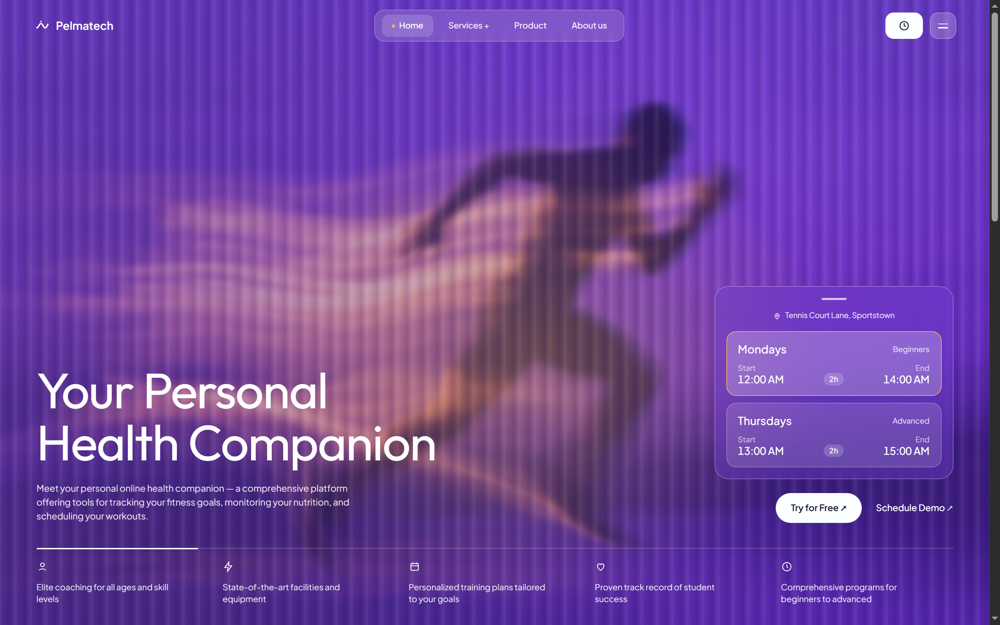 |  |

<details>
<summary>View full-page desktop capture</summary>

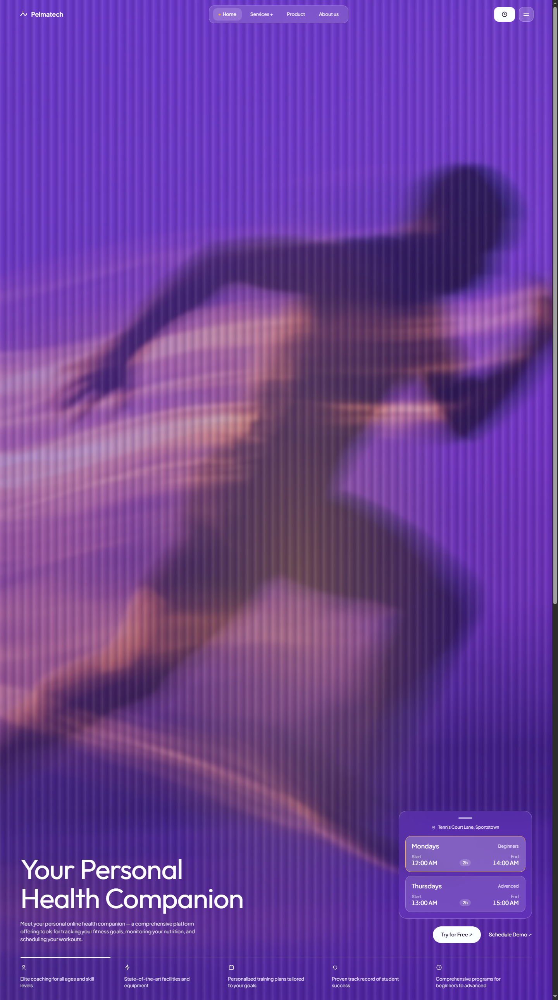

</details>

### 05. Kinetic — Motion Studio
Tangerine Orange `#EE5001` · White `#FFFFFF` · Acid Lime `#C8FD03` · [Open design folder](./motionstudio_tangerineorange+white+acidlime/README.md)

| Desktop (`1440×900`) | Mobile (`390×844`) |
| :---: | :---: |
| 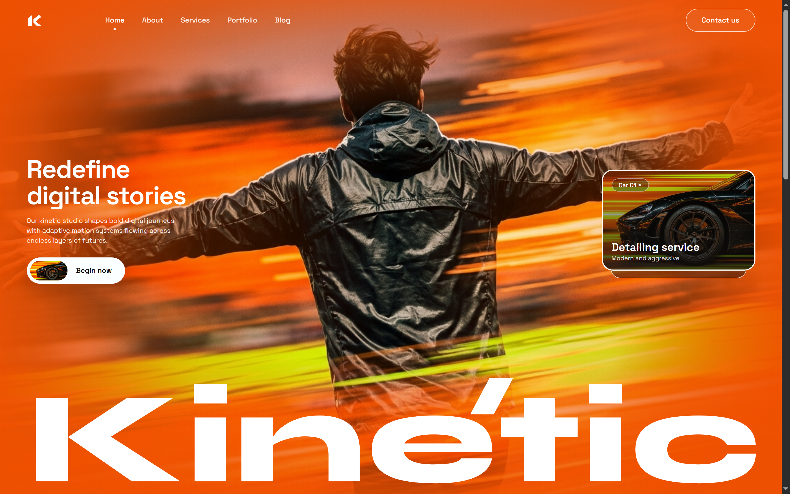 |  |

<details>
<summary>View full-page desktop capture</summary>


</details>

### 06. UPFLUENCE — Creator Growth
Sky Blue `#529BF5` · Cloudy White `#F5F6FA` · Amber Red `#EE3F24` · [Open design folder](./creatoragency_skyblue+cloudywhite+amberred/README.md)

| Desktop (`1440×900`) | Mobile (`390×844`) |
| :---: | :---: |
| 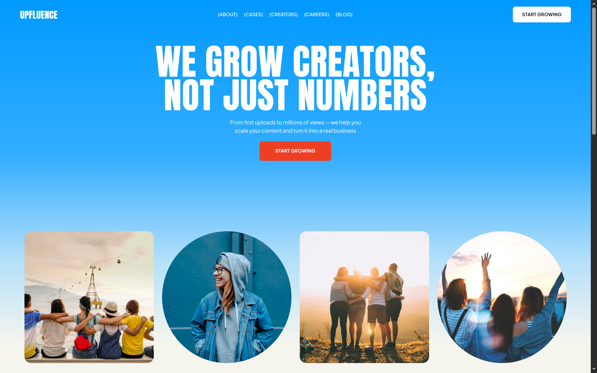 |  |

<details>
<summary>View full-page desktop capture</summary>


</details>

### 07. BASE CLUB — SocialFi
Red Orange `#FD4000` · Snowy White `#FAFAFA` · Yellow Punk `#E0F354` · [Open design folder](./socialclub_redorange+snowywhite+yellowpunk/README.md)

| Desktop (`1440×900`) | Mobile (`390×844`) |
| :---: | :---: |
|  |  |

<details>
<summary>View full-page desktop capture</summary>


</details>

### 08. Transform9+ — Voice AI
Sapphire Blue `#0B125E` · Ocean Blue `#1C4FD8` · Neon Jade `#0AD08C` · [Open design folder](./voiceai_sapphireblue+oceanblue+neonjade/README.md)

| Desktop (`1440×900`) | Mobile (`390×844`) |
| :---: | :---: |
|  |  |

<details>
<summary>View full-page desktop capture</summary>


</details>

### 09. ALTAVAL — Ski Resort
Baby Blue `#4DBEFF` · Indigo Navy `#001F59` · Bumblebee Yellow `#FFF800` · [Open design folder](./skiresort_babyblue+indigonavy+bumblebeeyellow/README.md)

| Desktop (`1440×900`) | Mobile (`390×844`) |
| :---: | :---: |
|  |  |

<details>
<summary>View full-page desktop capture</summary>

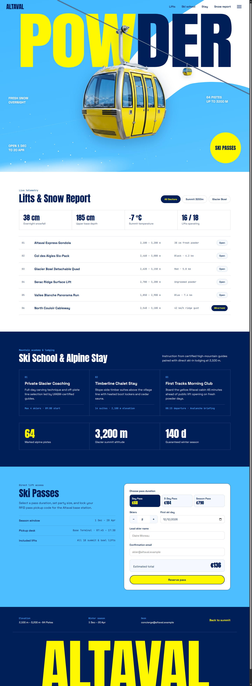

</details>

### 10. FluxEdit — AI Video Editor
Midnight Black `#02070A` · Electric Blue `#0297DE` · Cantaloupe Orange `#FC734D` · [Open design folder](./videoeditor_midnightblack+electricblue+cantaloupeorange/README.md)

| Desktop (`1440×900`) | Mobile (`390×844`) |
| :---: | :---: |
|  |  |

<details>
<summary>View full-page desktop capture</summary>


</details>

### 11. FORME — Architecture Studio
Persian Blue `#16284C` · Cream `#EFE8DA` · Amber `#FFB92E` · [Open design folder](./architecturestudio_persianblue+cream+amber/README.md)

| Desktop (`1440×900`) | Mobile (`390×844`) |
| :---: | :---: |
|  | 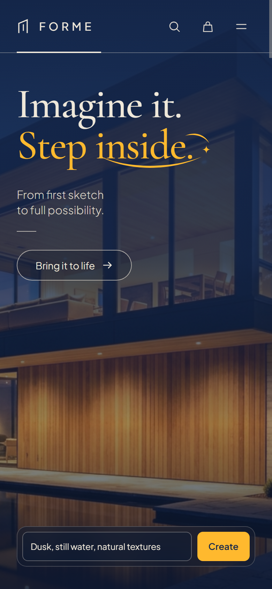 |

<details>
<summary>View full-page desktop capture</summary>


</details>

### 12. VOGUE — Monochrome Editorial
Skeleton Cream `#FDFDFD` · Deep Black `#060606` · Pine Green `#016030` · [Open design folder](./fashioneditorial_skeletoncream+deepblack+pinegreen/README.md)

| Desktop (`1440×900`) | Mobile (`390×844`) |
| :---: | :---: |
| 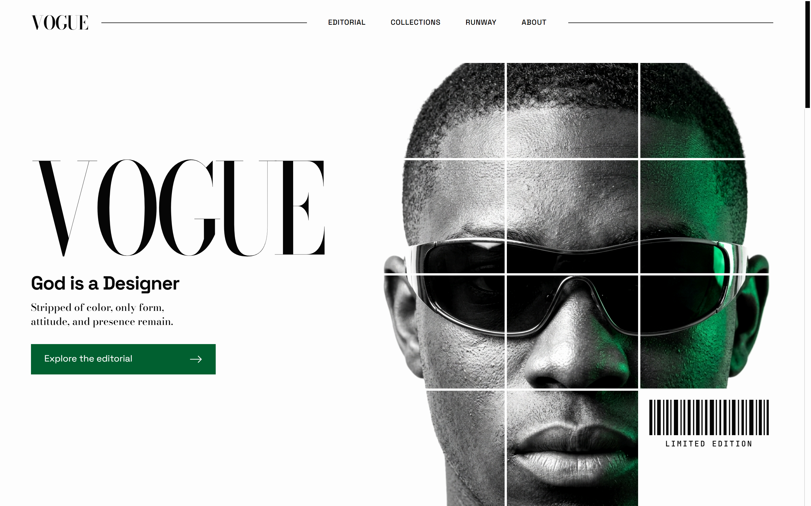 |  |

<details>
<summary>View full-page desktop capture</summary>


</details>

### 13. Visionary Intelligence — AI Consulting
Seal Blue `#DBF2FC` · Navy Blue `#072D59` · Crimson Pink `#FD6E88` · [Open design folder](./aiconsulting_sealblue+navyblue+crimsonpink/README.md)

| Desktop (`1440×900`) | Mobile (`390×844`) |
| :---: | :---: |
| 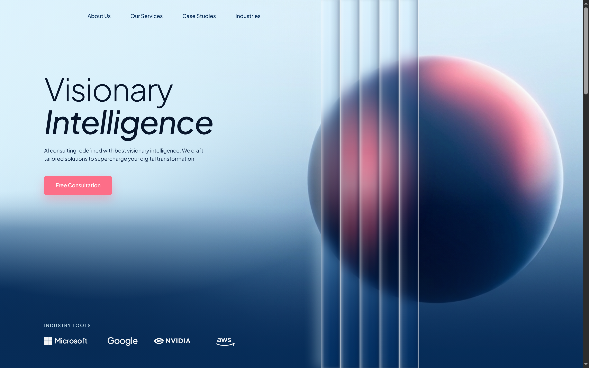 | 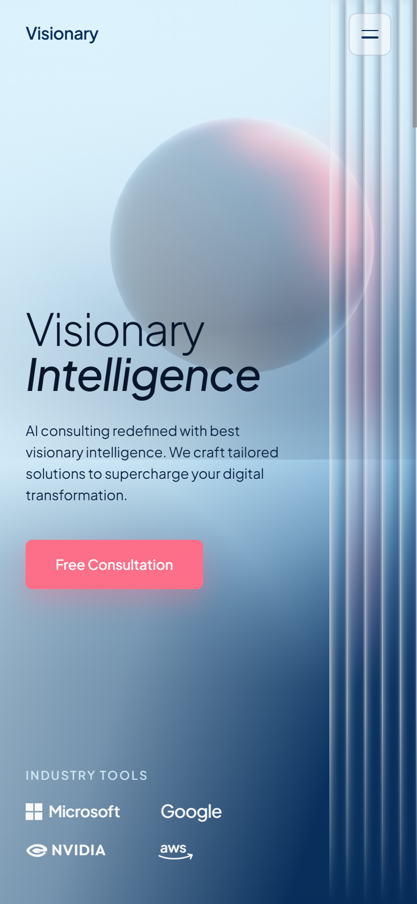 |

<details>
<summary>View full-page desktop capture</summary>

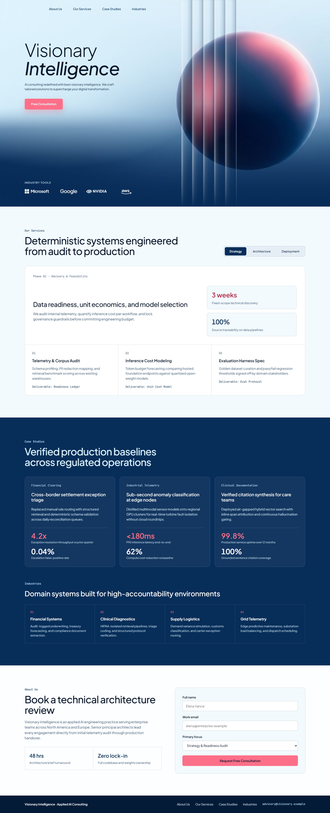

</details>

### 14. Rawables. — Graphics Vault
Onyx Black `#01010D` · Electric Indigo `#6331FB` · Tropical Mint `#88F9C0` · [Open design folder](./graphicassets_onyxblack+electricindigo+tropicalmint/README.md)

| Desktop (`1440×900`) | Mobile (`390×844`) |
| :---: | :---: |
| 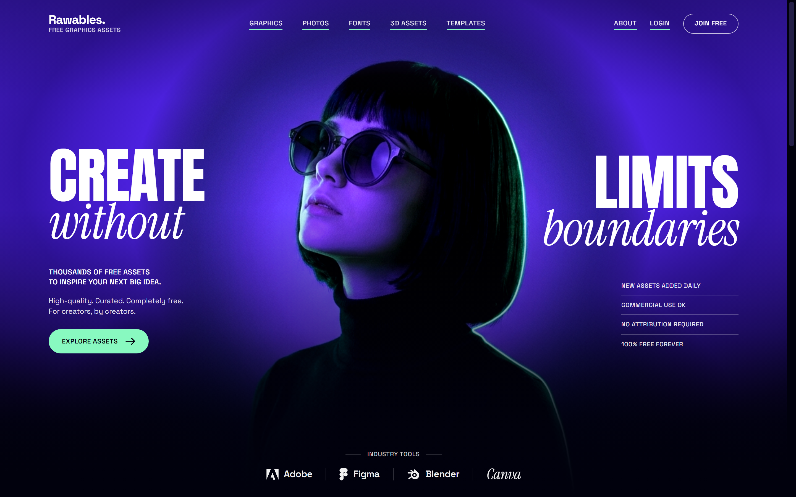 |  |

<details>
<summary>View full-page desktop capture</summary>


</details>

---

## Local Preview

Each design folder is self-contained static HTML, CSS, and vanilla JavaScript. Serve the repository locally to preview any folder in a browser:

```bash
python -m http.server 8080
```

## Similar & Variant Designs (`similar-designs` branch)

Template-twin and alternate-palette recreations live on the `similar-designs` branch (`git checkout similar-designs`):

| Folder | Variant Of | Palette |
| :--- | :--- | :--- |
| `creatoragency_lagoonblue+cloudwhite+bubblegumpink` | UPFLUENCE (`creatoragency_skyblue+cloudywhite+amberred`) | Lagoon Blue, Cloud White, Bubblegum Pink |
| `motionstudio_verminred+snowywhite+citrusyellow` | Kinetic (`motionstudio_tangerineorange+white+acidlime`) | Vermin Red, Snowy White, Citrus Yellow |
| `sparklingbeverage_mandarinorange+forestgreen+crestyellow` | Poster wave template (`skiresort_babyblue+indigonavy+bumblebeeyellow`) | Mandarin Orange, Forest Green, Crest Yellow |

## Rules and Conventions

See [AGENTS.md](./AGENTS.md) for the full agent rules. Summary:

- **One folder per design:** Each design lives in its own independent top-level folder.
- **Naming convention:** `<brandutility>_<colorscheme>` (for example, `clothingbrand_navyblue+cyan`).
- **Branch curation:** Keep distinct flagship designs on `main`; place template-twins and color-swap variants on `similar-designs`.
- **Folder documentation:** Each design folder includes its own `README.md` with screenshots of the design.
- **Faithful replication:** Each project recreates the layout, palette, typography, and components shown in its reference video as closely as possible.
- **Reference videos stay local:** All `.mp4` files are excluded via `.gitignore`.

## Design References

- [DESIGN_PRINCIPLES.md](./DESIGN_PRINCIPLES.md)
- [DESIGN_GOLDEN_NUGGETS.md](./DESIGN_GOLDEN_NUGGETS.md)
