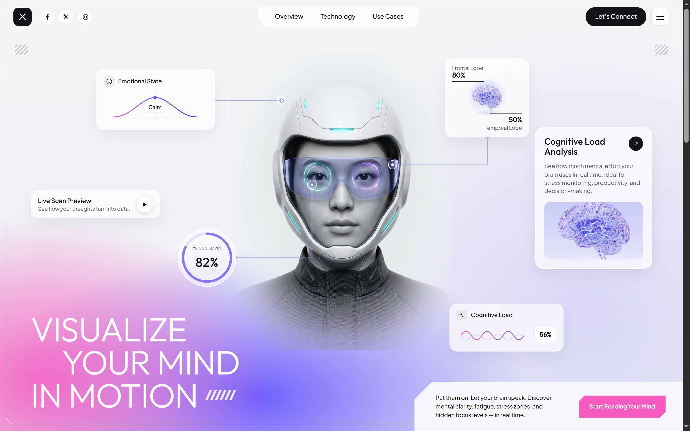
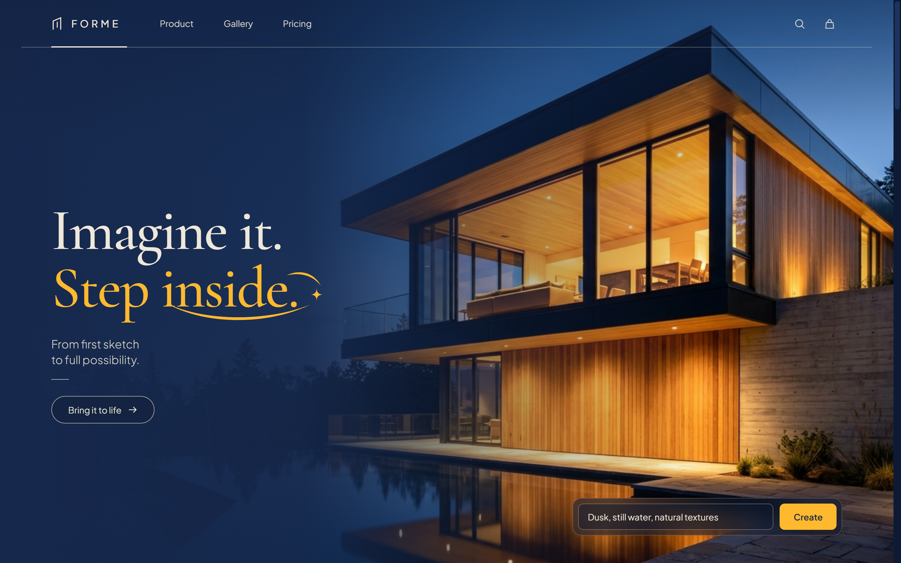

# Design Collections

Standalone web design recreations built from reference `.mp4` design videos.

## Flagship Designs (`main` branch)

Only structurally distinct, flagship designs live on `main`. Color swaps and template-twin variants live on `similar-designs`.

| Folder | Brand / Utility | Palette | Preview |
| :--- | :--- | :--- | :--- |
| [creativeagency_deepplum+electricviolet+acidlime](./creativeagency_deepplum+electricviolet+acidlime/README.md) | SOMA® Digital Studio | Deep Plum, Electric Violet, Acid Lime | [](./creativeagency_deepplum+electricviolet+acidlime/README.md) |
| [neurotech_cloudywhite+galacticviolet+bubblegumpink](./neurotech_cloudywhite+galacticviolet+bubblegumpink/README.md) | MindVision Neural Telemetry | Cloudy White, Galactic Violet, Bubblegum Pink | [](./neurotech_cloudywhite+galacticviolet+bubblegumpink/README.md) |
| [designagency_obsidianblack+blazeorange+glacierblue](./designagency_obsidianblack+blazeorange+glacierblue/README.md) | Designova Agency | Obsidian Black, Blaze Orange, Glacier Blue | [](./designagency_obsidianblack+blazeorange+glacierblue/README.md) |
| [healthcompanion_royalpurple+white+sunglowgold](./healthcompanion_royalpurple+white+sunglowgold/README.md) | Pelmatech Health Companion | Royal Purple, White, Sunglow Gold | [](./healthcompanion_royalpurple+white+sunglowgold/README.md) |
| [motionstudio_tangerineorange+white+acidlime](./motionstudio_tangerineorange+white+acidlime/README.md) | Kinetic Motion Studio | Tangerine Orange, White, Acid Lime | [](./motionstudio_tangerineorange+white+acidlime/README.md) |
| [creatoragency_skyblue+cloudywhite+amberred](./creatoragency_skyblue+cloudywhite+amberred/README.md) | UPFLUENCE Creator Growth | Sky Blue, Cloudy White, Amber Red | [](./creatoragency_skyblue+cloudywhite+amberred/README.md) |
| [socialclub_redorange+snowywhite+yellowpunk](./socialclub_redorange+snowywhite+yellowpunk/README.md) | BASE CLUB SocialFi | Red Orange, Snowy White, Yellow Punk | [](./socialclub_redorange+snowywhite+yellowpunk/README.md) |
| [voiceai_sapphireblue+oceanblue+neonjade](./voiceai_sapphireblue+oceanblue+neonjade/README.md) | Transform9+ Voice AI | Sapphire Blue, Ocean Blue, Neon Jade | [](./voiceai_sapphireblue+oceanblue+neonjade/README.md) |
| [skiresort_babyblue+indigonavy+bumblebeeyellow](./skiresort_babyblue+indigonavy+bumblebeeyellow/README.md) | ALTAVAL Ski Resort | Baby Blue, Indigo Navy, Bumblebee Yellow | [](./skiresort_babyblue+indigonavy+bumblebeeyellow/README.md) |
| [videoeditor_midnightblack+electricblue+cantaloupeorange](./videoeditor_midnightblack+electricblue+cantaloupeorange/README.md) | FluxEdit AI Video Editor | Midnight Black, Electric Blue, Cantaloupe Orange | [](./videoeditor_midnightblack+electricblue+cantaloupeorange/README.md) |
| [architecturestudio_persianblue+cream+amber](./architecturestudio_persianblue+cream+amber/README.md) | FORME Architecture Studio | Persian Blue, Cream, Amber | [](./architecturestudio_persianblue+cream+amber/README.md) |
| [fashioneditorial_skeletoncream+deepblack+pinegreen](./fashioneditorial_skeletoncream+deepblack+pinegreen/README.md) | VOGUE Monochrome Editorial | Skeleton Cream, Deep Black, Pine Green | [](./fashioneditorial_skeletoncream+deepblack+pinegreen/README.md) |
| [aiconsulting_sealblue+navyblue+crimsonpink](./aiconsulting_sealblue+navyblue+crimsonpink/README.md) | Visionary Intelligence AI Consulting | Seal Blue, Navy Blue, Crimson Pink | [](./aiconsulting_sealblue+navyblue+crimsonpink/README.md) |
| [graphicassets_onyxblack+electricindigo+tropicalmint](./graphicassets_onyxblack+electricindigo+tropicalmint/README.md) | Rawables. Graphics Vault | Onyx Black, Electric Indigo, Tropical Mint | [](./graphicassets_onyxblack+electricindigo+tropicalmint/README.md) |

## Local Preview

Each design folder is self-contained static HTML, CSS, and vanilla JavaScript. Serve the repository locally to preview any folder in a browser:

```bash
python -m http.server 8080
```

## Similar & Variant Designs (`similar-designs` branch)

Template-twin and alternate-palette recreations live on the `similar-designs` branch (`git checkout similar-designs`):

| Folder | Variant Of | Palette |
| :--- | :--- | :--- |
| `creatoragency_lagoonblue+cloudwhite+bubblegumpink` | UPFLUENCE (`creatoragency_skyblue+cloudywhite+amberred`) | Lagoon Blue, Cloud White, Bubblegum Pink |
| `motionstudio_verminred+snowywhite+citrusyellow` | Kinetic (`motionstudio_tangerineorange+white+acidlime`) | Vermin Red, Snowy White, Citrus Yellow |
| `sparklingbeverage_mandarinorange+forestgreen+crestyellow` | Poster wave template (`skiresort_babyblue+indigonavy+bumblebeeyellow`) | Mandarin Orange, Forest Green, Crest Yellow |

## Rules and Conventions

See [AGENTS.md](./AGENTS.md) for the full agent rules. Summary:

- **One folder per design:** Each design lives in its own independent top-level folder.
- **Naming convention:** `<brandutility>_<colorscheme>` (for example, `clothingbrand_navyblue+cyan`).
- **Branch curation:** Keep distinct flagship designs on `main`; place template-twins and color-swap variants on `similar-designs`.
- **Folder documentation:** Each design folder includes its own `README.md` with screenshots of the design.
- **Faithful replication:** Each project recreates the layout, palette, typography, and components shown in its reference video as closely as possible.
- **Reference videos stay local:** All `.mp4` files are excluded via `.gitignore`.

## Design References

- [DESIGN_PRINCIPLES.md](./DESIGN_PRINCIPLES.md)
- [DESIGN_GOLDEN_NUGGETS.md](./DESIGN_GOLDEN_NUGGETS.md)
