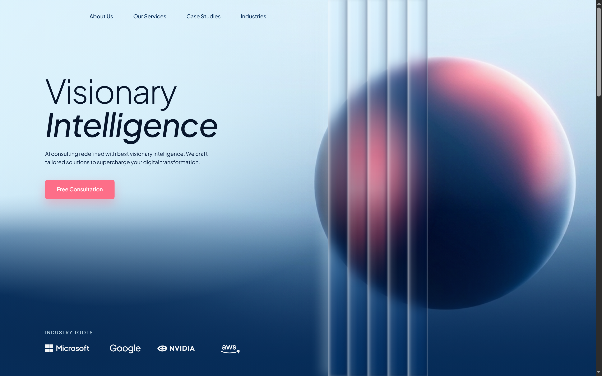
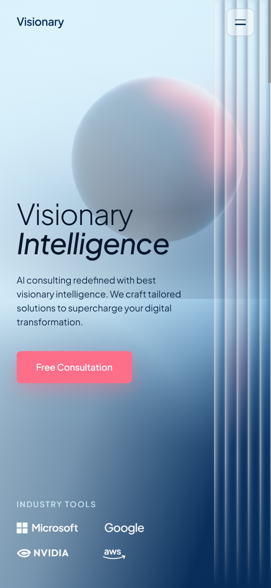
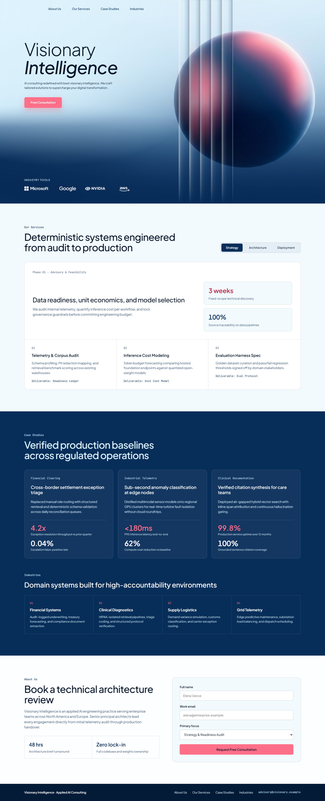

# Visionary Intelligence — AI Consulting

Standalone landing page for Visionary Intelligence, an applied AI engineering consultancy built with Seal Blue, Navy Blue, and Crimson Pink.

## Screenshots

### Desktop Hero (1440×900)


### Mobile Hero (390×844)


### Full Page


## Design System

| Role | Color | Hex |
| :--- | :--- | :--- |
| Quiet 1 (Light Field & Surfaces) | Seal Blue | `#DBF2FC` |
| Quiet 2 (Deep Field & Ink) | Navy Blue | `#072D59` |
| Loud Accent | Crimson Pink | `#FD6E88` |

- **Typography:** Plus Jakarta Sans with Outfit fallback (`300` regular and `500` italic for the split hero display title; `400`–`600` for navigation, body copy, and controls) paired with JetBrains Mono for phase indices and telemetry labels.
- **Layout:** Full-viewport hero pairing a Seal Blue to Navy Blue atmospheric field with a right-anchored 3D sphere behind a 5-rib fluted glass curtain (`backdrop-filter: blur(14px)`), left-aligned headline, Crimson Pink CTA, and monochrome platform wordmarks (`Microsoft`, `Google`, `NVIDIA`, `aws`), followed by a tabbed `Our Services` phase switcher, a 3-column `Case Studies` and `Industries` matrix, and an inline `Free Consultation` brief form above a `#041B38` footer.

## Run Locally

Serve the folder over HTTP:

```bash
npx serve .
```
