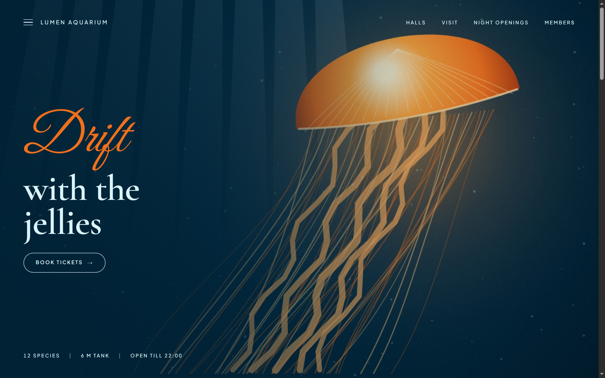
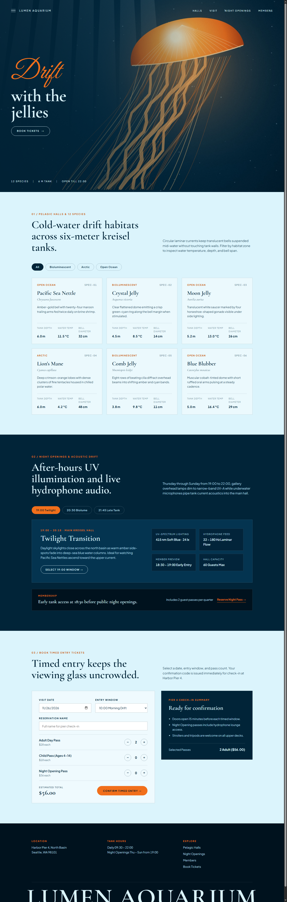
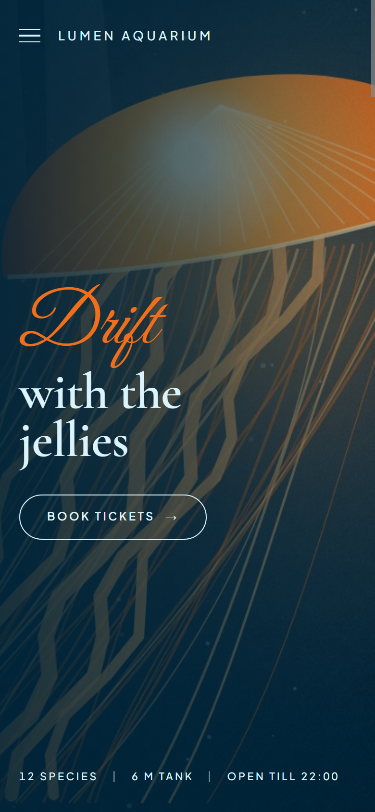

# Lumen Aquarium

A self-contained editorial landing page for **Lumen Aquarium** ("Drift with the jellies"), built with Deep Sea Blue (`#012438`), Foam White (`#DBF4FC`), and Sunset Orange (`#F16F1B`).

## Features

- **Full-Bleed Hero**: Calligraphic script (`Great Vibes`) paired with editorial serif (`Cormorant Garamond`), pill CTA, and bottom-left tabular-nums spec strip (`12 SPECIES | 6 M TANK | OPEN TILL 22:00`).
- **01 / Pelagic Halls & 12 Species**: Interactive habitat filter (`All`, `Bioluminescent`, `Arctic`, `Open Ocean`) across six jellyfish species with tank depth, water temperature, and bell diameter.
- **02 / Night Openings & Acoustic Drift**: Tabbed evening sessions (`19:00 Twilight`, `20:30 Biolume`, `21:45 Late Tank`) displaying UV-spectrum lighting, hydrophone feed frequency, member preview hours, and one-click window selection.
- **03 / Book Timed Entry Tickets**: Interactive reservation form with date, entry window, Adult/Child/Night Opening pass steppers, live total calculation, and confirmed pass code receipt.

## Screenshots





## Local Run

Open `index.html` directly or serve the folder over HTTP:

```bash
npx serve .
```
