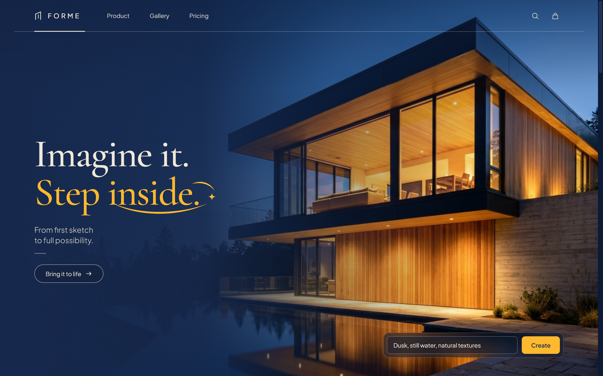
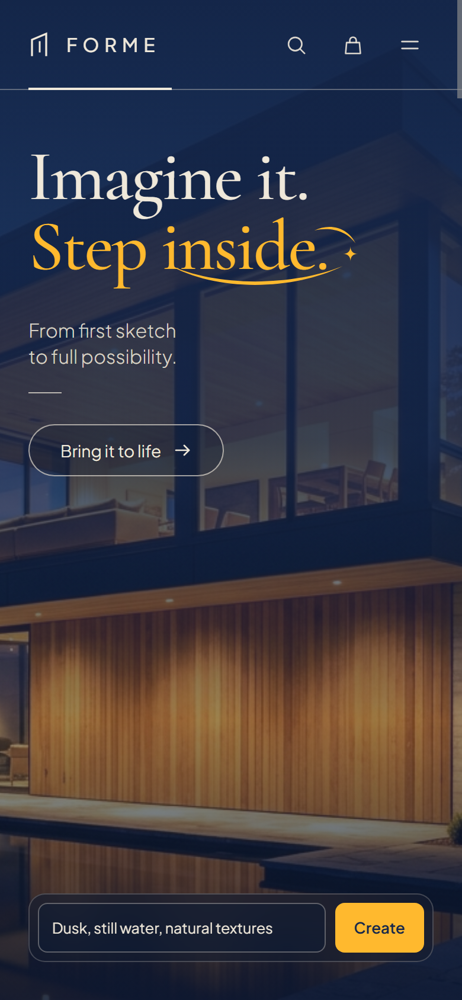
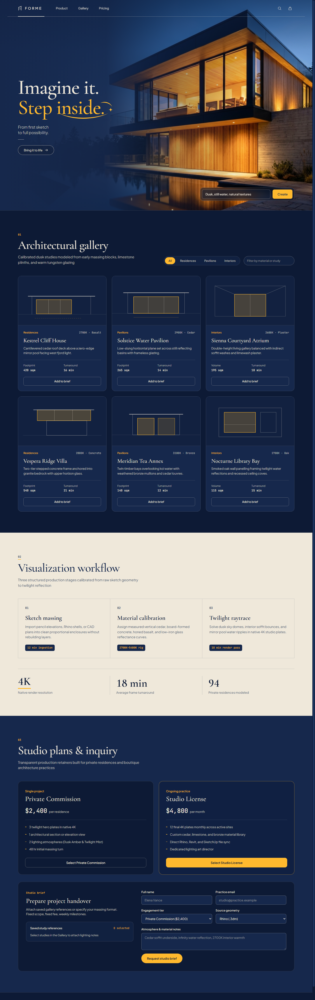

# FORME — Architectural Spatial Studio

Standalone web recreation built from the FORME twilight architecture studio reference (`12_forme.png`).

## Screenshots

### Desktop Hero (1440×900)


### Mobile Hero (390×844)


### Full Page


## Design System

| Role | Color | Hex |
| :--- | :--- | :--- |
| Quiet 1 (Canvas) | Persian Blue | `#16284C` |
| Quiet 2 (Paper & Type) | Warm Cream | `#EFE8DA` |
| Loud Accent | Amber Glow | `#FFB92E` |
| Deep Canvas | Midnight Navy | `#0D1A35` |

- **Typography:** Cormorant Garamond (editorial hero display, section titles, and metric figures), Plus Jakarta Sans (navigation, UI controls, and prose), JetBrains Mono (indices, Kelvin specs, and dimensions).
- **Layout:** Full-bleed twilight residence hero with directional `#16284C` scrim, single-line header hairline with active Cream logo underline, calligraphic `inside.` flourish and star, frosted glass prompt dock (`Create` atmosphere switcher), filterable architectural gallery with brief saving, three-step Cream workflow matrix, and studio inquiry form.

## Run Locally

Open `index.html` over any static server:

```bash
npx serve .
```
