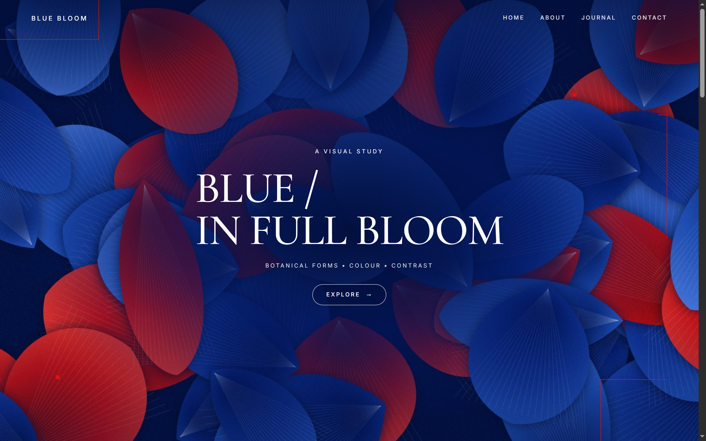
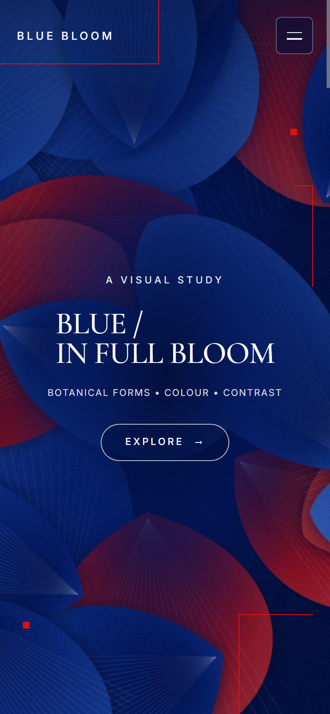
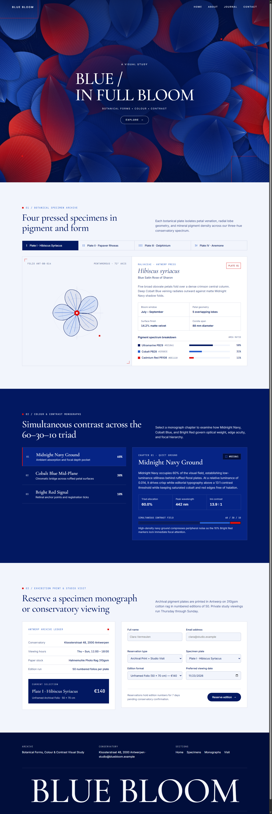

# BLUE BLOOM — Botanical Forms, Colour & Contrast

Standalone archival botanical study and conservatory showcase built in Midnight Navy, Cobalt Blue, and Bright Red.

## Screenshots

### Desktop Hero (1440×900)


### Mobile Hero (390×844)


### Full Page


## Design System

| Role | Color | Hex |
| :--- | :--- | :--- |
| Quiet 1 (60% Midnight Navy) | Midnight Navy | `#021861` (`#010E3B` deep void, `#062485` slab) |
| Quiet 2 (30% Cobalt & Alabaster) | Cobalt Blue | `#255DCE` (`#F5F7FC` ink, `#F2F5FC` alabaster) |
| Loud Accent (10% Bright Red) | Bright Red | `#DE1110` (`#A80A09` deep red) |

- **Typography:** Cormorant Garamond (400/500) for the `BLUE / IN FULL BLOOM` display lockup, section titles, binomials, and edge-to-edge footer wordmark; Inter (400/500/600) for tracked navigation, controls, and body copy; JetBrains Mono (400/500) for plate indices, pigment codes (`PB29`, `PB28`, `PR108`), wavelengths, and reservation references.
- **Interactive Craft:** Full-bleed botanical poster hero with `#DE1110` corner-bracket frames and `8×8px` registration markers, four-plate specimen archive with dynamic SVG petal geometry diagrams and pigment spectrum bars, three-chapter simultaneous contrast monograph ledger, and conservatory edition reservation form with live confirmation slip.

## Run Locally

Serve the directory over HTTP:

```bash
npx serve .
```
