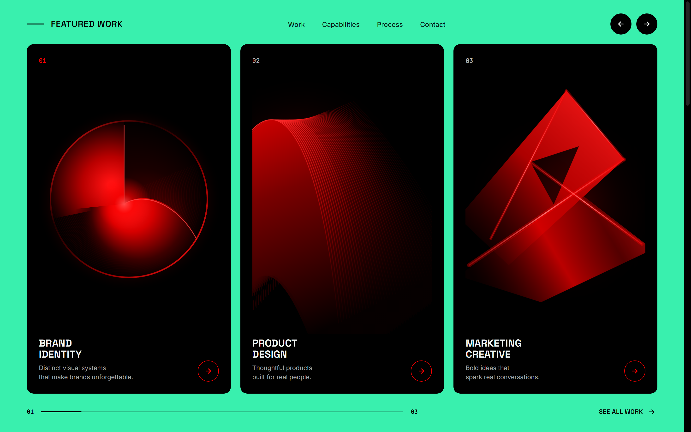
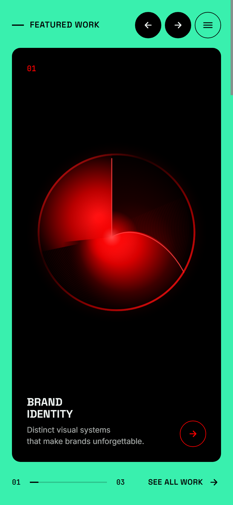
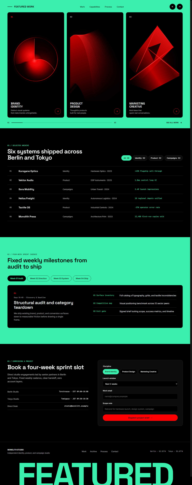

# Monolith Studio — Brand, Product & Marketing Showcase

Self-contained editorial studio showcase built on a Mint Green, Pure Black, and Vivid Red color system with procedural HTML5 Canvas sculptures and alternating architectural chapters.

## Screenshots

### Desktop Hero (1440×900)


### Mobile Hero (390×844)


### Full Page


## Design System

| Role | Color | Hex |
| :--- | :--- | :--- |
| Quiet 1 (Primary Field) | Mint Green / Step / Deep Ink | `#39F0AE` / `#25C98E` / `#07241A` |
| Quiet 2 (Structural Contrast) | Pure Black / Card Surface / Ink | `#000000` / `#0C0C0C` / `#F2F7F5` |
| Loud Accent (Focal Tension) | Vivid Red / Deep Crimson | `#FF0000` / `#B80000` |

- **Typography:** Space Grotesk (`500`, `600`, `700`) for display titles and monumental footer wordmark; Inter (`400`, `500`, `600`) for navigation and body text; JetBrains Mono (`400`, `500`) with `tabular-nums` for indices, sprint schedules, and metrics.
- **Hero Showcase:** Full-bleed Mint Green (`#39F0AE`) viewport housing three Pure Black (`#000000`) rounded discipline cards (`01 Brand Identity`, `02 Product Design`, `03 Marketing Creative`), each pairing a Vivid Red (`#FF0000`) procedural 3D Canvas sculpture with an interactive case-study drawer and keyboard-wired `01`–`03` progress strip.
- **Below-the-Fold Chapters:** Filterable 6-project archive ledger with WCAG AA Vivid Red (`#FF0000` fill, `#000000` ink) hover inversion, an interactive 4-week sprint cadence switcher on Mint Green, and a validated project brief intake form with instant confirmation receipt.

## Run Locally

Serve the folder statically from any HTTP server:

```bash
npx serve .
```
