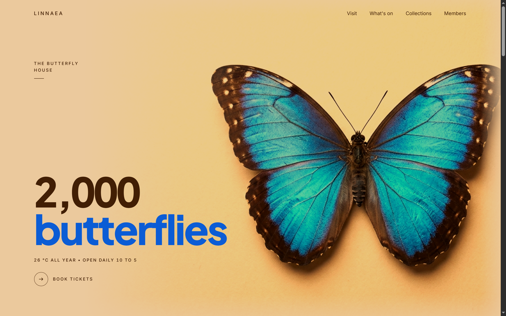
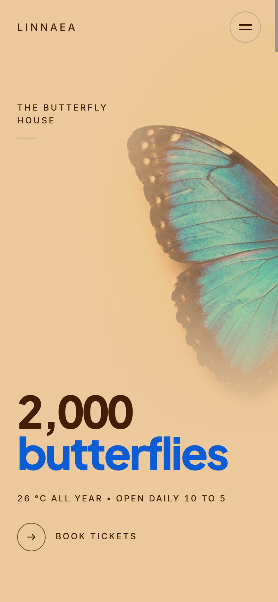
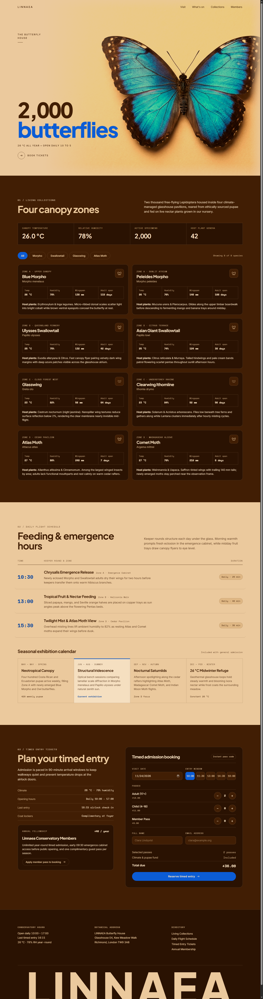

# LINNAEA — The Butterfly House

Standalone website for LINNAEA, a living tropical butterfly conservatory built in Old Paper, Deep Umber, and Morpho Blue.

## Screenshots

### Desktop Hero (1440×900)


### Mobile Hero (390×844)


### Full Page


## Design System

| Role | Color | Hex |
| :--- | :--- | :--- |
| Quiet 1 (60% Parchment Canvas) | Old Paper | `#EBC99D` (`#DFB784` step, `#F5DFC0` soft) |
| Quiet 2 (30% Ink & Canopy Slab) | Deep Umber | `#411E04` (`#2A1202` deep) |
| Loud Accent (10% Iridescent Focus) | Morpho Blue | `#0B5CD5` (`#08449E` deep) |

- **Typography:** Plus Jakarta Sans (700/800) for the `2,000 / butterflies` display lockup, section headings, and edge-to-edge footer wordmark; Inter (400/500/600) for top navigation, body prose, and form controls; Space Mono (400/700) for chapter indices, temperature/humidity readouts, wingspans, feeding hours, and pass codes.
- **Interactive Craft:** Full-bleed Old Paper hero blending the Morpho Blue specimen photograph via `mix-blend-mode: multiply` and feathered directional masks, species filter tabs (`Morpho`, `Swallowtail`, `Glasswing`, `Atlas Moth`), daily feeding and emergence ledger (`10:30`, `13:00`, `15:30`), seasonal exhibition calendar, and timed entry ticket reservation form with live totals and confirmation receipt.

## Run Locally

Serve the directory over HTTP:

```bash
npx serve .
```
