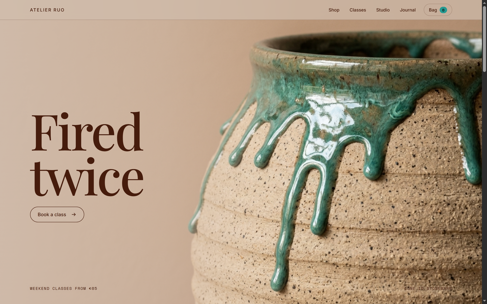
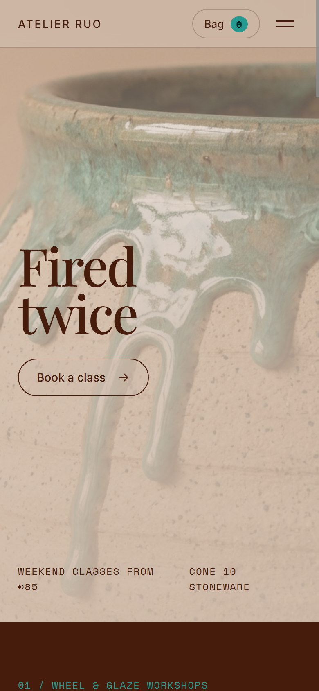
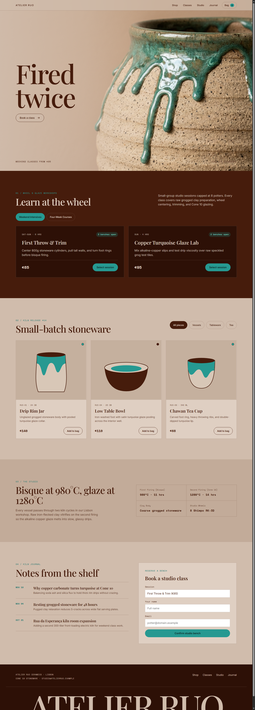

# ATELIER RUO — Fired twice

Standalone website for ATELIER RUO, a Cone 10 stoneware ceramics studio built in Raw Clay, Iron Brown, and Turquoise.

## Screenshots

### Desktop Hero (1440×900)


### Mobile Hero (390×844)


### Full Page


## Design System

| Role | Color | Hex |
| :--- | :--- | :--- |
| Quiet 1 (60% Studio Ground) | Raw Clay | `#D0BCAC` (`#C2AB99` step) |
| Quiet 2 (30% Ink & Kiln Slab) | Iron Brown | `#461C0C` (`#2D1006` deep) |
| Loud Accent (10% Copper Glaze) | Turquoise | `#269991` (`#1B7770` deep) |

- **Typography:** Playfair Display (500) for the `Fired / twice` serif stack, vessel names, and footer wordmark; Inter (400/500/600) for header links, pills, and studio prose; Space Mono (400/700) for kiln temperatures (`980°C`, `1280°C`), dates, and euro pricing.
- **Interactive Craft:** Studio hero framed by a close-up stoneware vessel dripping with turquoise copper glaze, paired with weekend vs four-week class tabs, category-filtered small-batch shop with bespoke SVG vessels, live shopping bag drawer, and bench reservation form.

## Run Locally

Serve the directory over HTTP:

```bash
npx serve .
```
