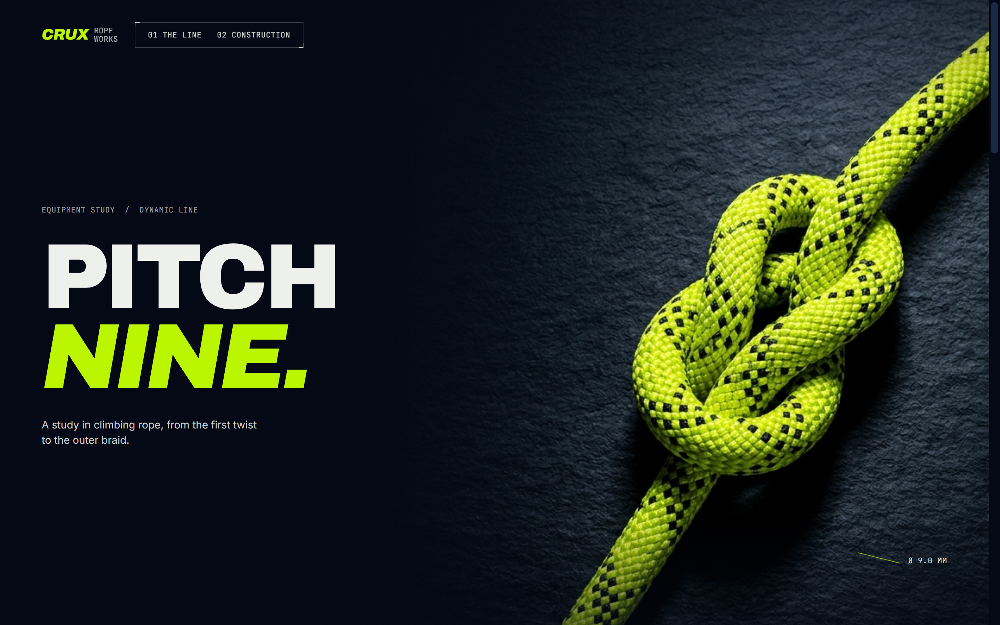
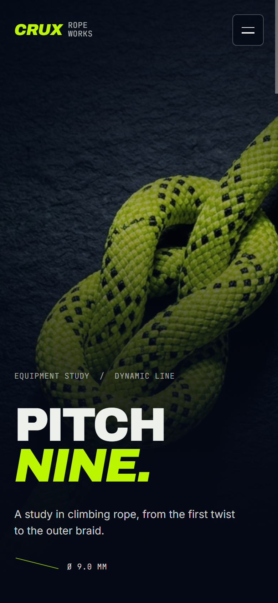
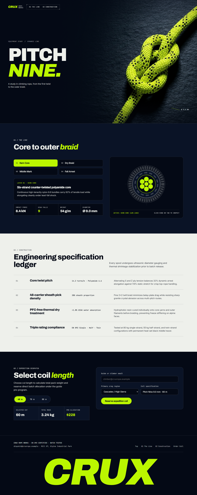

# CRUX — PITCH NINE.

Standalone product showcase for CRUX Rope Works built with Midnight Blue, Moonlight White, and Leafy Lemon.

## Screenshots

### Desktop Hero (1440×900)


### Mobile Hero (390×844)


### Full Page


## Design System

| Role | Color | Hex |
| :--- | :--- | :--- |
| Quiet 1 (Midnight Canvas) | Midnight Blue | `#040915` |
| Quiet 1 (Surface Step) | Midnight Slab | `#0A1326` |
| Quiet 2 (Engineering Plate) | Moonlight White | `#EEF0EB` |
| Loud Accent | Leafy Lemon | `#BBF600` |

- **Typography:** Archivo (700–900 normal and italic display headlines), Inter (body prose and controls), JetBrains Mono (corner-bracket navigation codes, diameter callout, and tabular telemetry).
- **Layout:** Full-viewport (`100dvh`) dark slate knot hero with masked figure-eight cord photography, corner-bracketed navigation box, `PITCH NINE.` split-italic display lockup, and `Ø 9.0 MM` leader line, followed by an interactive 4-layer SVG rope cutaway selector (`#line`), 12-column Moonlight White specification ledger (`#construction`), and dynamic coil length calculator (`#order`).

## Run Locally

Serve the folder over HTTP:

```bash
npx serve .
```
