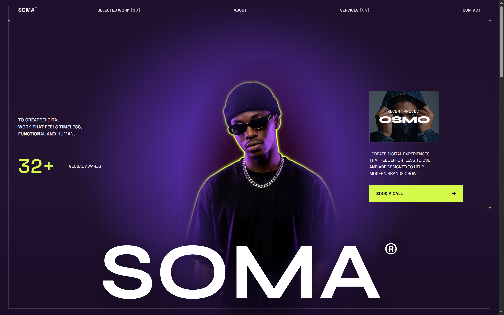
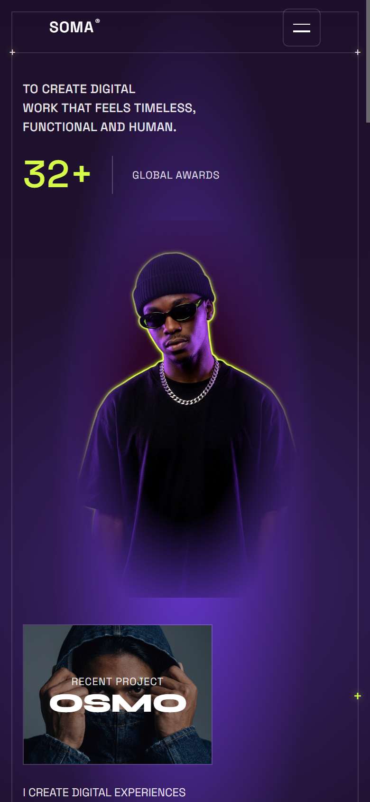
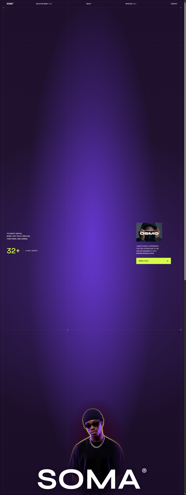

# SOMA® — Digital Creative Studio

Standalone web recreation built from the SOMA® reference design in the local video collection.

## Screenshots

### Desktop Hero (1440×900)


### Mobile Hero (390×844)


### Full Page


## Design System

| Role | Color | Hex |
| :--- | :--- | :--- |
| Quiet 1 (Canvas) | Deep Plum | `#221331` |
| Quiet 1 (Void) | Deep Void | `#150A20` |
| Quiet 2 (Atmosphere) | Electric Violet | `#7540F5` |
| Quiet 2 (Contrast Surface) | Paper White | `#F5F4F8` |
| Loud Accent | Acid Lime | `#D6FA4A` |

- **Typography:** Syne (display wordmark and headings), Space Grotesk (UI and body), JetBrains Mono (indices and counts).
- **Layout:** Asymmetric 3-column hero framed by `1px` architectural hairlines and crosshair markers, anchored by the overlapping `SOMA®` bottom wordmark, followed by filterable work rows, a `2×2` services matrix, semantic `<dl>` proof bar, and inline call-booking form.

## Run Locally

Open `index.html` in any browser or serve the folder with any static HTTP server:

```bash
npx serve .
```
