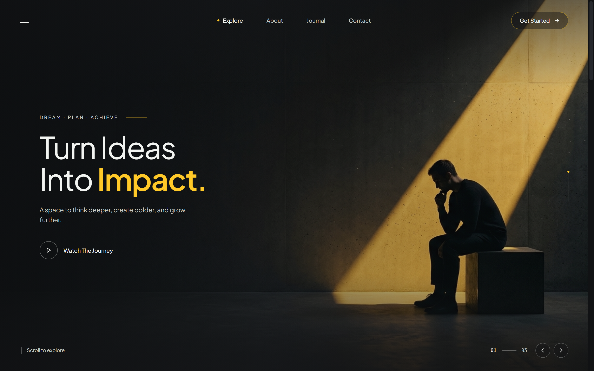
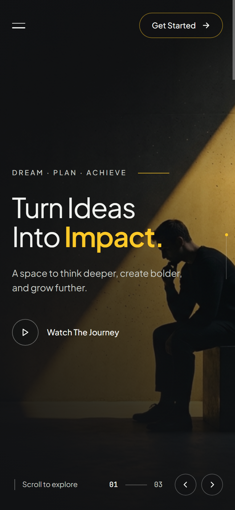
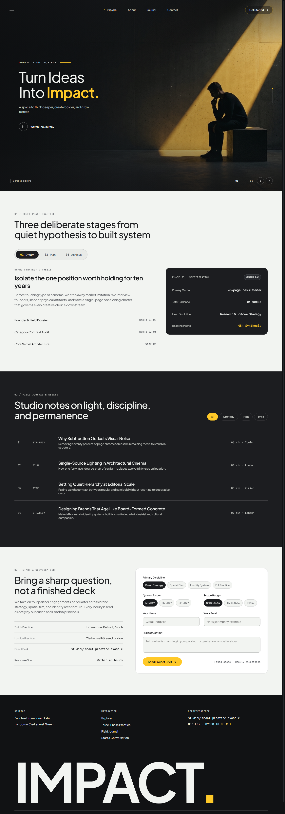

# IMPACT — Creative Strategy & Film Journal

Standalone website for Impact Studio ("Turn Ideas Into Impact."), built with Deep Graphite, Soft Cloud White, and Sunshine Yellow.

## Screenshots

### Desktop Hero (1440×900)


### Mobile Hero (390×844)


### Full Page


## Design System

| Role | Color | Hex |
| :--- | :--- | :--- |
| Quiet 1 (60% Primary Ground) | Deep Graphite | `#1C1D20` |
| Quiet 1 (Void & Slab Steps) | Deep Void / Graphite Slab | `#111214` / `#26282D` |
| Quiet 2 (30% Contrast Ground & Ink) | Soft Cloud White | `#F2F4F1` |
| Quiet 2 (Muted Secondary Ink) | Soft Cloud Muted | `#C6C9C3` |
| Loud Accent (10% Focal Tension) | Sunshine Yellow | `#FFC928` |

- **Typography:** Plus Jakarta Sans (400/500/600/700 for editorial display and interface copy) paired with JetBrains Mono (400/500 with `tabular-nums` for indices, timelines, and studio ledgers).
- **Hero:** Full-viewport (`clamp(680px, 100dvh, 960px)`) architectural concrete scene lit by a diagonal Sunshine Yellow beam, minimalist two-line menu drawer trigger, centered navigation with Sunshine Yellow active indicator dot, `Get Started` pill CTA, `DREAM · PLAN · ACHIEVE` lockup, `Turn Ideas Into Impact.` headline, interactive `Watch The Journey` chapter reel modal, vertical right-edge rail, and `01 — 03` spotlight switcher.
- **Chapters:** Alternating Soft Cloud White and Deep Graphite sections covering `01 / THREE-PHASE PRACTICE` (interactive `01 Dream`, `02 Plan`, `03 Achieve` tabs), `02 / FIELD JOURNAL & ESSAYS` (topic filter + inline essay reader drawer), `03 / START A CONVERSATION` (validated brief intake with in-place confirmation), and a Deep Void `IMPACT.` wordmark footer.

## Run Locally

Serve the folder over HTTP:

```bash
npx serve .
```
