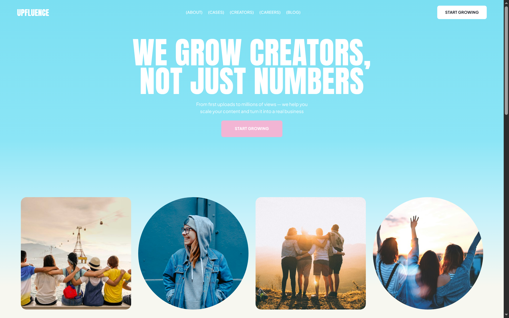
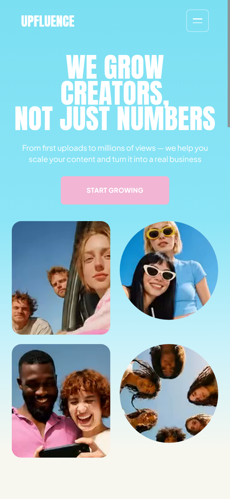
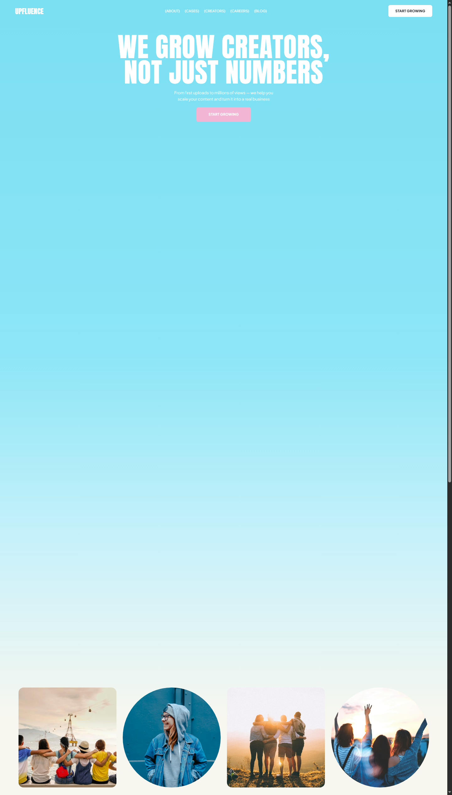

# UPFLUENCE — Creator Growth Agency (Lagoon Blue + Bubblegum Pink)

Standalone web recreation built from the UPFLUENCE Lagoon Blue & Bubblegum Pink reference design.

## Screenshots

### Desktop Hero (1440×900)


### Mobile Hero (390×844)


### Full Page


## Design System

| Role | Color | Hex |
| :--- | :--- | :--- |
| Quiet 1 (Sky Canvas) | Lagoon Blue | `#7BDFF2` |
| Quiet 2 (Ground Fade) | Cloud White | `#F7F7F0` |
| Loud Accent | Bubblegum Pink | `#F2B5D4` |
| Contrast Ink | Deep Slate | `#141820` |

- **Typography:** Anton (condensed uppercase display wordmark and hero `<h1>`), Plus Jakarta Sans (UI and body), JetBrains Mono (indices and labels).
- **Layout:** Centered poster hero fading from lagoon blue into cloud white behind a 4-frame alternating rectangle/circle creator portrait strip, followed by semantic `<dl>` proof figures, interactive growth playbook tabs, and a creator partner application form.

## Run Locally

Open `index.html` in any browser or serve statically:

```bash
npx serve .
```
