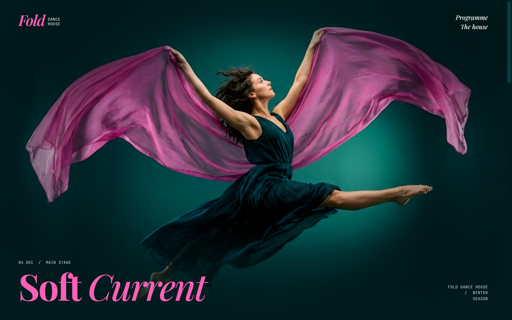
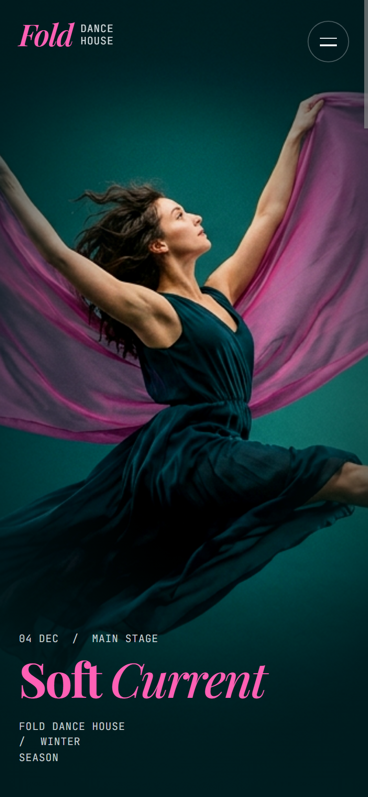
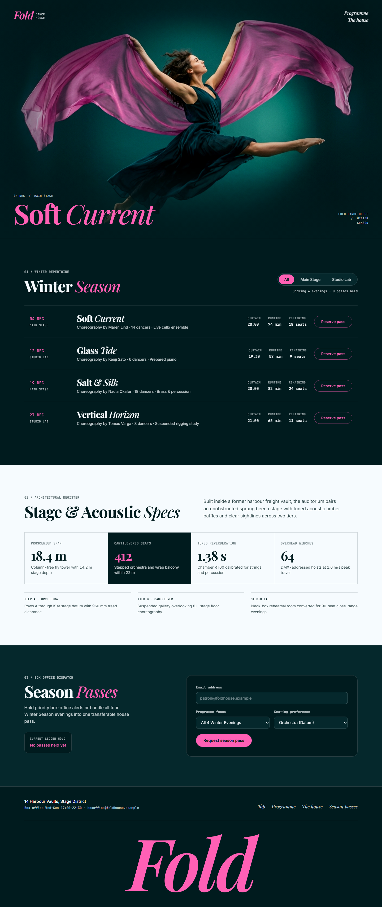

# Fold — Soft Current

Standalone editorial showcase for Fold Dance House built with Deep Teal, Ice White, and Magenta Pink.

## Screenshots

### Desktop Hero (1440×900)


### Mobile Hero (390×844)


### Full Page


## Design System

| Role | Color | Hex |
| :--- | :--- | :--- |
| Quiet 1 (Stage Dark) | Deep Teal | `#001B1E` |
| Quiet 1 (Surface Step) | Deep Teal Slab | `#05282C` |
| Quiet 2 (Architectural Contrast) | Ice White | `#F6FBFE` |
| Loud Accent | Magenta Pink | `#FF60B5` |

- **Typography:** Playfair Display (normal and italic serif display headings and navigation), Inter (UI controls and body prose), JetBrains Mono (stage indices, runtime metrics, and tabular timestamps).
- **Layout:** Full-viewport (`100dvh`) edge-vignetted dancer stage hero (`Soft Current`), interactive Winter Season repertoire ledger with stage filter tabs and seat-pass reservation toggles (`#programme`), high-contrast Ice White acoustic and stage specifications `<dl>` matrix (`#house`), and box-office pass dispatch form (`#reserve`).

## Run Locally

Serve the folder over HTTP:

```bash
npx serve .
```
