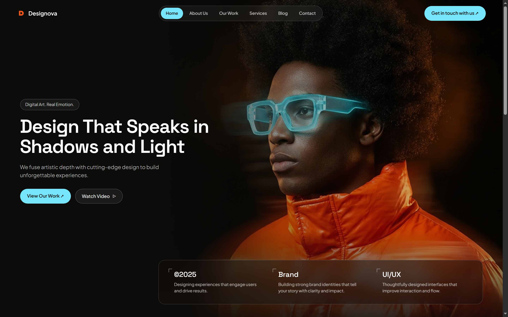
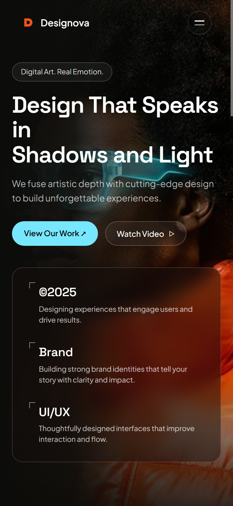
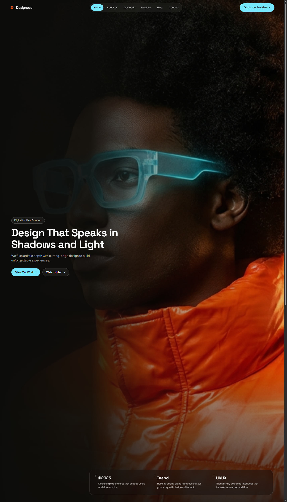

# Designova — Digital Design Agency

Standalone web recreation built from the Designova ("Design That Speaks in Shadows and Light") reference design.

## Screenshots

### Desktop Hero (1440×900)


### Mobile Hero (390×844)


### Full Page


## Design System

| Role | Color | Hex |
| :--- | :--- | :--- |
| Quiet 1 (Canvas) | Obsidian Black | `#0C0C0A` |
| Quiet 2 (Warm Highlight) | Blaze Orange | `#F15419` |
| Loud Accent | Glacier Blue | `#77E7FE` |
| Primary Text | Crisp White | `#F8F8FA` |

- **Typography:** Space Grotesk (display headings and numbers), Plus Jakarta Sans (UI and prose), JetBrains Mono (tags and metrics).
- **Layout:** Full-bleed dark editorial portrait hero with pill navigation bar, dual CTAs, and 3-column frosted bottom pillar bar (`©2025`, `Brand`, `UI/UX`), followed by filterable case studies, studio metrics, and contact sprint form.

## Run Locally

Open `index.html` in any browser or serve statically:

```bash
npx serve .
```
