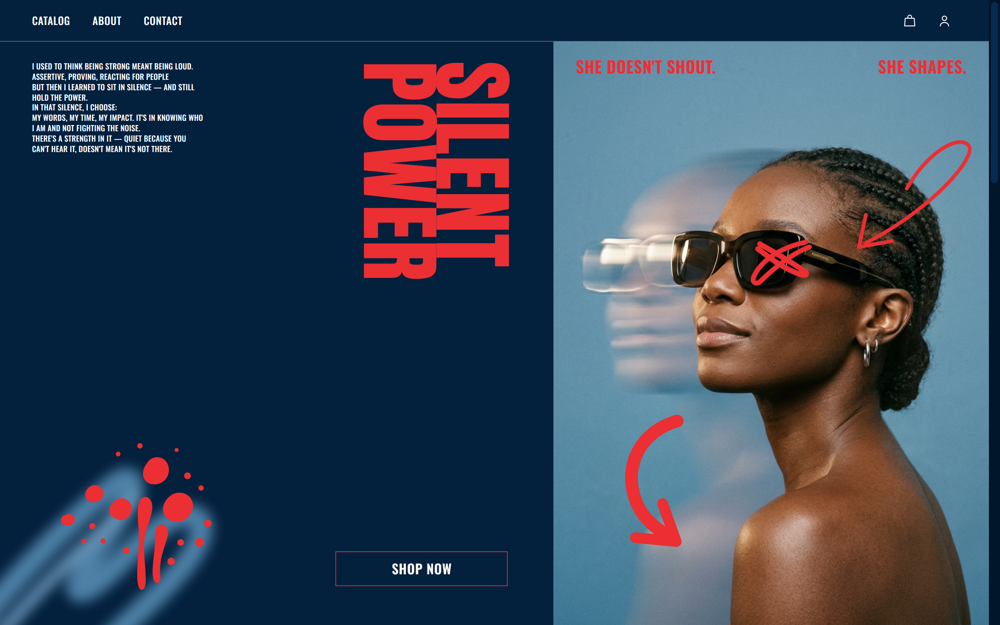
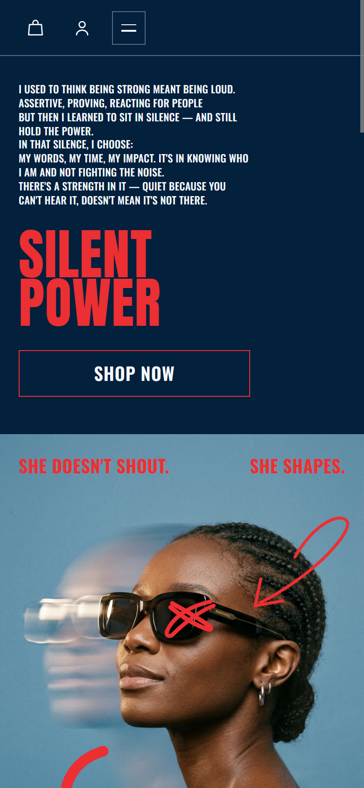
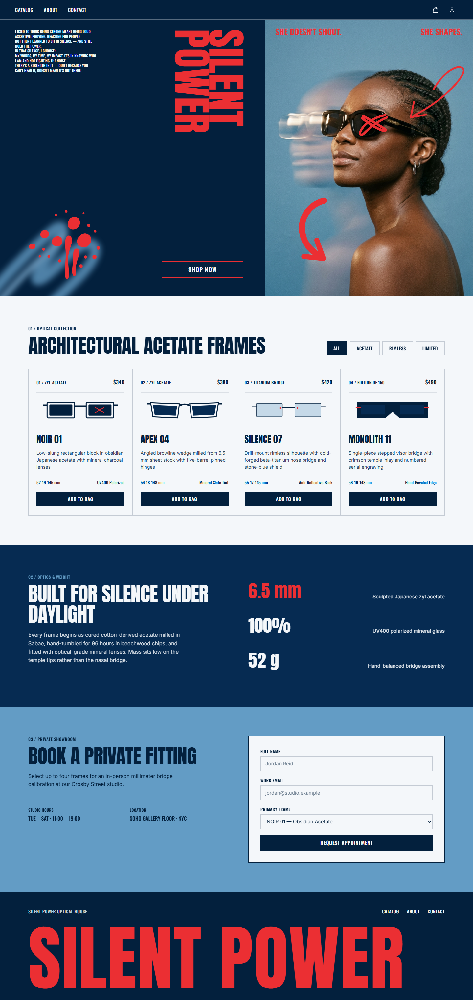

# SILENT POWER — Architectural Acetate Eyewear

Standalone eyewear showcase built with Egyptian Blue, Stone Blue, and Scarlet Red.

## Screenshots

### Desktop Hero (1440×900)


### Mobile Hero (390×844)


### Full Page


## Design System

| Role | Color | Hex |
| :--- | :--- | :--- |
| Quiet 1 (Deep Field) | Egyptian Blue | `#03203D` |
| Quiet 2 (Daylight Field) | Stone Blue | `#639CC5` |
| Loud Accent | Scarlet Red | `#EB2F33` |

- **Typography:** Anton (monumental vertical `SILENT POWER` hero lockup and footer wordmark), Oswald (navigation, ten-line manifesto, frame SKUs, and portrait callouts), Inter (body copy and form controls).
- **Layout:** Asymmetric `56fr / 44fr` vertical split hero pairing a condensed manifesto, vertical `SILENT POWER` typography, airbrushed stone-blue vector sweep with scarlet splatter drops, and rectangular `SHOP NOW` CTA against the full-height Stone Blue portrait annotated with scarlet brushstroke marks; followed by a filterable frame catalog (`#catalog`), `<dl>` craftsmanship metrics (`#about`), and a private showroom fitting form (`#contact`).

## Run Locally

Serve the directory over HTTP:

```bash
npx serve .
```
