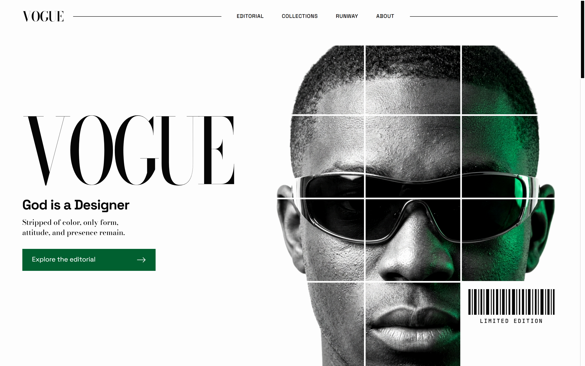
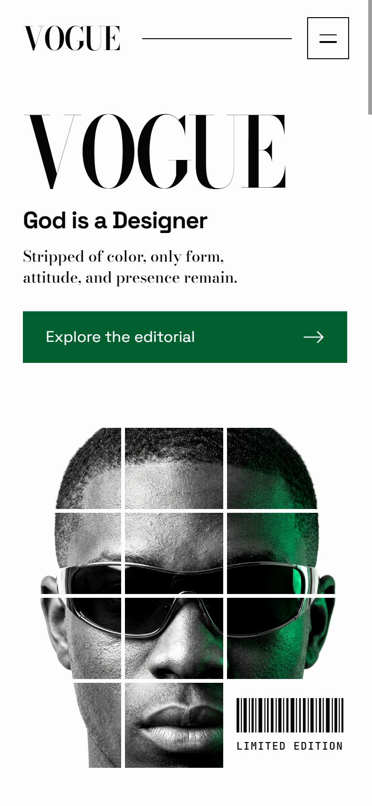
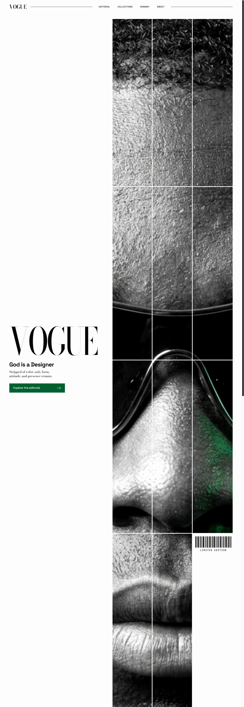

# VOGUE — Monochrome Editorial Issue 09

Standalone fashion editorial website built from the `13_vogue.png` reference frame.

## Screenshots

### Desktop Hero (1440×900)


### Mobile Hero (390×844)


### Full Page


## Design System

| Role | Color | Hex |
| :--- | :--- | :--- |
| Quiet 1 (Canvas) | Skeleton Cream | `#FDFDFD` |
| Quiet 2 (Ink) | Deep Black | `#060606` |
| Loud Accent | Pine Green | `#016030` |

- **Typography:** Bodoni Moda (compressed hero masthead, section headings, editorial deck, and footer wordmark), Space Grotesk (navigation links, subheading, buttons, and body text), JetBrains Mono (`LIMITED EDITION` stamp, section indices, and tabular print specs).
- **Layout:** Full-viewport (`100dvh`) split hero pairing the compressed `VOGUE` masthead and Pine Green `Explore the editorial` CTA against a monochrome portrait sliced by a `3×4` (`4px`) `#FDFDFD` grid overlay and a bottom-right SVG barcode cutout; followed below the fold by a filterable editorial plate ledger (`All`, `Monolith`, `Runway`, `Archive`), a three-column hairline collections matrix with `<dl>` issue specs, a Pine Green numbered print allocation form, and a Deep Black colophon footer.

## Run Locally

Serve the directory over any static HTTP server:

```bash
npx serve .
```
