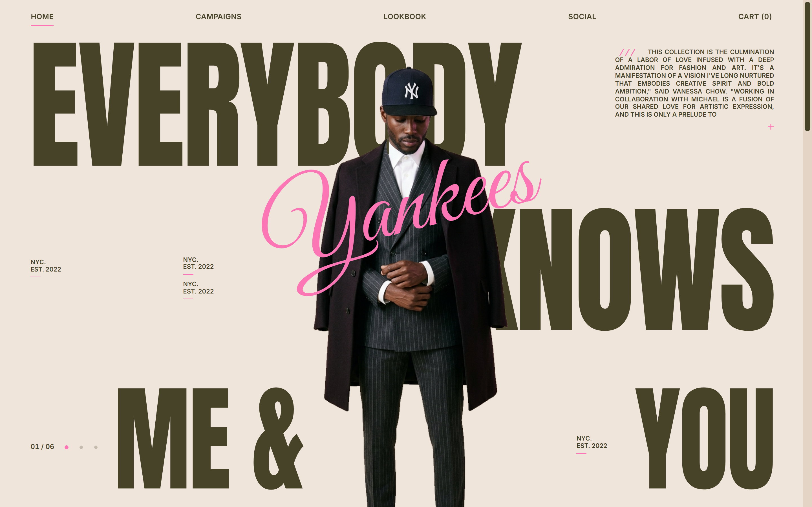
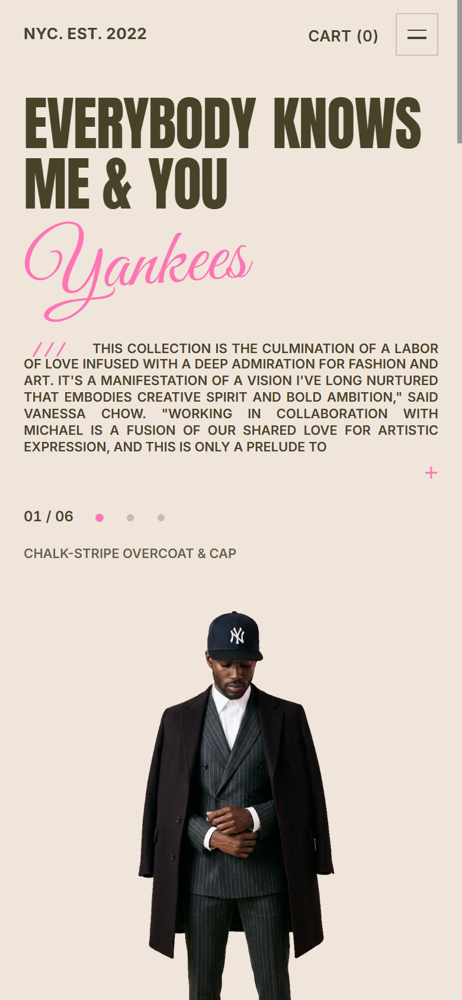
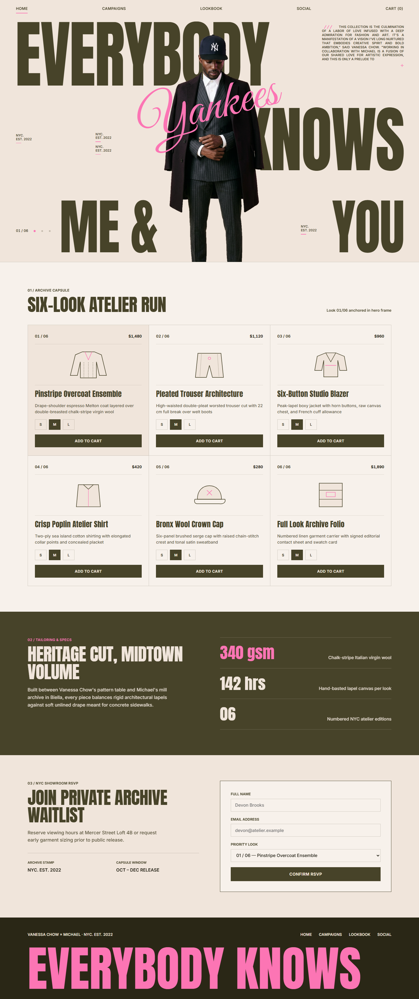

# EVERYBODY KNOWS ME & YOU — Yankees Atelier Lookbook

Standalone NYC tailoring lookbook built in Soft Sand, Mocha Green, and Watermelon Pink.

## Screenshots

### Desktop Hero (1440×900)


### Mobile Hero (390×844)


### Full Page


## Design System

| Role | Color | Hex |
| :--- | :--- | :--- |
| Quiet 1 (Gallery Paper) | Soft Sand | `#F0E5DB` |
| Quiet 2 (Ink & Structure) | Mocha Green | `#474329` |
| Loud Accent | Watermelon Pink | `#FC75B4` |

- **Typography:** Anton (`EVERYBODY KNOWS ME & YOU` display wall, section headings, garment figures, and footer wordmark), Great Vibes (sweeping calligraphic `Yankees` centerpiece), Inter (evenly spread uppercase header bar, justified editorial manifesto, and UI controls).
- **Layout:** Four-layer `100dvh` poster composition stacking the Mocha Green display wall (`z-index: 1`), upper-right `///` manifesto, `NYC. EST. 2022` stamps, and `01 / 06` slide pagination (`z-index: 2`), keyed portrait (`z-index: 3`), and angled Watermelon Pink `Yankees` script (`z-index: 4`); followed by a 6-look pinstripe capsule grid (`#lookbook`), `<dl>` garment construction metrics (`#campaigns`), and Mercer Street showroom RSVP form (`#social`).

## Run Locally

Serve the directory over HTTP:

```bash
npx serve .
```
