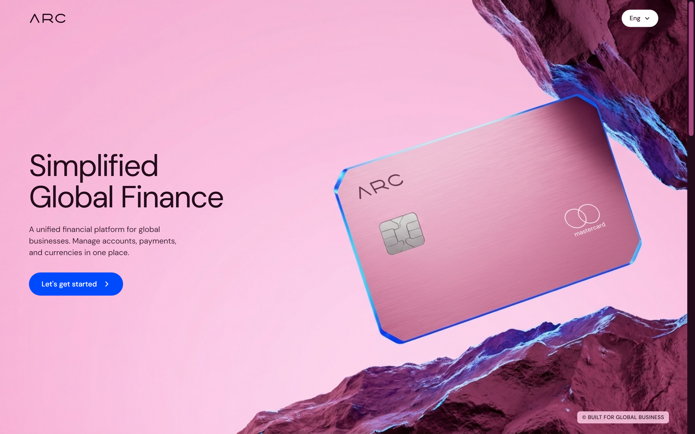
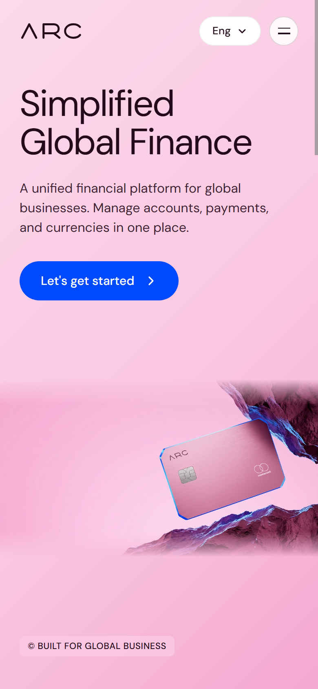
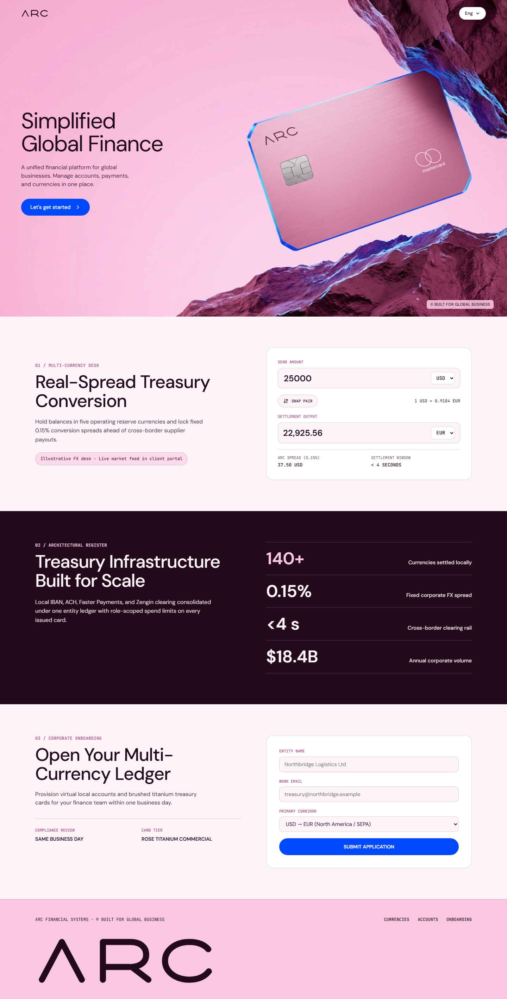

# ARC — Simplified Global Finance

Standalone corporate treasury landing page built in Flamingo Pink, Plum Pink, and Electric Blue.

## Screenshots

### Desktop Hero (1440×900)


### Mobile Hero (390×844)


### Full Page


## Design System

| Role | Color | Hex |
| :--- | :--- | :--- |
| Quiet 1 (Studio Backdrop) | Flamingo Pink | `#FAC7E1` |
| Quiet 2 (Ink & Basalt) | Plum Pink / Deep Plum | `#A5467C` / `#240B1B` |
| Loud Accent | Electric Blue | `#004AFD` |

- **Typography:** DM Sans (hero display headline, lead copy, navigation controls, and ledger figures), JetBrains Mono (FX desk currency codes, spreads, and section indices).
- **Layout:** Full-viewport (`100dvh`) studio hero pairing an inline geometric `ARC` wordmark, live locale selector (`Eng`, `Fra`, `Deu`, `Jpn`), `Simplified Global Finance` display stack, and Electric Blue `Let's get started` pill CTA against the brushed rose-titanium card; followed below the fold by an interactive five-currency FX desk (`#currencies`), a Deep Plum `<dl>` settlement register (`#accounts`), a corporate onboarding form (`#start`), and a Flamingo Pink editorial footer.

## Run Locally

Serve the directory over HTTP:

```bash
npx serve .
```
