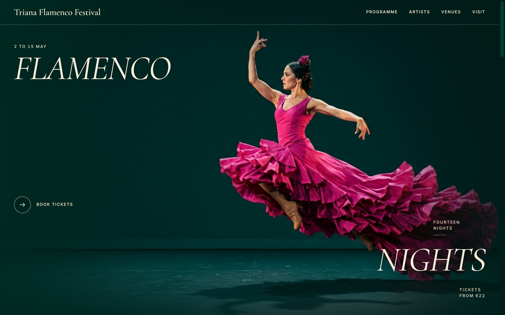
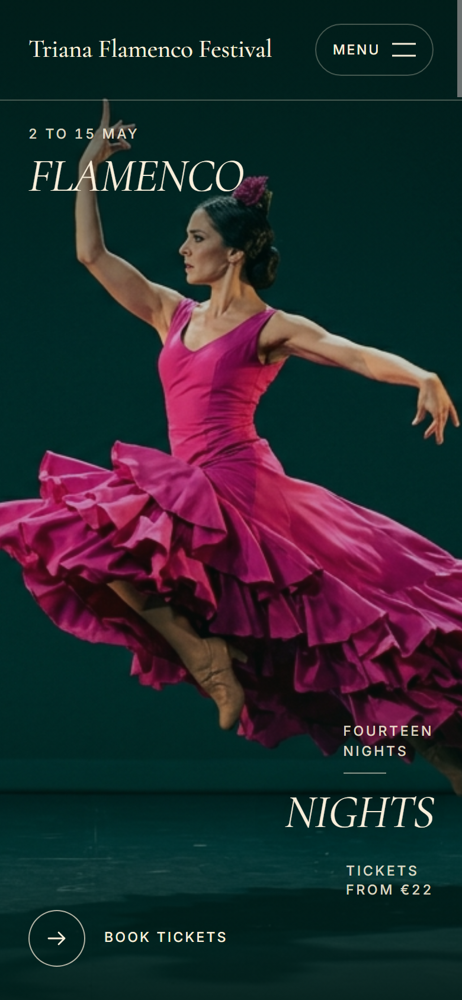
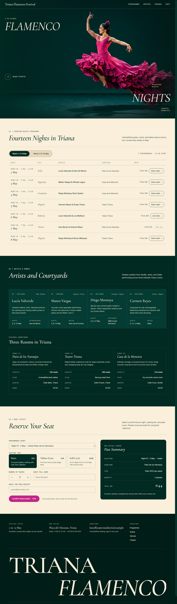

# Triana Flamenco Festival — Flamenco Nights

Standalone festival showcase for Triana Flamenco Festival in Seville, built with Deep Teal, Bone, and Magenta.

## Screenshots

### Desktop Hero (1440×900)


### Mobile Hero (390×844)


### Full Page


## Design System

| Role | Color | Hex |
| :--- | :--- | :--- |
| Quiet 1 (Stage Canvas) | Deep Teal | `#012A23` |
| Quiet 1 (Stage Void / Slab) | Deep Stage / Slab | `#011D18` / `#043B32` |
| Quiet 2 (Architectural Contrast) | Bone | `#F9EFDB` |
| Quiet 2 (Muted Surface) | Muted Bone | `#E8D9BC` |
| Loud Accent | Magenta | `#C12589` |

- **Typography:** Cormorant Garamond (italic and upright display headlines, navigation brand mark, and chapter headings), Inter (UI controls, programme metadata, and body copy), and JetBrains Mono (night indices, prices, and acoustic specifications).
- **Layout:** Full-viewport (`clamp(680px, 100dvh, 960px)`) edge-vignetted stage hero with `FLAMENCO / NIGHTS` editorial counterpoint, interactive two-week Fourteen Nights programme ledger (`#programme`), four featured soloists and three historic Triana courtyard specification cards (`#artists` / `#venues`), interactive pass booking form with live euro calculation and confirmation receipt (`#tickets`), and Deep Stage footer with edge-to-edge `TRIANA / FLAMENCO` wordmark (`#visit`).

## Run Locally

Serve the directory over HTTP:

```bash
npx serve .
```
