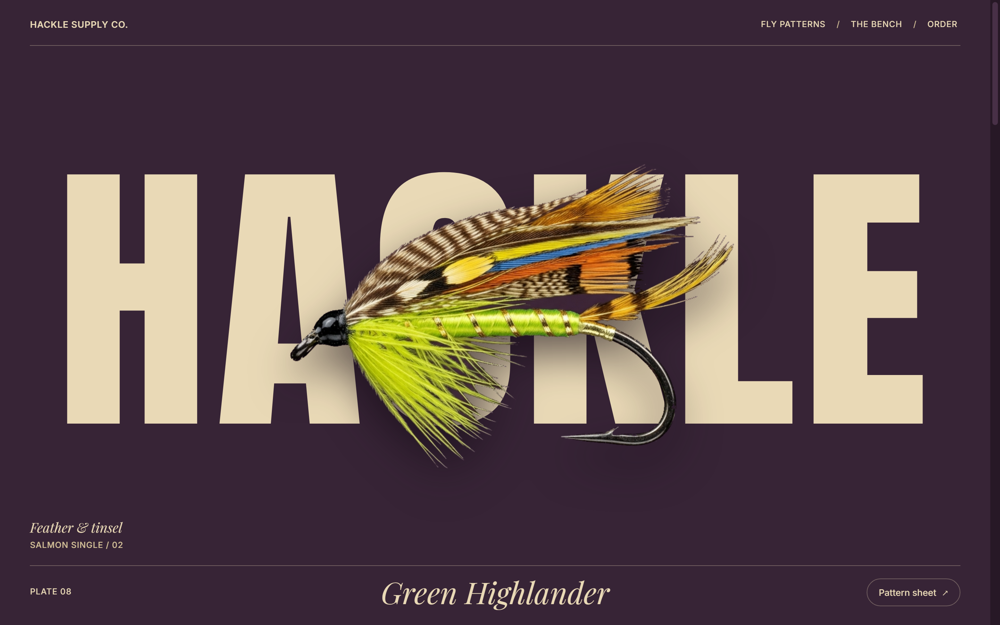
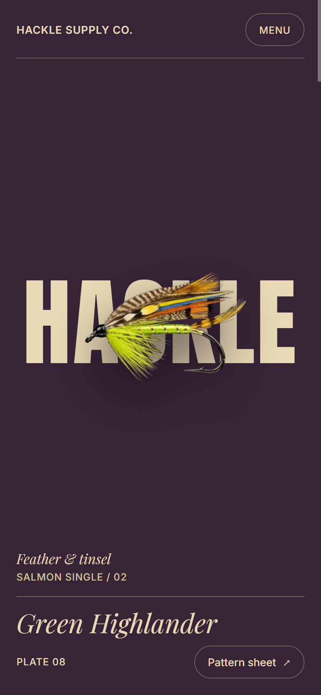
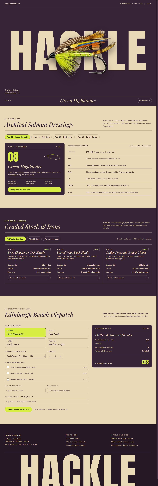

# HACKLE SUPPLY CO. — Green Highlander

Standalone website for HACKLE SUPPLY CO., an Edinburgh Atlantic salmon fly-tying supply house and archival pattern archive built in Damson, Vellum, and Chartreuse.

## Screenshots

### Desktop Hero (1440×900)


### Mobile Hero (390×844)


### Full Page


## Design System

| Role | Color | Hex |
| :--- | :--- | :--- |
| Quiet 1 (60% Ground) | Damson | `#372436` (`#271826` deep, `#483047` slab) |
| Quiet 2 (30% Contrast Field) | Vellum | `#E9D9B6` (`#D6C399` muted) |
| Loud Accent (10% Focal) | Chartreuse | `#D7ED44` (`#1F2406` ink) |

- **Typography:** Anton (400) for the monumental `HACKLE` poster wordmark, plate numerals, and edge-to-edge footer mark; Playfair Display (italic 400/500) for specimen titles and `Feather & tinsel` captions; Inter (400/500/600) with `tabular-nums` for navigation, recipe specifications, and order forms.
- **Interactive Craft:** Three-layer poster hero placing the keyed Green Highlander salmon fly in front of the Vellum `HACKLE` letterforms, paired with an interactive pattern plate switcher (`Plate 08`–`Plate 19`), graded bench material selector, and live Edinburgh dispatch order form.

## Run Locally

Serve the directory over HTTP:

```bash
npx serve .
```
