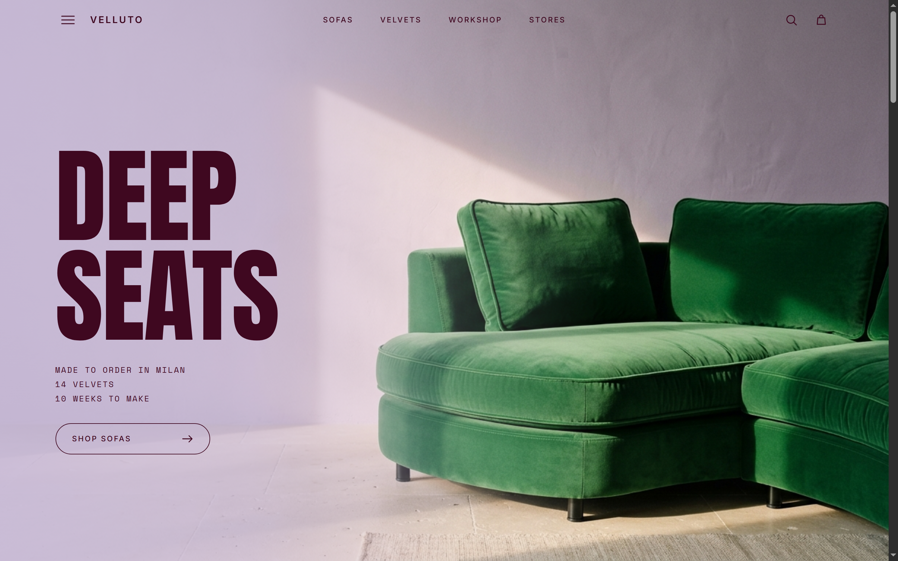
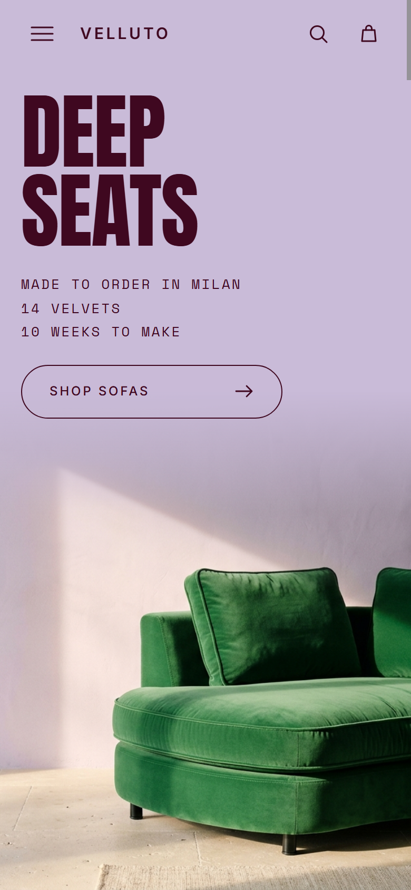
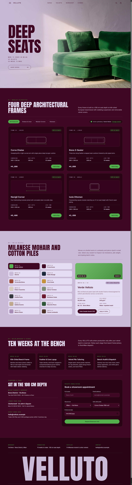

# VELLUTO — Deep Seats

Standalone website for VELLUTO, a Milan made-to-order velvet sofa workshop built in Lilac, Deep Plum, and Velvet Green.

## Screenshots

### Desktop Hero (1440×900)


### Mobile Hero (390×844)


### Full Page


## Design System

| Role | Color | Hex |
| :--- | :--- | :--- |
| Quiet 1 (60% Plaster Ground) | Lilac | `#C9BBD8` (`#B7A6C9` step, `#E4DCF0` mist) |
| Quiet 2 (30% Ink & Plum Slab) | Deep Plum | `#3F0820` (`#290414` deep ink) |
| Loud Accent (10% Velvet CTA) | Velvet Green | `#52AE4C` (`#378532` deep, `#0F290E` ink) |

- **Typography:** Anton (`400`) for the stacked `DEEP / SEATS` display lockup, chapter headings, and footer wordmark; Inter (`400/500/600`) for top navigation, sofa specs, and editorial copy; Space Mono (`400/700`) for `MADE TO ORDER IN MILAN` metadata, swatch indices, Martindale counts, and Euro pricing.
- **Interactive Craft:** Synchronized 14-velvet swatch studio with live Martindale and dye-batch inspector, category-filtered 108 cm modular sofa grid, live slide-over order bag drawer with quantity controls and complimentary swatch ordering, catalog search drawer, and showroom appointment form with inline validation.

## Run Locally

Serve the directory over HTTP:

```bash
npx serve .
```
