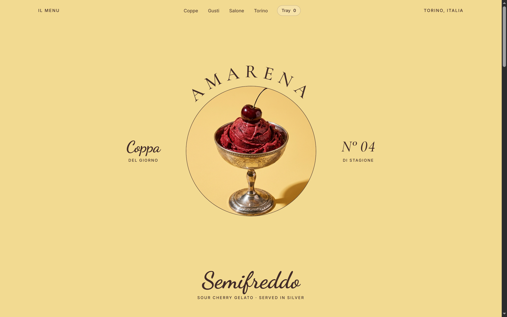
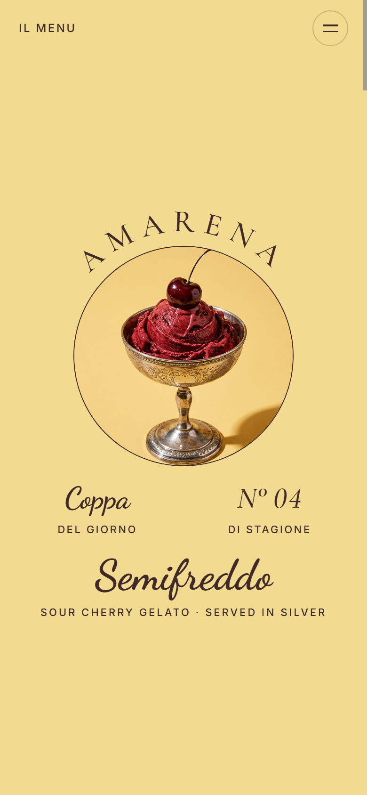
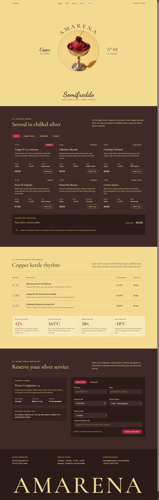

# AMARENA — Coppa N° 04 Semifreddo

Standalone website for AMARENA, a Torino sour-cherry gelateria and pasticceria built in Butter, Roast, and Morello.

## Screenshots

### Desktop Hero (1440×900)


### Mobile Hero (390×844)


### Full Page


## Design System

| Role | Color | Hex |
| :--- | :--- | :--- |
| Quiet 1 (60% Poster Ground) | Butter | `#F2DA91` (`#E7CA74` step, `#F8E8B8` light) |
| Quiet 2 (30% Ink & Salone Slab) | Roast | `#402A27` (`#2B1B19` deep) |
| Loud Accent (10% Sour Cherry) | Morello | `#A2213A` (`#81172B` deep) |

- **Typography:** Cormorant Garamond (500/600, italic) for the arched `AMARENA` SVG `<textPath>` wordmark, `N° 04`, and editorial headings; Dancing Script (700) for `Coppa` and `Semifreddo` brush lockups; Inter (400/500/600) with `tabular-nums` for navigation, batch ledgers, pricing, and forms.
- **Interactive Craft:** Centered circular `1.5px` Roast medallion framing silver-coupe sour-cherry gelato, category-filtered daily menu (`Coppe in Silver`, `Semifreddi`, `Sorbetti`) with live tasting tray assembly, copper-kettle batch schedule, and Piazza Carignano table or thermal-box reservation confirmation ticket.

## Run Locally

Serve the directory over HTTP:

```bash
npx serve .
```
