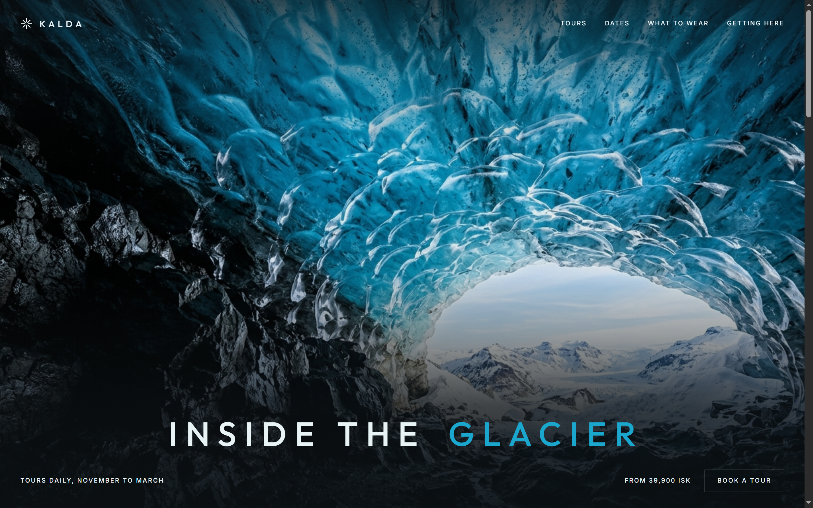
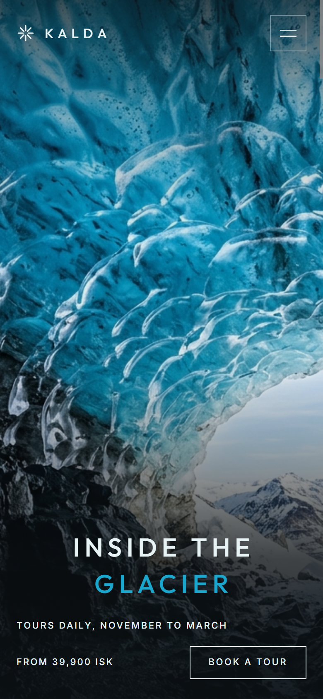
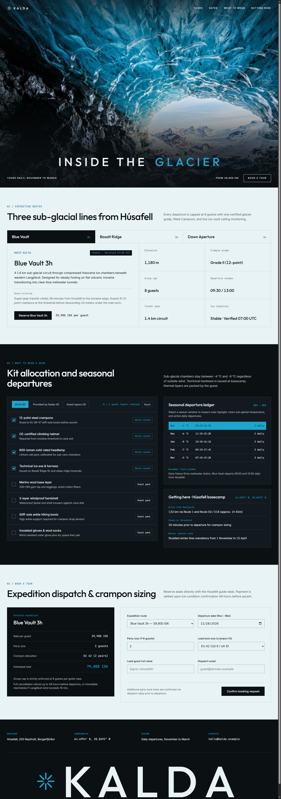

# KALDA — Inside the Glacier

Standalone website for KALDA, an Icelandic glacier and ice-cave expedition operator based at Húsafell, built with Black Basalt, Bone, and Glacier Blue.

## Screenshots

### Desktop Hero (1440×900)


### Mobile Hero (390×844)


### Full Page


## Design System

| Role | Color | Hex |
| :--- | :--- | :--- |
| Quiet 1 (Canvas & Footer) | Black Basalt | `#0B1013` |
| Quiet 1 (Surface Step) | Basalt Slab | `#121A1F` |
| Quiet 2 (Light Chapters & Ink) | Bone | `#E8F3F6` |
| Loud Accent | Glacier Blue | `#1BA6CD` |

- **Typography:** Outfit (500–600 wide-tracked hero lockup and section display titles), Inter (navigation, prose, and form controls), JetBrains Mono (section indices, basecamp coordinates, seasonal ledger, and tabular ISK figures).
- **Layout:** Full-viewport (`clamp(680px, 100dvh, 960px)`) sub-glacial ice cave hero with 8-spoke asterisk geometric mark, wide-tracked `INSIDE THE GLACIER` display title, and bottom dispatch bar (`TOURS DAILY, NOVEMBER TO MARCH`, `FROM 39,900 ISK`, `BOOK A TOUR`), followed by alternating Bone and Black Basalt chapters: interactive expedition route tabs (`#tours`), filterable kit checklist and Nov–Mar departure ledger (`#what-to-wear`, `#dates`, `#getting-here`), and validated crampon-sized expedition booking (`#book`).

## Run Locally

Serve the folder over HTTP:

```bash
npx serve .
```
