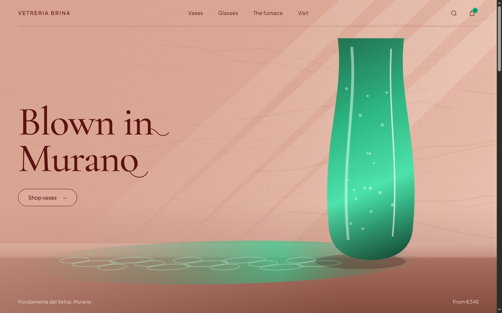
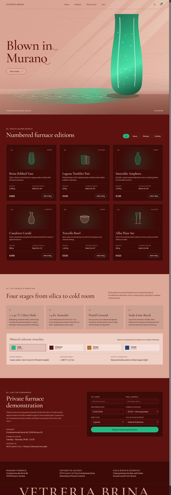
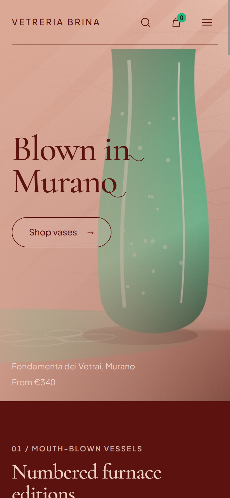

# VETRERIA BRINA — Blown in Murano

Self-contained Venetian glassworks website built with HTML, CSS, and vanilla JavaScript.

## Design System

- **Quiet 1 (60% Rose Marble):** `#DCA997`, `#CCA090` step, `#EED0C4` light marble
- **Quiet 2 (30% Oxblood):** `#5C1310`, `#3D0A08` deep ink
- **Loud Accent (10% Jade Green):** `#23B781`, `#178C61` deep jade, `#082E20` ink on jade
- **Typography:** `Cormorant Garamond` (display) and `Plus Jakarta Sans` (interface and tabular numerals)

## Implemented Sections

- **Hero:** Full-bleed Murano vessel backdrop (`./assets/murano-vase.jpg`), tracked top bar with live search and collection bag triggers, oxblood display headline with terminal swashes, and Fondamenta dei Vetrai footer bar.
- **01 / Mouth-Blown Vessels:** Category tabs (`All`, `Vases`, `Glasses`, `Carafes`), search filtering, six numbered furnace editions with weight and batch metadata, and a slide-over collection bag drawer.
- **02 / The Furnace & Annealing:** Four-stage Venetian glassblowing specifications and interactive mineral colorant swatches (`Jade`, `Oxblood`, `Amber`, `Cobalt`).
- **03 / Visit the Fondamenta:** Private furnace demonstration booking form with validation and Venice appointment slip confirmation.
- **Footer:** Murano vaporetto details and edge-to-edge `VETRERIA BRINA` wordmark.

## Screenshots

