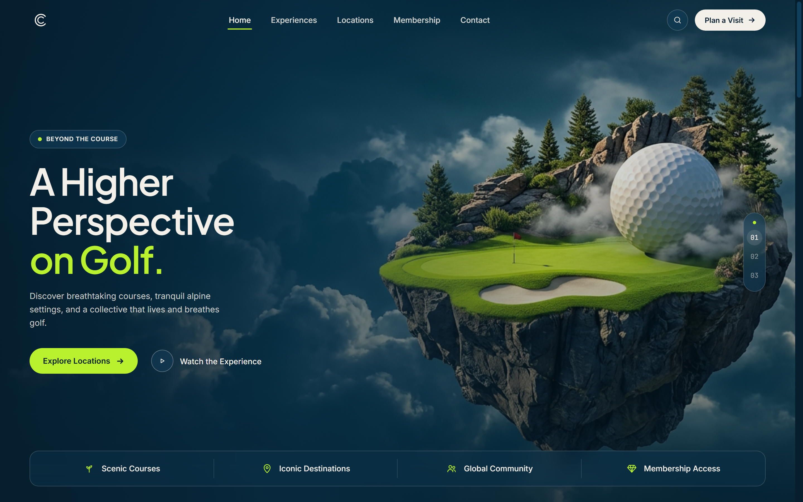
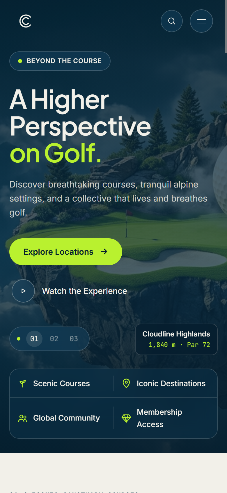
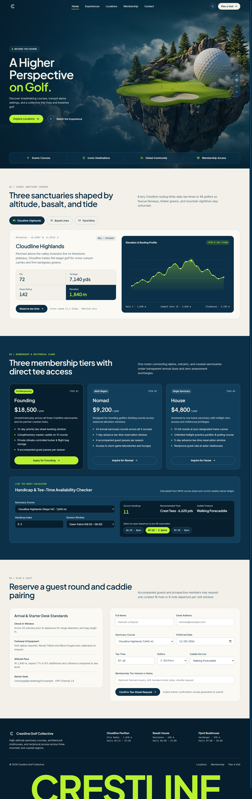

# Crestline Golf — A Higher Perspective on Golf

Standalone website for Crestline Golf, a high-altitude sanctuary golf collective operating alpine, volcanic basalt, and fjord courses, built with Deep Midnight Teal, Soft Pearl, and Vibrant Neon Lime.

## Screenshots

### Desktop Hero (1440×900)


### Mobile Hero (390×844)


### Full Page


## Design System

| Role | Color | Hex |
| :--- | :--- | :--- |
| Quiet 1 (Primary Canvas) | Deep Midnight Teal | `#0B3048` |
| Quiet 1 (Deep Void & Footer) | Deep Void | `#061E2E` |
| Quiet 1 (Glass Slab) | Slate Teal Slab | `#113E5B` |
| Quiet 2 (Light Chapters & Ink) | Soft Pearl | `#F2F0E9` |
| Loud Accent | Vibrant Neon Lime | `#B9F12F` |
| Loud Accent (Deep) | Deep Lime | `#98CC1B` |

- **Typography:** Plus Jakarta Sans (600–700 display headline and monumental `CRESTLINE` footer wordmark), Inter (400–600 navigation, copy, and controls), JetBrains Mono (400–500 course coordinates, elevation readouts, and tabular metrics).
- **Layout:** Full-viewport (`clamp(680px, 100dvh, 960px)`) floating-sanctuary hero featuring a concentric double-C monogram, left-scrimmed floating green island centerpiece, `• BEYOND THE COURSE` pill eyebrow, right-edge `01 / 02 / 03` sanctuary stepper, and 4-column frosted bottom dock (`Scenic Courses`, `Iconic Destinations`, `Global Community`, `Membership Access`), followed by alternating Soft Pearl and Deep Midnight Teal chapters: interactive course tabs with SVG elevation profiles (`#locations`), 3 membership tiers and live handicap tee-time availability checker (`#membership`), and validated guest reservation with confirmed tee-sheet receipt (`#visit`).

## Run Locally

Serve the folder over HTTP:

```bash
npx serve .
```
