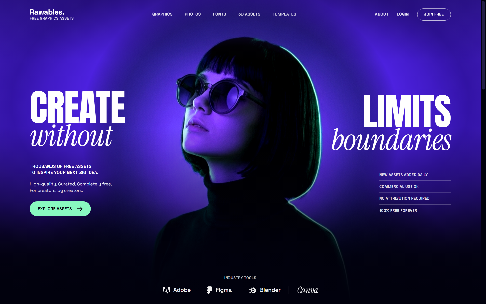
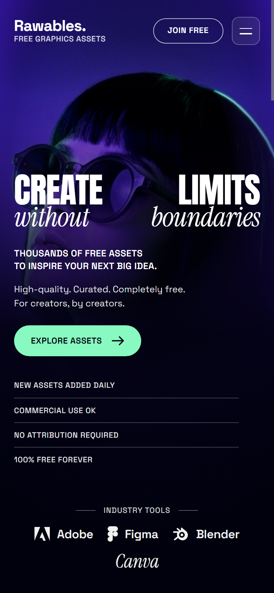
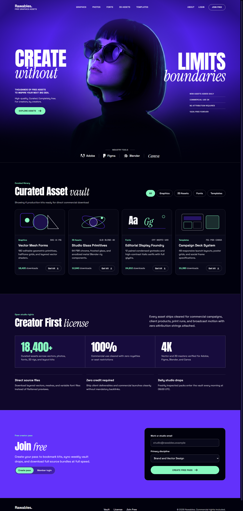

# Rawables. — Free Graphics Assets

Standalone landing page for Rawables., a curated library of graphics, studio photos, fonts, 3D assets, and UI templates built with Onyx Black, Electric Indigo, and Tropical Mint.

## Screenshots

### Desktop Hero (1440×900)


### Mobile Hero (390×844)


### Full Page


## Design System

| Role | Color | Hex |
| :--- | :--- | :--- |
| Quiet 1 (Deep Canvas) | Onyx Black | `#01010D` |
| Quiet 2 (Atmosphere & Structure) | Electric Indigo | `#6331FB` |
| Loud Accent | Tropical Mint | `#88F9C0` |

- **Typography:** Anton (condensed uppercase display headlines and stats), Instrument Serif italic with Playfair Display fallback (editorial serif counterpoint `without` and `boundaries`), Space Grotesk (navigation, UI controls, body copy, and tabular figures).
- **Layout:** Full-viewport (`100dvh`) studio portrait hero framed by an Electric Indigo and Onyx Black vignette, split monumental display typography (`CREATE without` / `LIMITS boundaries`), a Tropical Mint `EXPLORE ASSETS` pill button, four hairline-divided guarantee labels, and a monochrome Industry Tools bar (`Adobe`, `Figma`, `Blender`, `Canva`), followed by a tabbed asset vault (`#vault`), semantic `<dl>` library license metrics (`#about`), and an inline free pass registration dock (`#join`).

## Run Locally

Serve the directory over HTTP:

```bash
npx serve .
```
