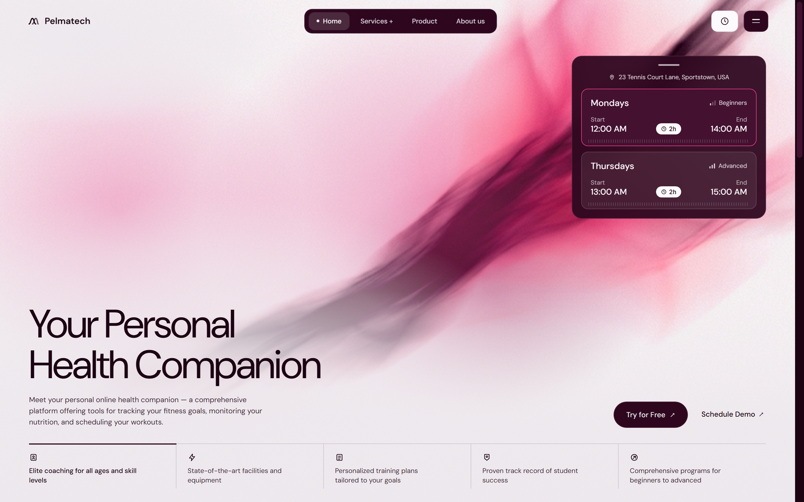
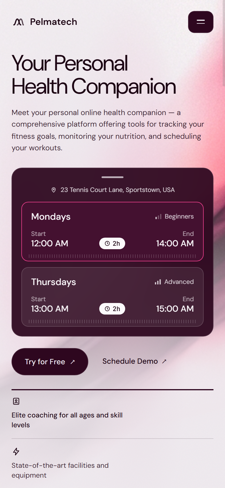
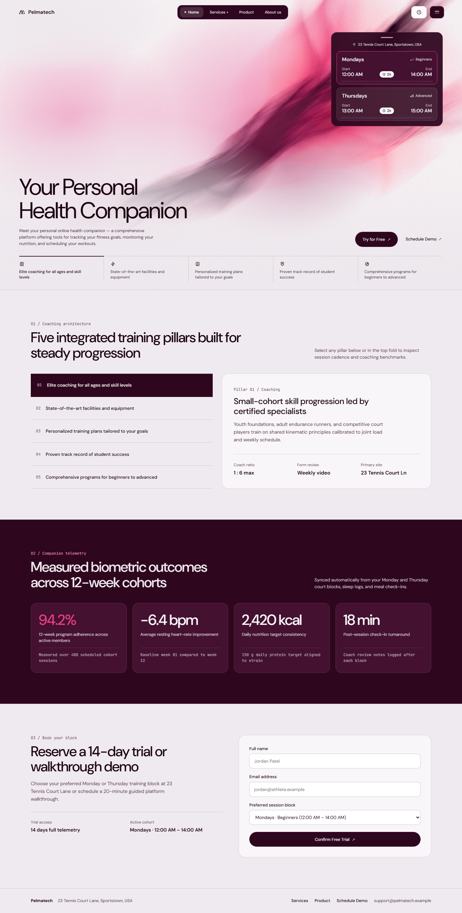

# Pelmatech — Tactile Health Companion

Standalone recreation of the tactile Pelmatech landing page built around a Pearl White field, Deep Plum schedule architecture, and Berry Pink atmospheric motion.

## Screenshots

### Desktop Hero (1440×900)


### Mobile Hero (390×844)


### Full Page


## Design System

| Role | Color | Hex |
| :--- | :--- | :--- |
| Quiet 1 (Canvas) | Pearl White | `#EFEAEF` |
| Quiet 2 (Contrast & Chrome) | Deep Plum / Dark Ink | `#2E071F` / `#1C0413` |
| Nested Surface | Nested Plum | `#441130` |
| Loud Accent | Berry Pink | `#E93E8A` |

- **Typography:** DM Sans (`400`, `500`, `600`, `700`) for display headlines, UI labels, and body copy; JetBrains Mono (`400`, `500`) for duration badges and telemetry indices.
- **Interactive Structure:** Top pill navigation, selectable Monday and Thursday session cards with bottom barcode strips, synchronized 5-pillar bottom rule and coaching detail tabs, semantic biometric `<dl>` telemetry chapter, and in-place cohort booking form.

## Run Locally

Serve the folder statically from any HTTP server:

```bash
npx serve .
```
