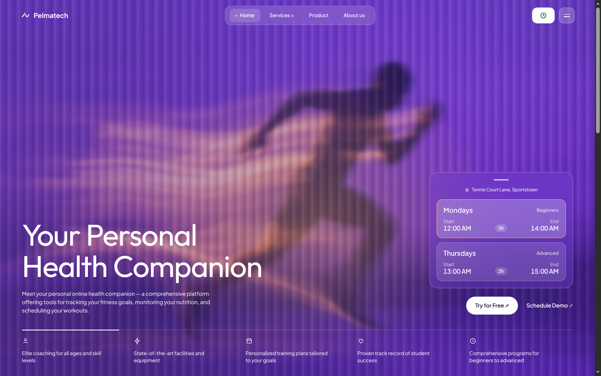
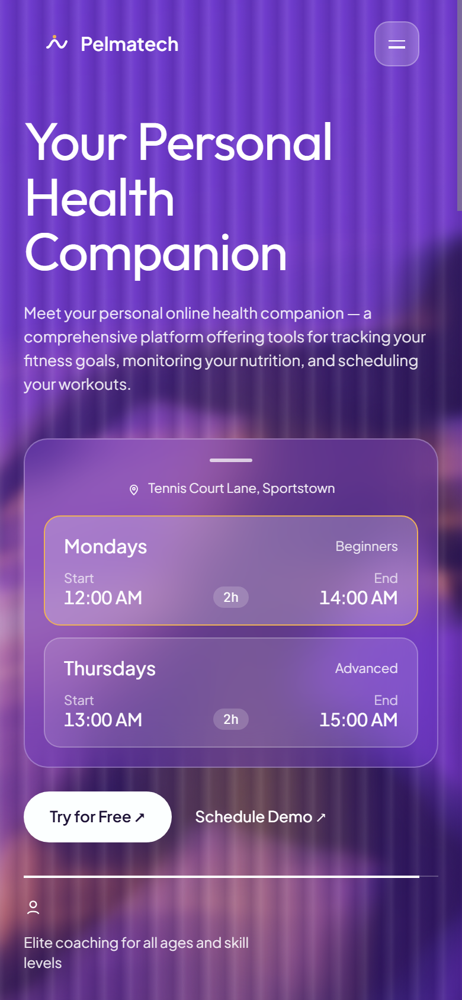
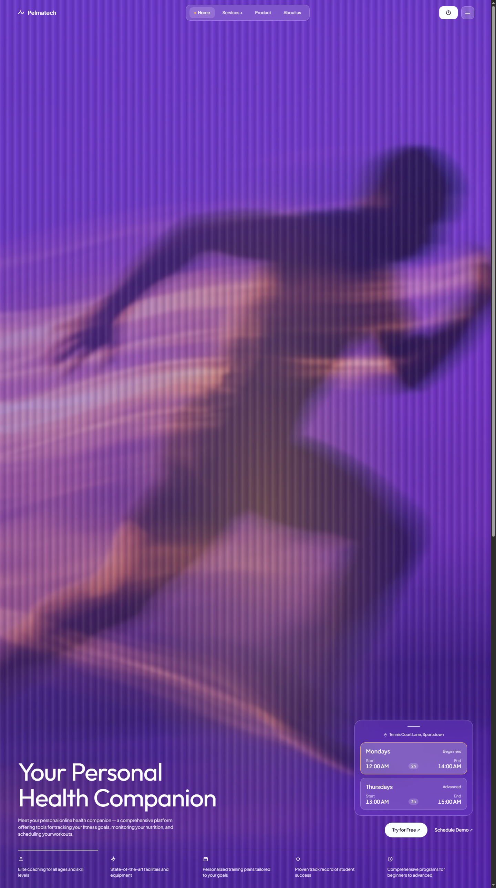

# Pelmatech — Personal Health Companion

Standalone web recreation built from the Pelmatech ("Your Personal Health Companion") reference design.

## Screenshots

### Desktop Hero (1440×900)


### Mobile Hero (390×844)


### Full Page


## Design System

| Role | Color | Hex |
| :--- | :--- | :--- |
| Quiet 1 (Canvas) | Royal Purple | `#723CD6` |
| Quiet 2 (Contrast Surface) | White | `#FCFFFF` |
| Loud Accent | Sunglow Gold | `#EDB158` |

- **Typography:** Outfit (light display headline and figures), Plus Jakarta Sans (UI and body), JetBrains Mono (durations and tags).
- **Layout:** Vertical fluted-glass hero over golden motion-blurred runner backdrop, paired with interactive Monday/Thursday session cards, a 5-pillar bottom bar, and companion workout/nutrition tabs.

## Run Locally

Open `index.html` in any browser or serve statically:

```bash
npx serve .
```
