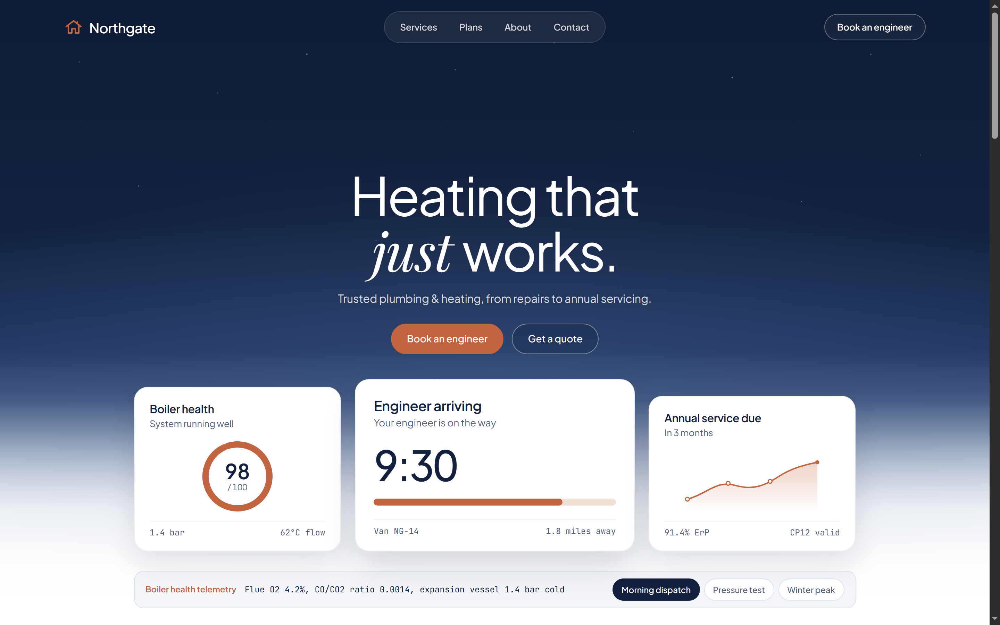
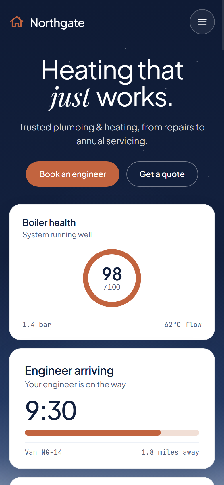
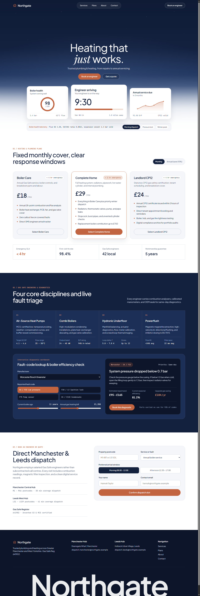

# Northgate — Heating that just works

Standalone heating engineering, boiler diagnostic, and plumbing care website recreated from the Northgate reference (`temp/new_crops/n3_d3_northgate_14.png`).

## Screenshots

### Desktop Hero (1440x900)


### Mobile Hero (390x844)


### Full Page


## Design System

| Role | Color | Hex |
| :--- | :--- | :--- |
| Quiet 1 (Canvas & Structural Ink) | Deep Navy | `#13213F` |
| Deep Void / Elevated Slab | Void / Navy Slab | `#0C1529` / `#1C2F57` |
| Quiet 2 (Atmosphere & Surface) | White / Soft Slate | `#FFFFFF` / `#F4F6FA` |
| Loud Accent | Clay | `#C2643F` (`#9E4B2B` deep) |

- **Typography:** `Plus Jakarta Sans` and `Inter` for headline and interface text, `Playfair Display` italic for the hero emphasis (`just`), and `JetBrains Mono` with `tabular-nums` for telemetry metrics, fault codes, SLAs, and dispatch references.
- **Hero Architecture:** `clamp(680px, 100dvh, 960px)` Deep Navy night sky with fine atmospheric starlight dissolving smoothly into White along the bottom third, anchored by a three-card live telemetry deck (`Boiler health 98 / 100`, elevated `Engineer arriving 9:30`, and `Annual service due` sparkline) with interactive telemetry presets.
- **Chapters:**
  - `01 / HEATING & PLUMBING PLANS`: Monthly/annual toggle across `Boiler Care` (`£18/mo`), `Complete Home` (`£29/mo`), and `Landlord CP12` (`£24/mo`) with response-time SLAs (`< 4 hr emergency`).
  - `02 / GAS SAFE ENGINEERS & DIAGNOSTICS`: Four engineering disciplines (`Air-Source Heat Pumps`, `Combi Boilers`, `Hydronic Underfloor`, `Powerflush`) paired with an interactive fault-code triage and efficiency calculator.
  - `03 / BOOK AN ENGINEER OR QUOTE`: Postcode dispatch router for Manchester and Leeds hubs with morning/afternoon window toggle and instant `NG-4821` dispatch ticket confirmation.

## Local Preview

Serve the folder from any static server:

```bash
npx serve heatingservice_deepnavy+white+clay
```
