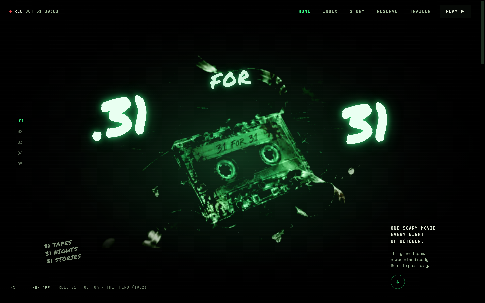
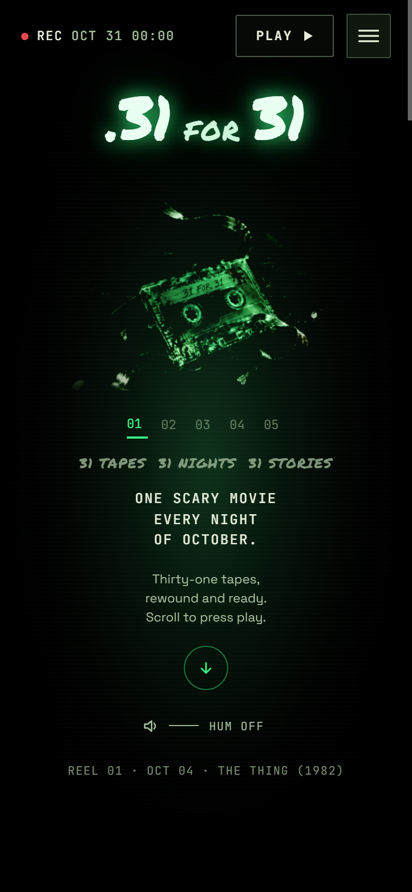
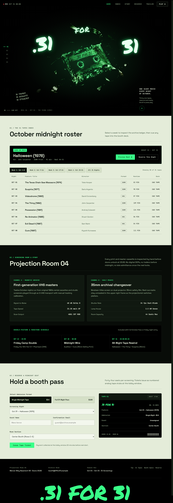

# .31 FOR 31 — October Horror Tape Archive

Standalone midnight cinema archive for `.31 FOR 31` ("31 TAPES. 31 NIGHTS. 31 STORIES.") built in Jet Black, Muted Moss Green, and Neon Emerald Green.

## Screenshots

### Desktop Hero (1440×900)


### Mobile Hero (390×844)


### Full Page


## Design System

| Role | Color | Hex |
| :--- | :--- | :--- |
| Quiet 1 (60% Jet Black) | Jet Black | `#000000` (`#080C08` void, `#101810` slab) |
| Quiet 2 (30% Muted Moss Green) | Muted Moss Green | `#6D8F63` (`#A6BF9D` text, `#E4ECD9` archival paper) |
| Loud Accent (10% Neon Emerald) | Neon Emerald Green | `#39FF88` (`#18C962` deep, `#031A0C` ink) |

- **Typography:** Permanent Marker for the `.31 FOR 31` chalk display lockup, tilted hero note, and footer wordmark; Space Grotesk (400/500/600) for section titles and prose; JetBrains Mono (400/500/700) for `REC OCT 31 00:00` telemetry, vertical reel rail, tabular runtimes, and tape ticket codes.
- **Interactive Features:** Full-bleed unspooled VHS cassette hero with clickable `01`–`05` reel rail, Web Audio ambient tape hum toggle, CRT trailer preview modal (`PLAY`), four-week October screening ledger (`Week 1`–`Week 4` plus `All 31 Nights`) that cues any tape onto the deck, and seat reservation form issuing a perforated `TAPE-31` ticket stub.

## Run Locally

Serve the folder over HTTP:

```bash
npx serve .
```
