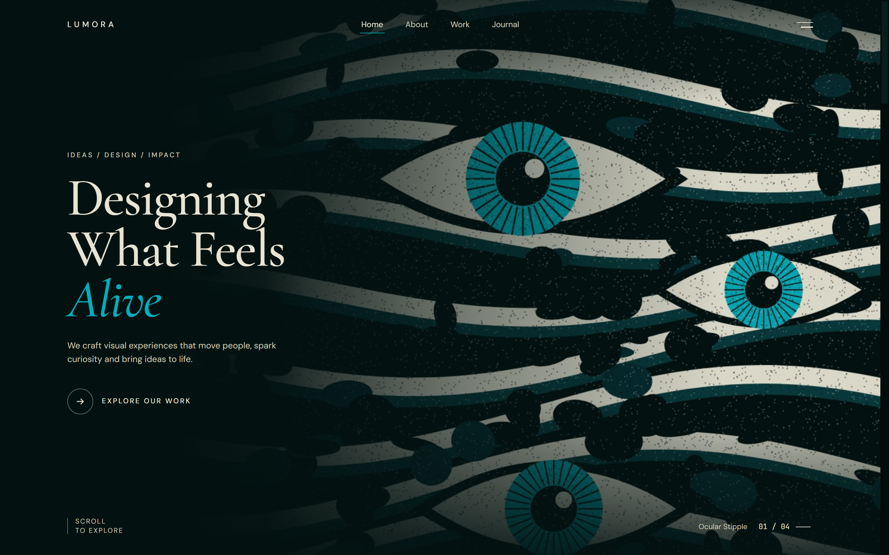
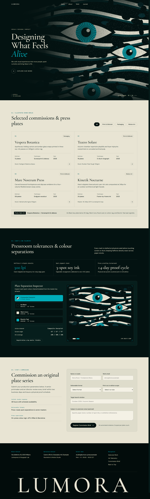
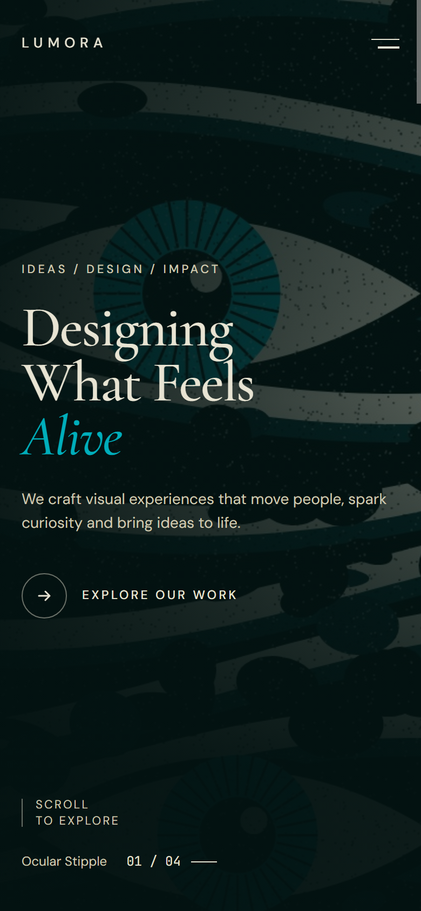

# LUMORA — Illustration & Visual Identity Studio

Self-contained studio website recreating the **LUMORA** ("Designing What Feels Alive") editorial illustration identity in an Ink Black, Warm Ivory, and Electric Teal palette.

## Color System

- **Quiet 1 — Ink Black (60%):** `#031211` (slab `#061E1C`, footer `#020C0B`)
- **Quiet 2 — Warm Ivory (30%):** `#E8E4D3` (muted `#CFC9B2`)
- **Loud Accent — Electric Teal (10%):** `#00AEBB` (deep `#008691`, dark ink on teal `#021A1C`)

## Features & Structure

- **Full-Bleed Editorial Hero (`clamp(680px, 100dvh, 960px)`):** Pairs `./assets/lumora-eyes.jpg` with a directional Ink Black scrim, tracked `LUMORA` wordmark, centered navigation, slide-out studio drawer, italic teal headline payoff, and interactive `01 / 04` plate archive switcher.
- **01 / Illustrated Brand Worlds:** Interactive discipline filter (`All`, `Print & Editorial`, `Packaging`, `Motion Art`), 2x2 hairline commission matrix with Electric Teal hover inversion, and live plate specification notes.
- **02 / Craft & Ink Telemetry:** Pressroom tolerance metrics (`300 lpi`, `3-spot soy ink`, `14-day proof cycle`) paired with an interactive 3-spot colour separation inspector and registration mark toggle.
- **03 / Start a Commission:** Client brief form with inline validation and in-place studio docket assignment.

## Screenshots

### Desktop Hero (`1440x900`)


### Full Page (`1440px`)


### Mobile Hero (`390x844`)


## Local Usage

Open `index.html` directly or serve the folder over HTTP:

```bash
npx serve .
```
