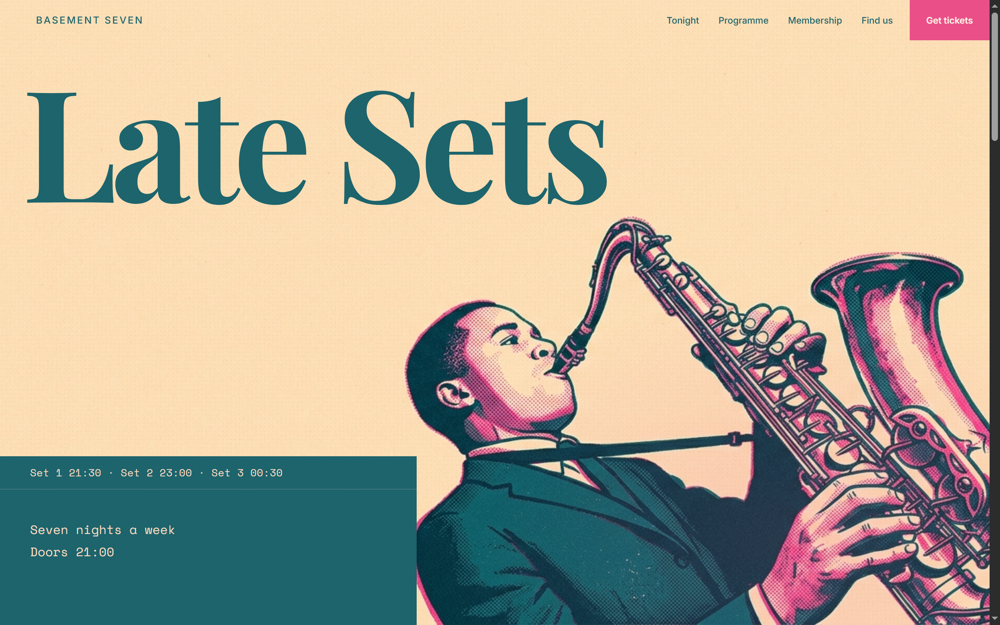
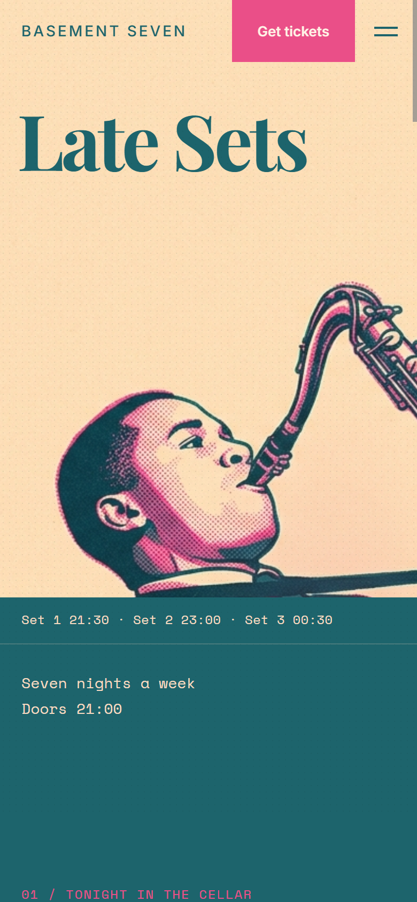
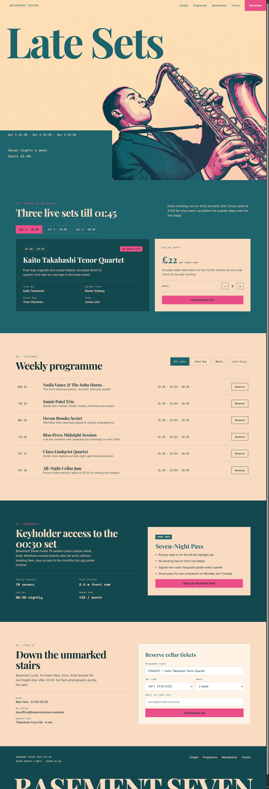

# BASEMENT SEVEN — Late Sets

Standalone website for BASEMENT SEVEN, an intimate seven-night jazz cellar built in Cream Paper, Riso Teal, and Fluorescent Pink.

## Screenshots

### Desktop Hero (1440×900)


### Mobile Hero (390×844)


### Full Page


## Design System

| Role | Color | Hex |
| :--- | :--- | :--- |
| Quiet 1 (60% Poster Canvas) | Cream Paper | `#F8DBC1` |
| Quiet 2 (30% Display, Ink & Slab) | Riso Teal | `#1D646C` (`#13484E` deep) |
| Loud Accent (10% Overprint & CTA) | Fluorescent Pink | `#EA4F88` |

- **Typography:** Playfair Display (700) for the monumental `Late Sets` display lockup, section titles, and footer wordmark; Inter (400/500/600) for navigation and copy; Space Mono (400/700) for nightly set times (`21:30 · 23:00 · 00:30`), tabular capacities, and venue specs.
- **Interactive Craft:** Full-bleed risograph-grained poster hero pairing a two-color teal/pink saxophonist overprint with an interactive three-set nightly lineup switcher, tabular seat counter, genre-filtered weekly programme ledger, and validated door-list booking form.

## Run Locally

Serve the directory over HTTP:

```bash
npx serve .
```
