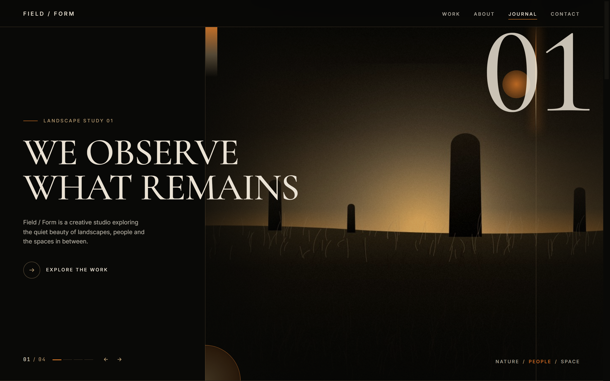
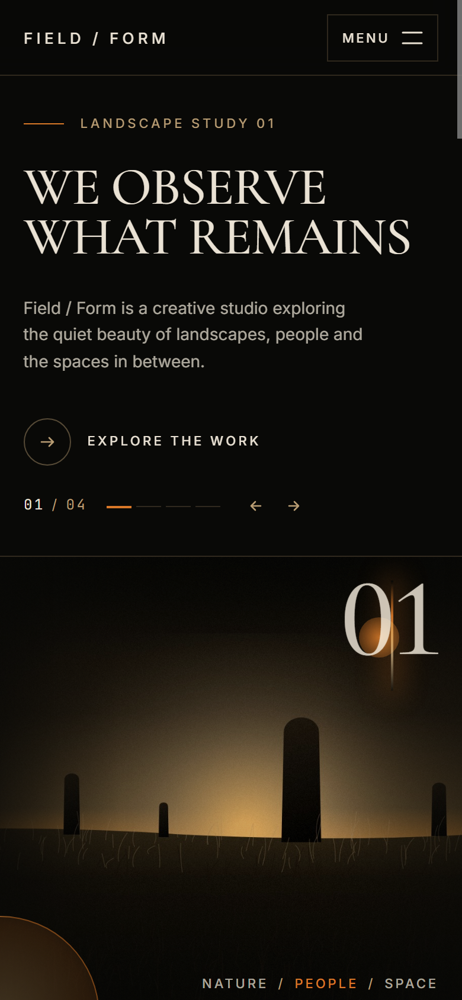
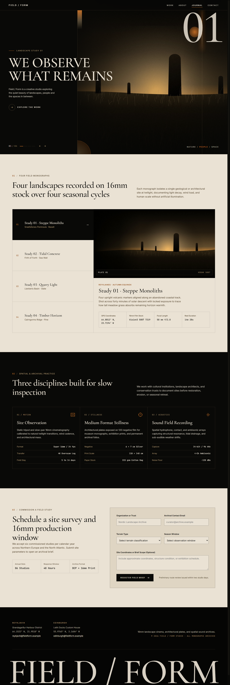

# FIELD / FORM — We Observe What Remains

Standalone website for FIELD / FORM, a landscape cinema and spatial observation studio built in Charcoal, Earth Brown, and Burnt Amber.

## Screenshots

### Desktop Hero (1440×900)


### Mobile Hero (390×844)


### Full Page


## Design System

| Role | Color | Hex |
| :--- | :--- | :--- |
| Quiet 1 (60% Ground & Slab) | Charcoal | `#090907` (`#14130F` slab, `#050504` footer) |
| Quiet 2 (30% Ink & Paper) | Earth Brown & Warm Parchment | `#6C5636` / `#EAE2D4` |
| Loud Accent (10% Light Ribbon) | Burnt Amber | `#B99D73` (`#D97828` amber glow) |

- **Typography:** Cormorant Garamond (500) for the `WE OBSERVE / WHAT REMAINS` display title, oversized `01` overlay numeral, and edge-to-edge footer wordmark; Inter (400/500/600) for tracked navigation, study notes, and form controls; JetBrains Mono (400/500) with `tabular-nums` for GPS coordinates, film stocks, focal lengths, durations, and dossier numbers.
- **Interactive Craft:** Split asymmetric poster hero with interactive `01 / 04` study switcher, architectural hairlines, screen-blended vertical amber light ribbons, alternating Warm Parchment and Charcoal chapters, four-monograph field dossier selector, three-column archival practice matrix, and validated field brief inquiry form.

## Run Locally

Serve the directory over HTTP:

```bash
npx serve .
```
