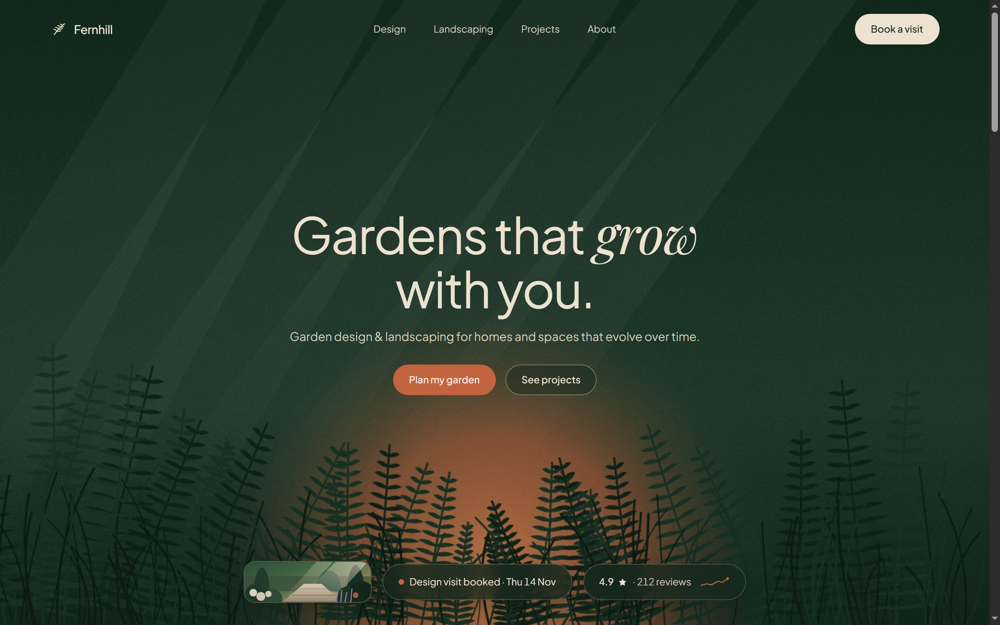
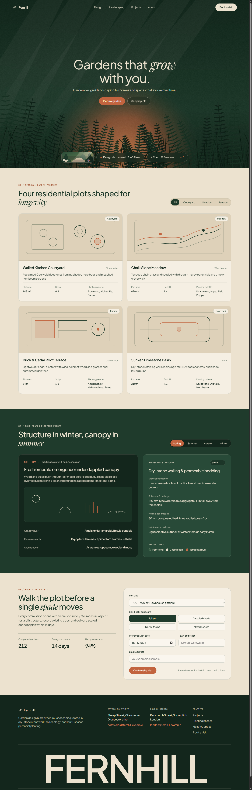
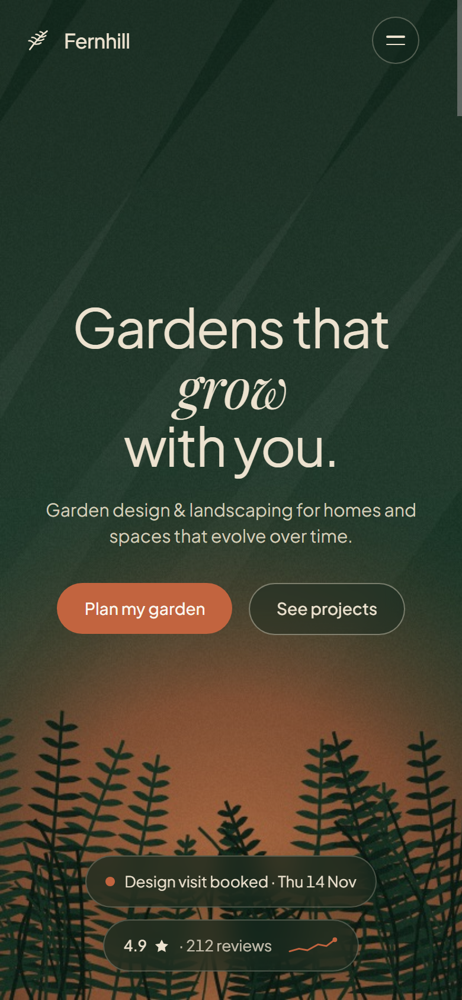

# Fernhill — Garden Design & Architectural Landscaping

Self-contained garden design and architectural landscaping showcase built with a **Forest Green**, **Warm Sand**, and **Clay** palette.

## Color System

| Role | Name | Hex | Usage |
| :--- | :--- | :--- | :--- |
| Quiet 1 (60%) | Forest Green | `#1F3B2C` (`#13261C` deep, `#284A38` slab) | Hero canvas, planting phase chapter, footer wordmark ground |
| Quiet 2 (30%) | Warm Sand | `#ECE2CF` (`#DED1B9` step, `#F5EFE3` surface) | Primary headline ink, nav CTA pill, project & survey chapters |
| Loud Accent (10%) | Clay | `#C2643F` (`#9E4B2B` deep clay) | Primary CTA pill, active season tab, booking status indicator, sparkline |

## Typography

- **Display & UI Sans:** `Plus Jakarta Sans` (`400`, `500`, `600`)
- **Editorial Serif Accent:** `Playfair Display` (`italic 400`)
- **Technical Indices & Specs:** `JetBrains Mono` (`400`, `500`)

## Implemented Sections

1. **Hero (`100dvh`):** Full-bleed atmospheric fern canopy backdrop (`./assets/fernhill-garden.jpg`), single-row top bar, mixed sans/italic serif `<h1>` (`Gardens that grow with you.`), Clay and outlined CTAs, and a 3-pill frosted strip (courtyard preview card, booking status pill, and review sparkline pill).
2. **01 / Seasonal Garden Projects:** Warm Sand chapter with accessible `tablist` category filtering (`All`, `Courtyard`, `Meadow`, `Terrace`) across four residential commissions with architectural SVG plans and `tabular-nums` soil/area ledgers.
3. **02 / Four-Season Planting Phases:** Forest Green chapter with interactive season tabs (`Spring`, `Summer`, `Autumn`, `Winter`) updating bloom cadence, planting layer elevation, dry-stone masonry specifications, and seasonal tone swatches.
4. **03 / Book a Site Visit:** Warm Sand consultation chapter with plot size, light exposure radio pills, date, location, and email validation, producing a confirmed reference receipt and updating the hero booking pill.
5. **Footer:** Deep Forest `#13261C` band with Cotswolds and London studio details and an edge-to-edge `FERNHILL` display wordmark.

## Screenshots

