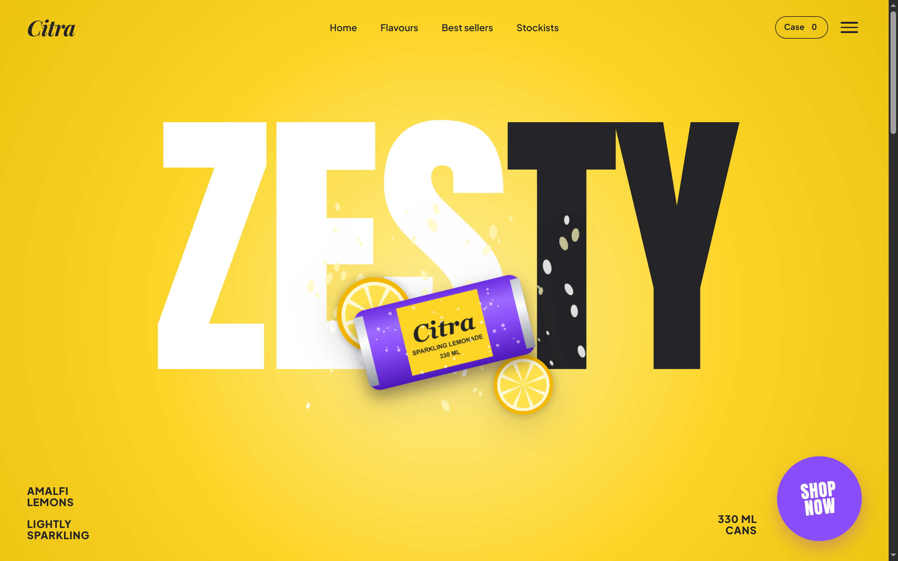
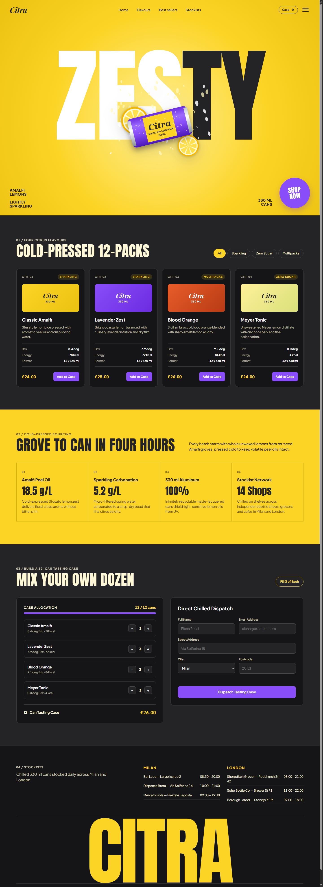
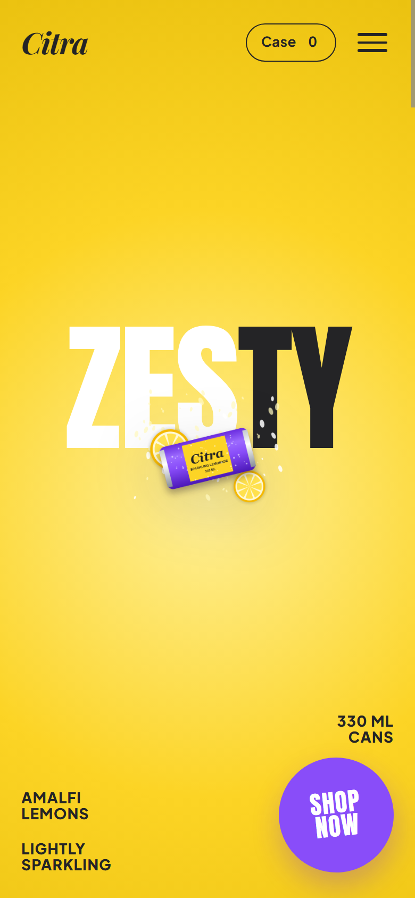

# Citra — Zesty Sparkling Lemonade

Self-contained recreation of the Citra Sparkling Lemonade poster and storefront using the Lemon Yellow, Charcoal, and Electric Lavender palette.

## Palette

- Lemon Yellow: `#FCD425` (with `#EBC210` step and `#FFF099` cream highlight)
- Charcoal: `#242426` (with `#151517` deep charcoal and `#FFF8D6` ink)
- Electric Lavender: `#894DF9` (with `#6B2CE0` deep lavender and `#FFFFFF` ink)

## Features

- Full-viewport poster hero with split two-tone `ZESTY` display typography (`Anton`), layered `330 ml` can artwork, and tilted Electric Lavender `SHOP NOW` badge.
- Interactive flavour category filters (`All`, `Sparkling`, `Zero Sugar`, `Multipacks`) with `tabular-nums` Brix and calorie specifications.
- Slide-over 12-pack Case Drawer with live quantity controls and subtotal calculation.
- Four-column cold-pressed sourcing hairline matrix.
- Interactive 12-can mix-and-match tasting case builder with validated chilled dispatch form (`CTR-330`).
- Milan and London stockist directory and full-width `CITRA` footer wordmark.

## Screenshots

