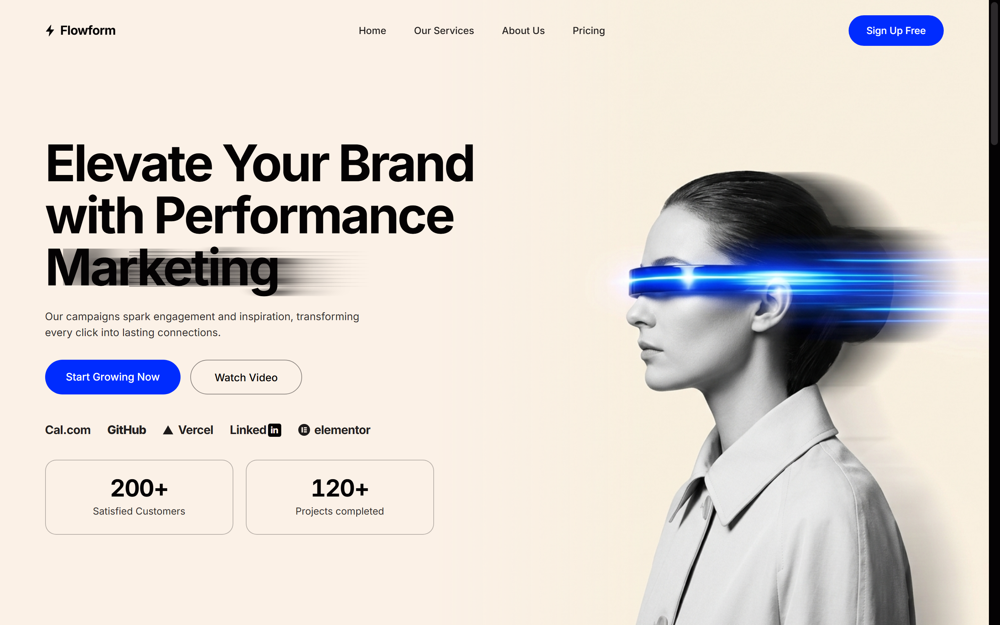
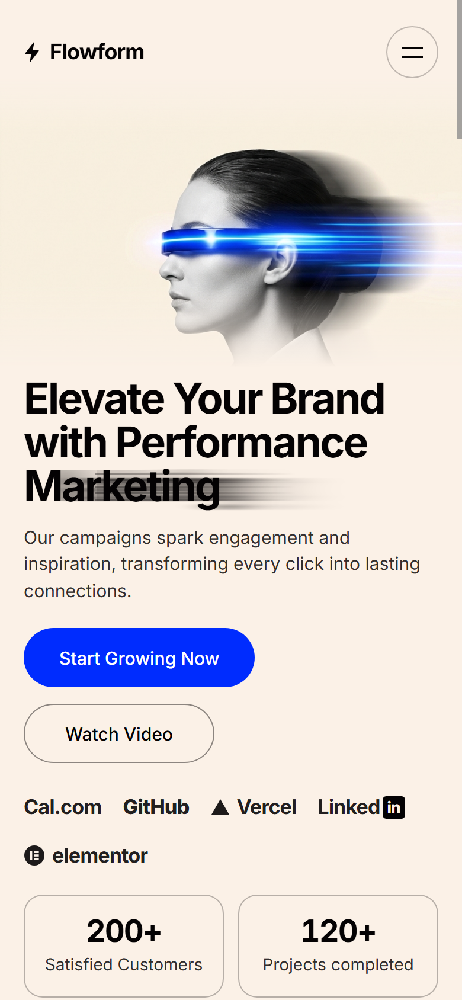
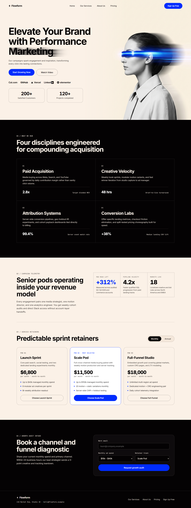

# Flowform — Performance Marketing Agency

Standalone landing page for Flowform built with Linen Cream, Deep Black, and Psychedelic Blue.

## Screenshots

### Desktop Hero (1440×900)


### Mobile Hero (390×844)


### Full Page


## Design System

| Role | Color | Hex |
| :--- | :--- | :--- |
| Quiet 1 (Paper Canvas) | Linen Cream | `#FBF1E7` |
| Quiet 2 (Ink & Contrast Chapter) | Deep Black | `#040203` |
| Loud Accent | Psychedelic Blue | `#002CFE` |

- **Typography:** Inter (400–800 display headlines, controls, and tabular metrics), JetBrains Mono (section indices, billing descriptors, and chapter codes).
- **Layout:** Asymmetric split hero pairing an SVG `<filter id="speed-blur">` directional motion-blur `Marketing` wordmark, monochrome partner strip, and `<dl>` customer metric cards against the masked visor profile, followed by a 4-cell hairline services matrix (`#services`), campaign telemetry ledger (`#about`), interactive Monthly/Annual retainer toggle (`#pricing`), growth audit intake (`#signup`), and keyboard-accessible showreel `<dialog>`.

## Run Locally

Serve the folder over HTTP:

```bash
npx serve .
```
