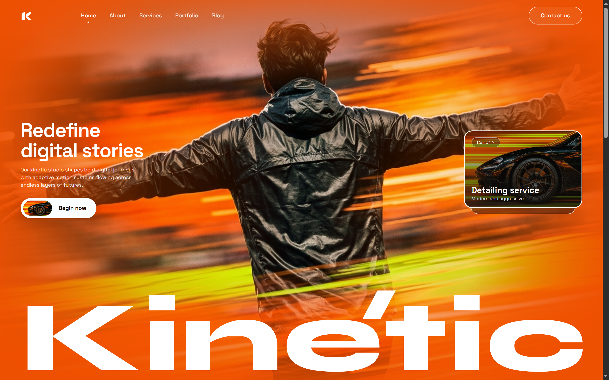
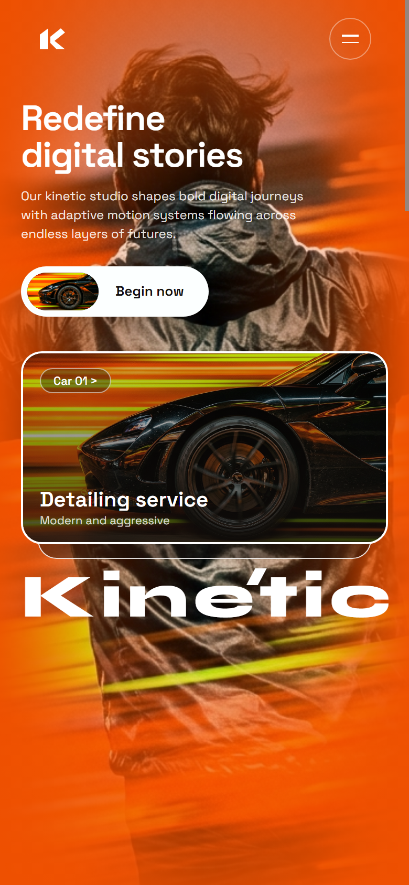
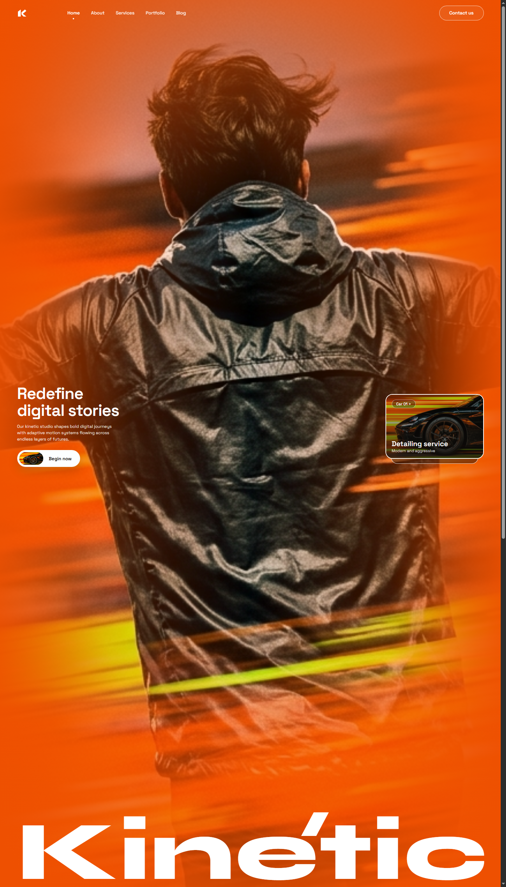

# Kinetic — Motion & Digital Storytelling Studio

Standalone web recreation built from the Kinetic ("Redefine digital stories") reference design.

## Screenshots

### Desktop Hero (1440×900)


### Mobile Hero (390×844)


### Full Page


## Design System

| Role | Color | Hex |
| :--- | :--- | :--- |
| Quiet 1 (Canvas) | Tangerine Orange | `#EE5001` |
| Quiet 2 (Contrast Surface) | Crisp White | `#FCFFFF` |
| Loud Accent | Acid Lime | `#C8FD03` |
| Dark Surface | Void Black | `#120E0C` |

- **Typography:** Syne (edge-to-edge bottom display wordmark and headings), Space Grotesk (UI and body), JetBrains Mono (indices and codes).
- **Layout:** Full-bleed tangerine motion-blurred athlete hero with acid-lime speed streaks, pill CTA with embedded preview thumbnail, floating stacked `Detailing service` card, and monumental `Kinetic` wordmark.

## Run Locally

Open `index.html` in any browser or serve statically:

```bash
npx serve .
```
