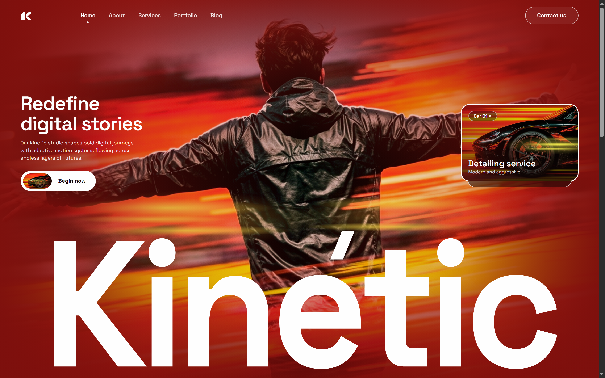
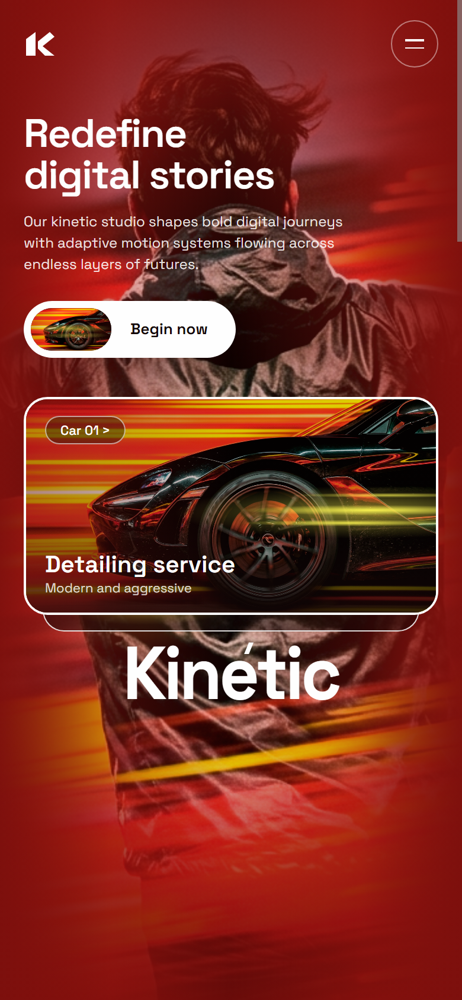
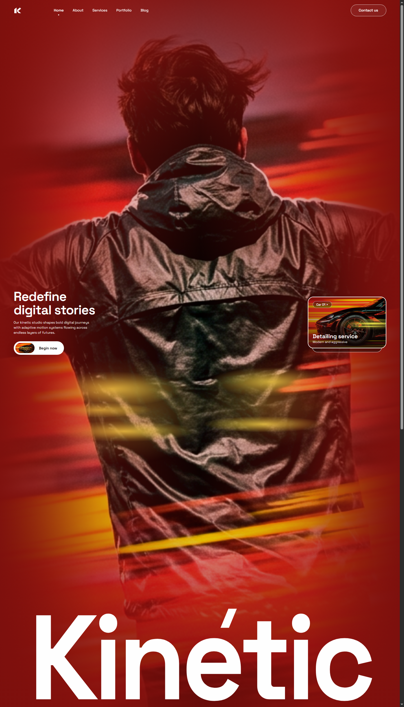

# Kinetic — Vermin Red & Citrus Yellow Motion Studio

Standalone web recreation built from the Kinetic ("Redefine digital stories") Vermin Red variant reference design.

## Screenshots

### Desktop Hero (1440×900)


### Mobile Hero (390×844)


### Full Page


## Design System

| Role | Color | Hex |
| :--- | :--- | :--- |
| Quiet 1 (Deep Canvas) | Vermin Red | `#7E100D` / `#A81711` |
| Quiet 2 (Contrast Surface) | Snowy White | `#FEFEFE` |
| Loud Accent | Citrus Yellow | `#FEF650` |
| Dark Surface | Void Black | `#120606` |

- **Typography:** Syne (section headlines and metric values), Space Grotesk (edge-to-edge bottom `Kinetic` wordmark, navigation, and UI prose), JetBrains Mono (project codes and eyebrows).
- **Layout:** Full-viewport `100dvh` Vermin Red motion-blurred hero graded from studio photography with layered Citrus Yellow speed streaks, pill CTA with embedded preview thumbnail, floating stacked automotive card, and monumental `Kinetic` wordmark, followed by a filterable portfolio grid, studio metrics `<dl>` ledger, and sprint inquiry form.

## Run Locally

Open `index.html` in a browser or serve statically:

```bash
npx serve .
```
