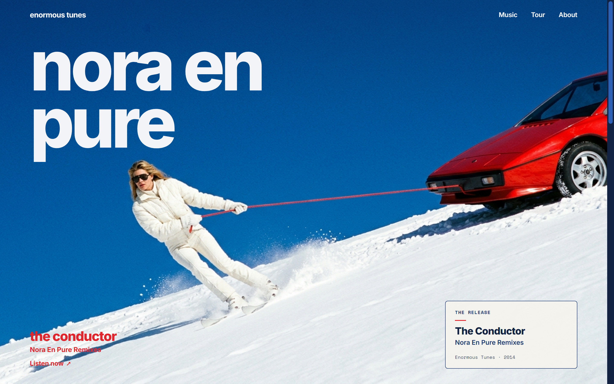
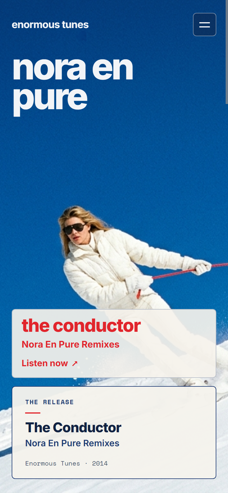
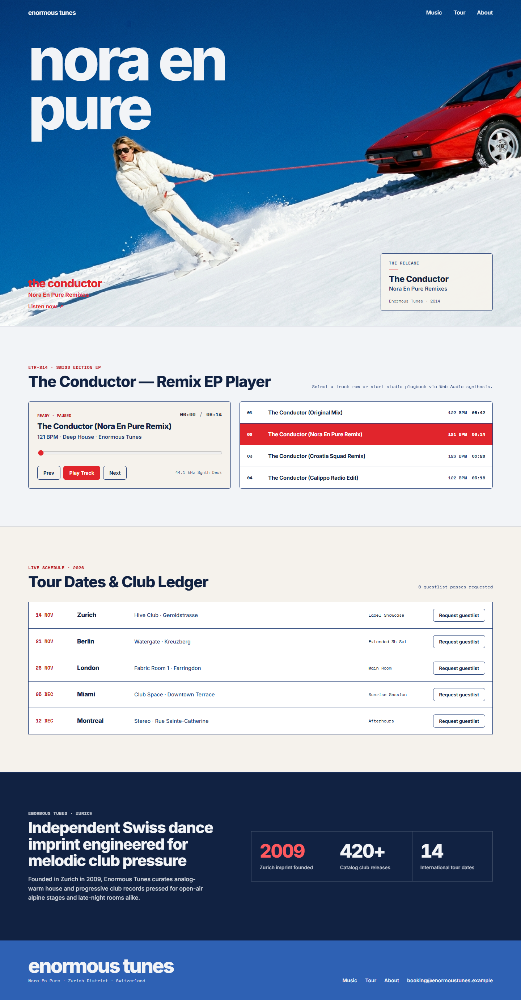

# Enormous Tunes — Nora En Pure (`The Conductor`)

Standalone label showcase and interactive EP player for Nora En Pure's *The Conductor* on Enormous Tunes, styled in Cobalt Blue, Snow White, and Signal Red.

## Screenshots

### Desktop Hero (1440×900)


### Mobile Hero (390×844)


### Full Page


## Design System

| Role | Color | Hex |
| :--- | :--- | :--- |
| Quiet 1 (Sky & Label Field) | Cobalt Blue | `#2E61B4` |
| Quiet 2 (Typography & Swiss Card) | Snow White (`#F5F2EC` card) | `#F2F4F7` |
| Loud Accent | Signal Red | `#E1252C` |

- **Typography:** Inter (500–900) for lowercase monumental `nora en / pure` display type and editorial headings; Space Mono (400/700) for catalog metadata, BPM readouts, and tour dates.
- **Interactive Modules:** Full-bleed alpine hero matching the reference layout, 4-track EP player with Web Audio API pulse playback and scrubber, Swiss-grid 2026 tour ledger with stateful guestlist toggles, and semantic `<dl>` archive stats.

## Run Locally

Serve the directory over HTTP:

```bash
npx serve .
```
