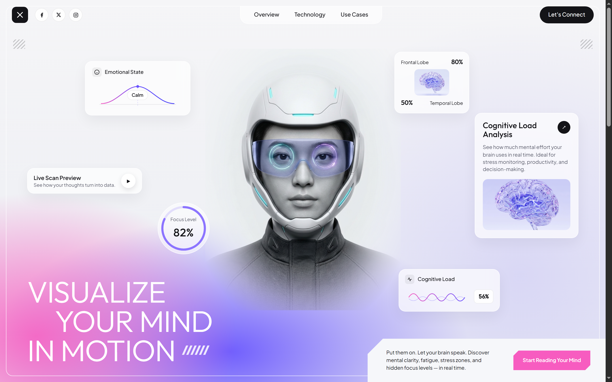
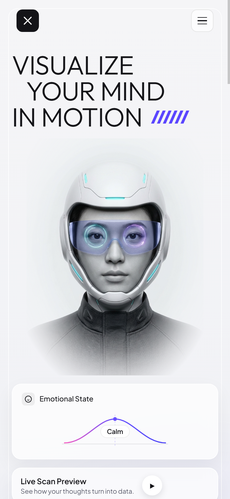
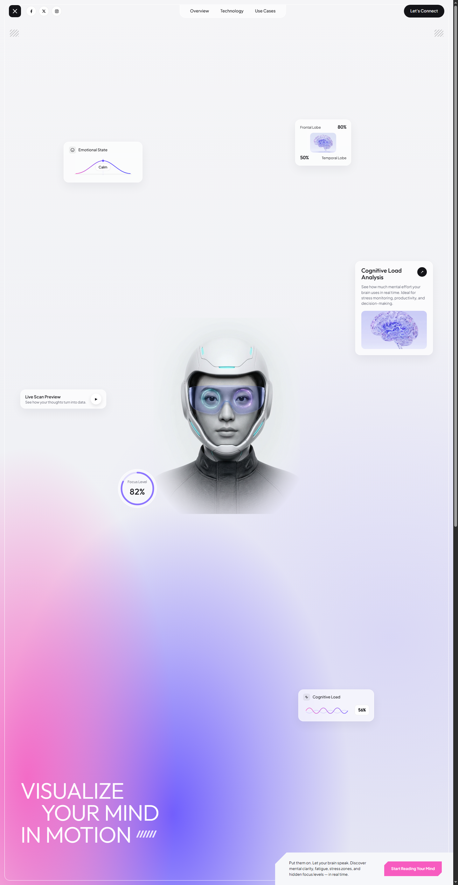

# MindVision — Neural Visor Telemetry

Standalone web recreation built from the MindVision ("Visualize Your Mind in Motion") neurotech reference design.

## Screenshots

### Desktop Hero (1440×900)


### Mobile Hero (390×844)


### Full Page


## Design System

| Role | Color | Hex |
| :--- | :--- | :--- |
| Quiet 1 (Canvas) | Cloudy White | `#F0F0F4` |
| Quiet 2 (Telemetry Accent) | Galactic Violet | `#5B46FF` |
| Loud Accent | Bubblegum Pink | `#F75CC0` |
| Primary Ink | Charcoal Ink | `#141418` |

- **Typography:** Outfit (light display headline and figures), Plus Jakarta Sans (UI and body), JetBrains Mono (telemetry counters).
- **Layout:** Central neural visor bust surrounded by frosted glass telemetry widgets (`Emotional State`, `Live Scan Preview`, `Focus Level 82%`, `Frontal/Temporal Lobe`, `Cognitive Load Analysis`, and live `56%` wave), paired with a chamfered conversion dock and interactive telemetry tabs below the fold.

## Run Locally

Open `index.html` in any browser or run a static server:

```bash
npx serve .
```
