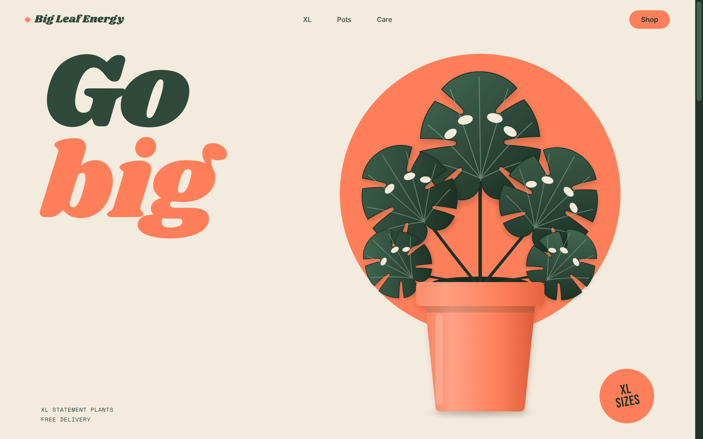
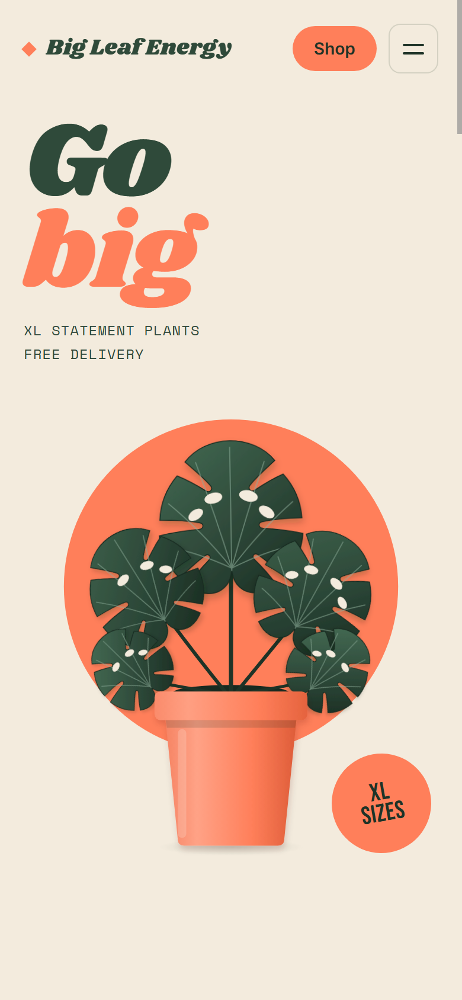
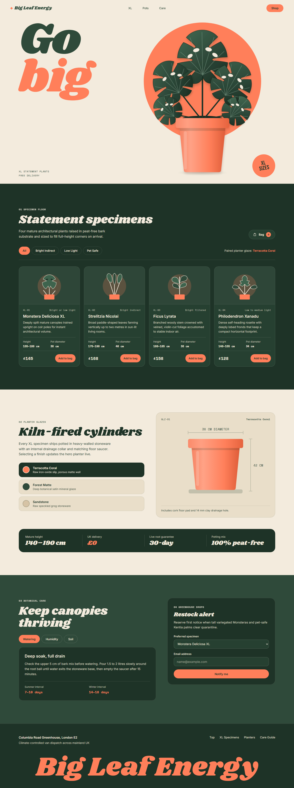

# Big Leaf Energy — Go big

Standalone plant shop storefront built in Cream, Forest, and Coral.

## Screenshots

### Desktop Hero (1440×900)


### Mobile Hero (390×844)


### Full Page


## Design System

| Role | Color | Hex |
| :--- | :--- | :--- |
| Quiet 1 (Canvas) | Cream / Cream Step | `#F3EBDD` / `#E9DEC9` |
| Quiet 2 (Foliage & Ink) | Forest / Deep Forest | `#2F4A3A` / `#1E3327` |
| Loud Accent | Coral | `#FF7F5A` |

- **Typography:** Shrikhand (display headline, brand wordmark, section headings, and footer mark), Bebas Neue (`XL SIZES` circular badge), Inter (navigation, descriptions, controls), and Space Mono (metadata, prices, measurements).
- **Hero:** Full-viewport (`100dvh`) asymmetric poster pairing the stacked `Go big` headline and mono delivery metadata with a five-leaf Monstera vector illustration potted in cylindrical Coral terracotta against a circular Coral backdrop and `-10deg` `XL SIZES` badge.
- **Interactive Modules:** Light-tolerance specimen filter tabs with empty-state reset, live shopping bag drawer with glaze tracking and quantity adjustments, three-finish stoneware glaze picker synced to the hero planter SVG, species care tabs, and an inline-validated restock alert form.

## Run Locally

Serve the directory over HTTP:

```bash
npx serve .
```
