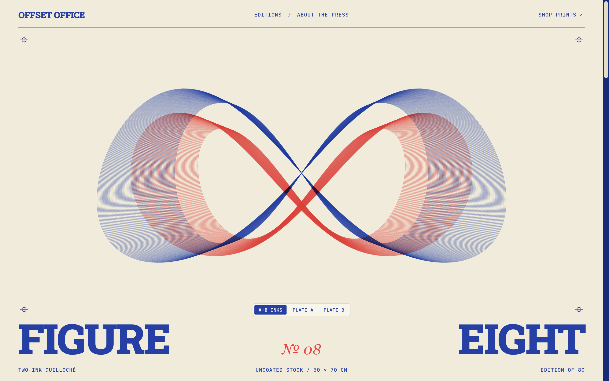
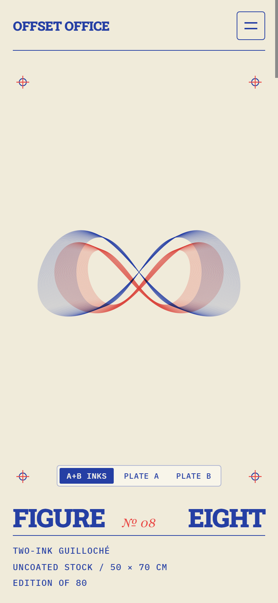
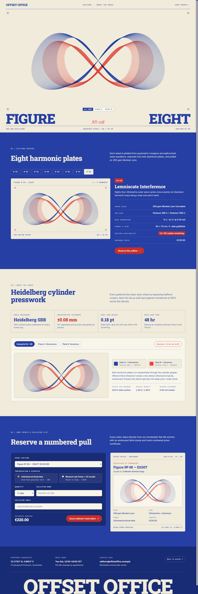

# OFFSET OFFICE — Figure № 08 Eight

Self-contained website for **OFFSET OFFICE**, an Amsterdam two-ink guilloché print studio and numbered editions press, built in Newsprint, Ultramarine, and Geranium.

## Direction

- **Product:** Numbered 50 × 70 cm two-ink guilloché editions pulled on a Heidelberg SBB cylinder press on 300 gsm Munken Lynx uncoated paper.
- **Character:** Tactile, calibrated, architectural.
- **World:** Cotton-rag newsprint, dense spot-ink overprints, registration crosshairs, and flat-file press slips.
- **Moments:** Live 160-path mathematical two-ink SVG guilloché lemniscate in the hero; interactive 8-edition harmonic archive (`№ 01`–`№ 08`); Heidelberg plate-separation inspector; live collector certificate preview.
- **Signature:** Four SVG two-ink press registration crosshairs framing the central print bed.

## Color System

| Role | Color | Hex |
| :--- | :--- | :--- |
| Quiet 1 (60% Ground) | Newsprint | `#F0EBDA` (`#E3DCC6` step, `#F8F5EA` highlight) |
| Quiet 2 (30% Ink / Chapter) | Ultramarine | `#253FA4` (`#182B75` deep ink) |
| Loud Accent (10% Focal) | Geranium | `#E94643` (`#C62E2B` deep geranium) |

## Typography

- **Display:** `Roboto Slab` (`700`, `800`, `900`) for the `OFFSET OFFICE` masthead, `FIGURE` / `EIGHT` poster lockup, chapter headings, and edge-to-edge footer mark.
- **Numeral Accent:** Italic serif (`№ 08`) for edition indices.
- **Interface Sans:** `Inter` (`400`, `500`, `600`) for technical copy and form controls.
- **Monospace:** `IBM Plex Mono` (`400`, `500`) with `tabular-nums` for press metadata, coordinates, and edition ledgers.

## Screenshots

### Desktop Hero (1440×900)


### Mobile Hero (390×844)


### Full Page


## Run Locally

Serve the directory over HTTP:

```bash
npx serve .
```
