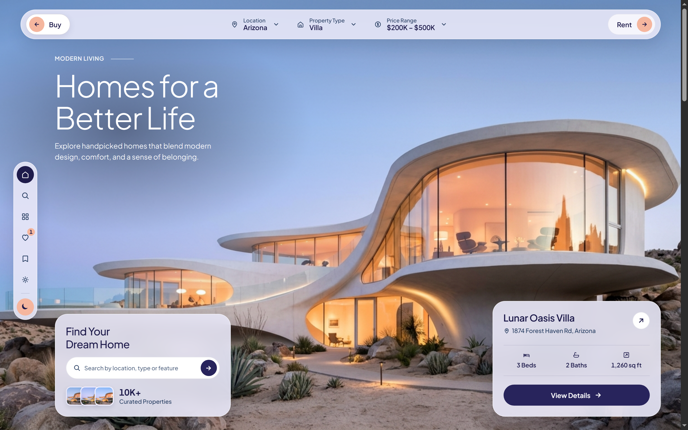
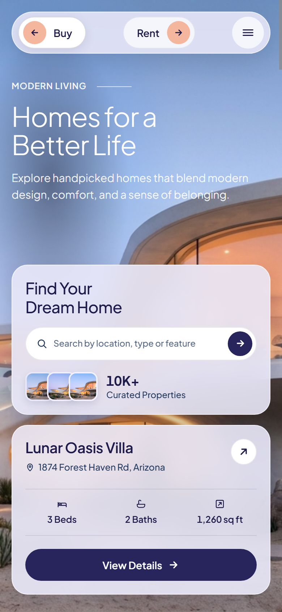
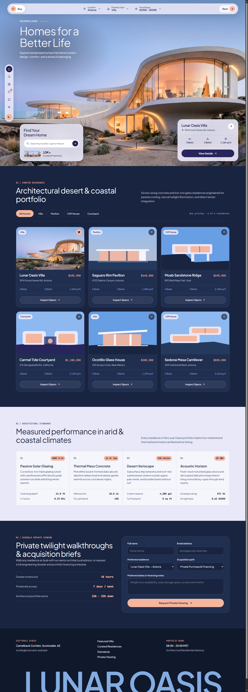

# Lunar Oasis — Homes for a Better Life

Architectural desert and coastal residence portal built around Lunar Oasis Villa in Arizona.

## Palette

- **Powder Blue (60%):** `#8DB9F0` (`#689EE4` sky step, `#233A5E` deep slate-navy ink on light surfaces)
- **Soft Lavender White (30%):** `#E9E8F8` (`#F5F5FC` frosted card surface, `#192440` deep indigo chapter canvas)
- **Warm Sunset Peach (10%):** `#F5B69E` (`#28245C` and `#1E1B4B` deep indigo ink for high contrast on light cards)

## Typography

- **Display & UI:** `Plus Jakarta Sans` (weights 300, 400, 500, 600, 700)
- **Metrics & Specs:** `JetBrains Mono` (`tabular-nums`)

## Features

- **Twilight Villa Hero (`clamp(680px, 100dvh, 960px)`):** Full-bleed `./assets/lunar-villa.jpg` backdrop with directional blue scrim, top floating frosted pill bar (`Buy`/`Rent` toggle, interactive `Location`, `Property Type`, and `Price Range` dropdowns), left vertical frosted icon rail (`Home`, `Search`, `Grid`, `Saved`, `Notes`, `Settings`, `Theme`), bottom-left live search dock (`10K+ Curated Properties`), and bottom-right featured `Lunar Oasis Villa` card (`View Details` drawer trigger).
- **01 / Curated Residences:** Live filterable 6-residence desert and coastal catalog synced with the hero search bar, Buy/Rent pricing toggle, and typology tabs, plus shortlist saving and an instant architectural inspection drawer.
- **02 / Architectural Standards:** Four-column hairline matrix detailing passive solar glazing (`SHGC 0.24`), thermal mass concrete (`11 hr lag`), desert xeriscape (`94% native`), and acoustic horizon ratings (`28 dBA`).
- **03 / Schedule Private Viewing:** Validated tour and portfolio financing inquiry form with inline field feedback and booking confirmation reference.

## Local Preview

Serve the folder from the repository root:

```bash
npx serve realestate_powderblue+lavenderwhite+sunsetpeach
```

## Screenshots




