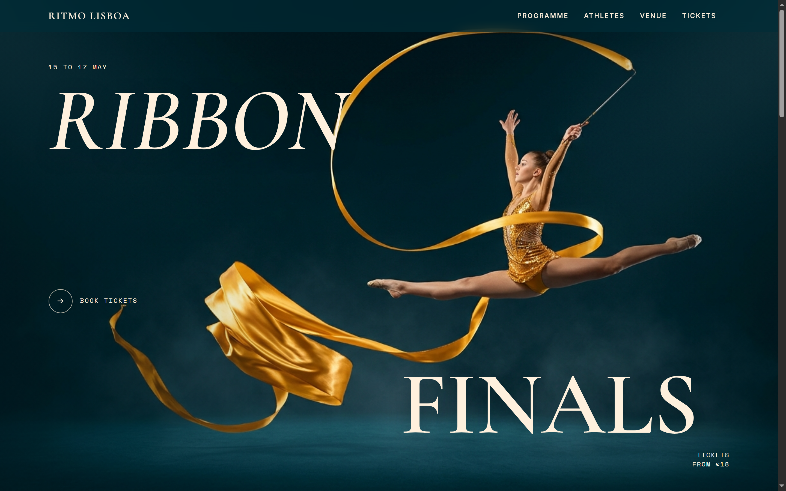
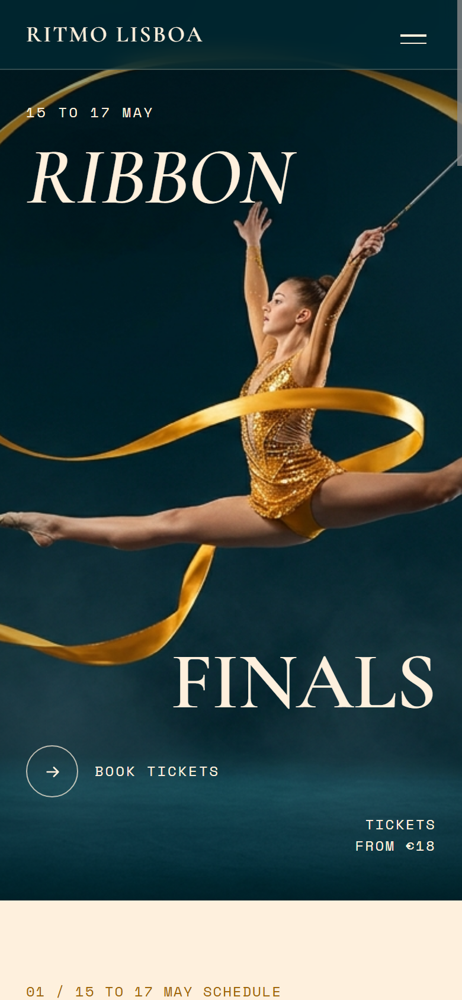
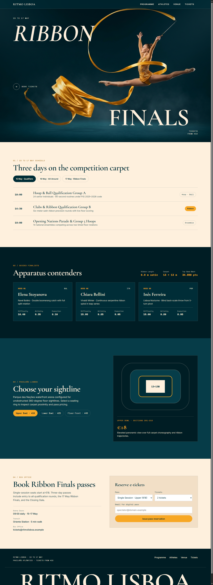

# RITMO LISBOA — RIBBON FINALS

Standalone website for RITMO LISBOA Ribbon Finals (15 to 17 May) built in Petrol Blue, Ivory, and Saffron Gold.

## Screenshots

### Desktop Hero (1440×900)


### Mobile Hero (390×844)


### Full Page


## Design System

| Role | Color | Hex |
| :--- | :--- | :--- |
| Quiet 1 (60% Arena Stage) | Petrol Blue | `#002D37` (`#001D24` deep) |
| Quiet 2 (30% Type & Ledger Canvas) | Ivory | `#FEF0DD` (`#F2DFC6` soft) |
| Loud Accent (10% Ribbon & CTA) | Saffron Gold | `#F7A724` |

- **Typography:** Cormorant Garamond (600 italic and roman) for the split `RIBBON` / `FINALS` display lockup and masthead; Inter (400/500/600) for uppercase navigation and body copy; Space Mono (400/700) for competition schedule times, apparatus scores, and ticket tiers.
- **Interactive Craft:** Split diagonal arena hero framing a leaping rhythmic gymnast and saffron satin ribbon, paired with a three-day competition schedule switcher, seeded apparatus contender cards, interactive Pavilhão Lisboa seating ring selector, and e-ticket reservation form.

## Run Locally

Serve the directory over HTTP:

```bash
npx serve .
```
