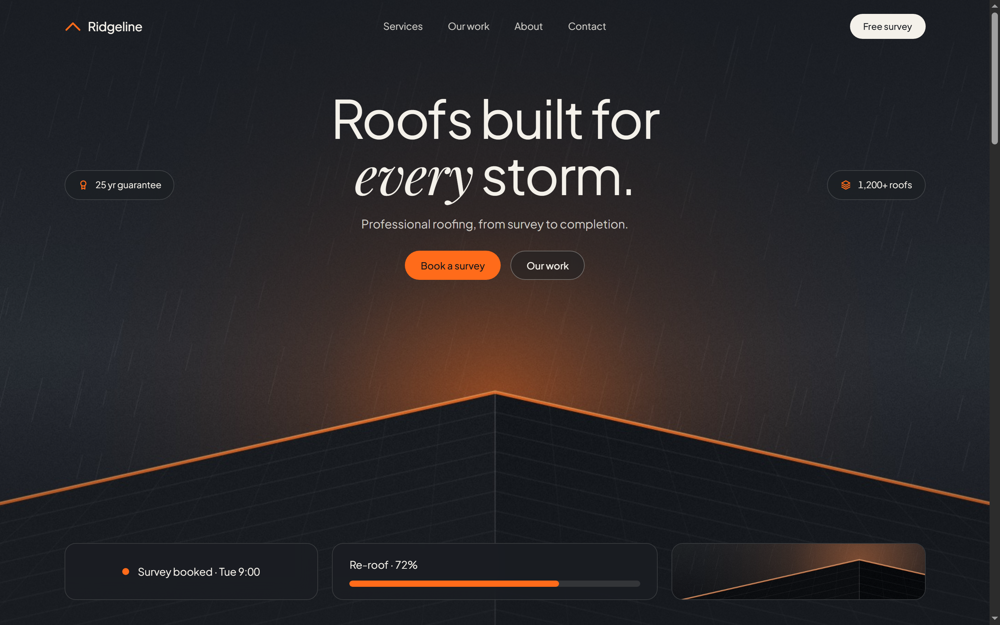
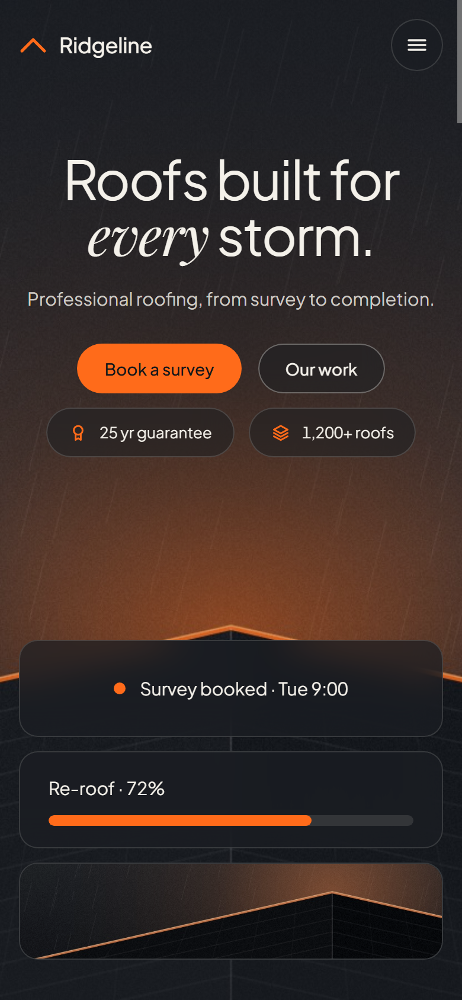
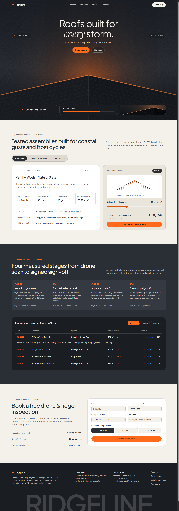

# Ridgeline — Roofs built for every storm

Architectural roofing website built in Slate Charcoal, Off-White, and Safety Orange, recreated from `temp/new_crops/n3_d2_ridgeline.png`.

## Screenshots

### Desktop Hero (1440x900)


### Mobile Hero (390x844)


### Full Page


## Design System

| Role | Color | Hex |
| :--- | :--- | :--- |
| Quiet 1 (60% Slate Charcoal) | Slate Charcoal / Void / Slab | `#2A2E35` / `#1A1D22` / `#343942` |
| Quiet 2 (30% Off-White) | Off-White / Muted | `#F4F1EA` / `#DFDBD2` |
| Loud Accent (10% Safety Orange) | Safety Orange / Deep / Ink | `#FF6B1A` / `#D9530A` / `#14161A` |

- **Typography:** `Plus Jakarta Sans` (`400`, `500`, `600`) for display and interface text, `Playfair Display` italic for the hero emphasis (`every`), and `JetBrains Mono` with `tabular-nums` for wind ratings, survey references, and telemetry counters.
- **Hero:** `clamp(680px, 100dvh, 960px)` full-bleed storm-sky and standing-seam slate ridge backdrop (`./assets/ridgeline-roof.jpg`) framed by flanking guarantee pills (`25 yr guarantee`, `1,200+ roofs`), dual action pills (`Book a survey`, `Our work`), and a bottom three-panel frosted telemetry strip (`Survey booked · Tue 9:00`, `Re-roof · 72%`, and architectural roof detail preview).
- **Chapters:**
  - `01 / ROOFING SYSTEMS & GUARANTEES`: Interactive tabs for `Welsh Slate`, `Standing-Seam Zinc`, and `Clay Plain Tile` with wind uplift ratings, lifespans, and an interactive roof-area guide calculator.
  - `02 / SURVEY TO COMPLETION LEDGER`: Four-stage installation sequence paired with a depot-filterable storm-repair and re-roof log.
  - `03 / BOOK A FREE DRONE SURVEY`: Postcode-routed drone inspection booking form with field validation and instant confirmation (`RL-2094`).

## Local Preview

Serve the folder from any static server:

```bash
npx serve roofing_slatecharcoal+offwhite+safetyorange
```
