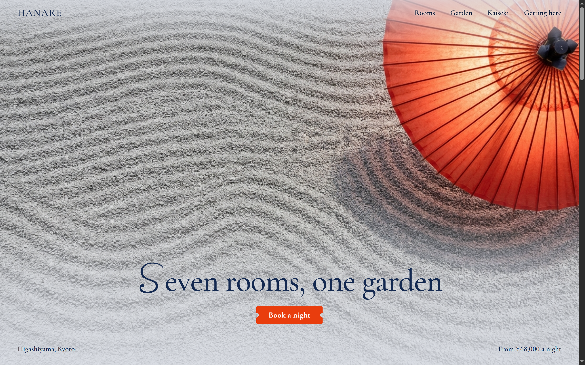
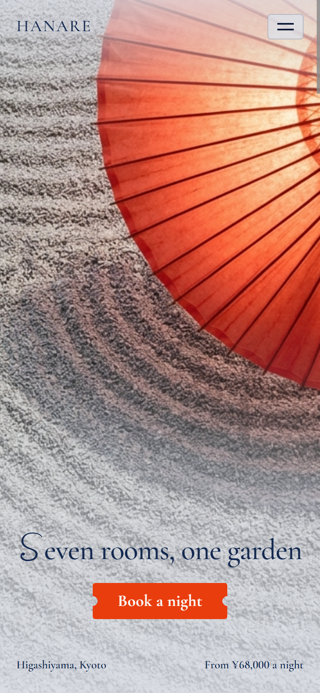
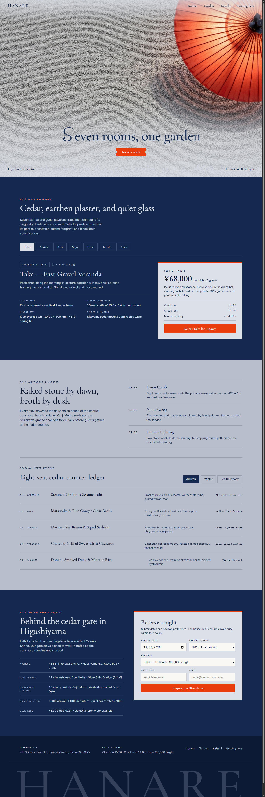

# HANARE — Seven rooms, one garden

Kyoto ryokan and dry-landscape garden sanctuary in Higashiyama. Seven standalone cedar-and-plaster pavilions arranged around a single Shirakawa granite courtyard.

## Palette

- **Stone Grey (60%):** `#B8BECB` (`#A6ADBC` step, `#DCE0E8` highlight)
- **Deep Indigo (30%):** `#142950` (`#0C1A36` deep ink)
- **Vermilion (10%):** `#E93D0D` (`#C63007` hover)

## Typography

- **Display:** `Cormorant Garamond` (weights 400, 500, 600, 700)
- **Body:** `Inter` (weights 400, 500, 600)
- **Indices & Metrics:** `IBM Plex Mono` (`tabular-nums`)

## Features

- Full-bleed raked stone gravel and backlit vermilion wagasa umbrella hero with custom calligraphic swash `S` and ticket-notched CTA.
- **01 / Seven Pavilions:** Interactive switcher across all seven rooms (`Take`, `Matsu`, `Kiri`, `Sugi`, `Ume`, `Kaede`, `Kiku`) with garden orientation, tatami dimensions, hinoki bath sizing, and nightly tariff.
- **02 / Karesansui & Kaiseki:** Daily gravel raking schedule and seasonal Kyoto kaiseki ledger (`Autumn`, `Winter`, `Tea Ceremony`).
- **03 / Getting Here & Inquiry:** Higashiyama directions and validated reservation inquiry form with instant booking reference.

## Local Preview

Serve the folder statically from the repository root:

```bash
npx serve ryokanhotel_stonegrey+deepindigo+vermilion
```

## Screenshots




