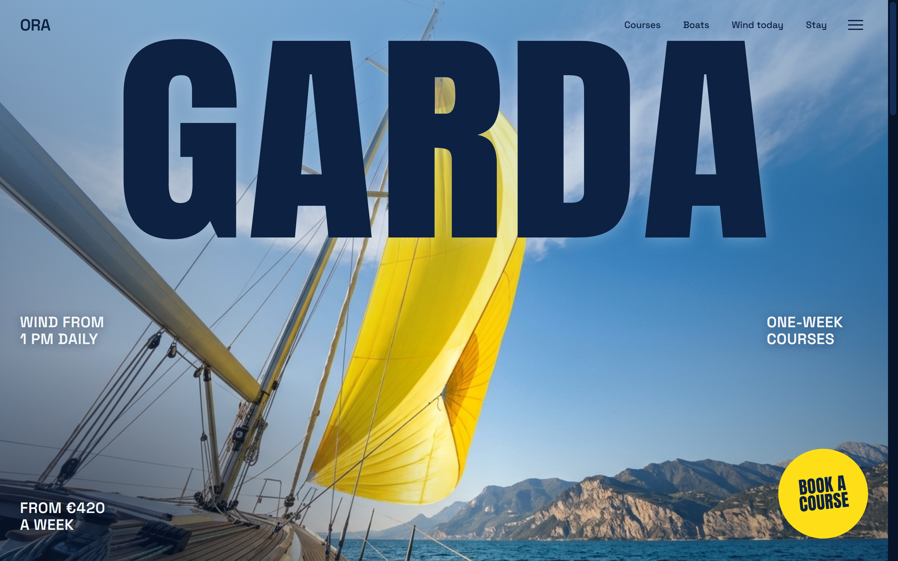
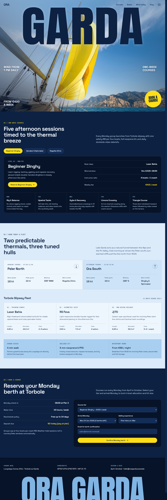
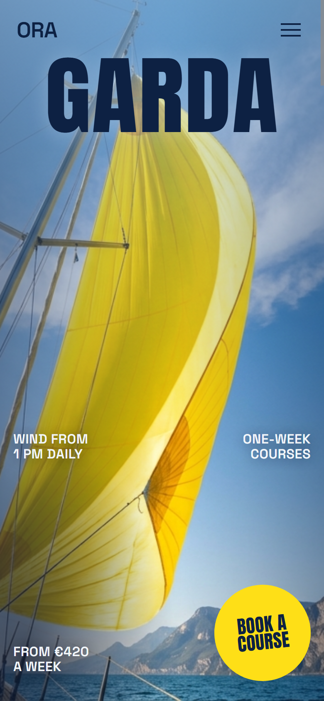

# ORA GARDA — Lake Garda Sailing School

Self-contained poster-first landing page for ORA GARDA, a one-week dinghy, spinnaker, and regatta sailing school based at Torbole harbor on Lake Garda.

## Direction

- **Product:** One-week Lake Garda sailing courses timed to the daily afternoon Ora thermal wind, launched from Torbole harbor.
- **Character:** Sunlit, wind-timed, direct.
- **World:** Alpine lake water, rigging steel, sun-bleached canvas, and deep navy hulls.
- **Moments:** Monumental `GARDA` sky typography framing the billowing Sun Yellow spinnaker with circular `BOOK A COURSE` stamp; thermal wind ledger comparing morning Peler and afternoon Ora beside the three-boat fleet.
- **Signature:** `144px` circular Sun Yellow `#FEDF17` regatta stamp CTA anchored at the bottom-right corner of the hero.

## Color System

- **Quiet 1 (60% Lake Blue):** `#80B4E3`, `#5F9CD4`, `#A8CEF0`, `#DCEBFA`
- **Quiet 2 (30% Navy):** `#0D2143`, `#071329`, `#132D59`, `#F2F6FA`
- **Loud Accent (10% Sun Yellow):** `#FEDF17`, `#E2C407`

## Typography

- **Display:** `Anton` (`400`)
- **Interface Sans:** `Space Grotesk` (`400`, `500`, `600`)
- **Monospace:** `JetBrains Mono` (`400`, `500`)

## Screenshots

### Desktop Hero (`1440x900`)

### Desktop Full Page

### Mobile Hero (`390x844`)

