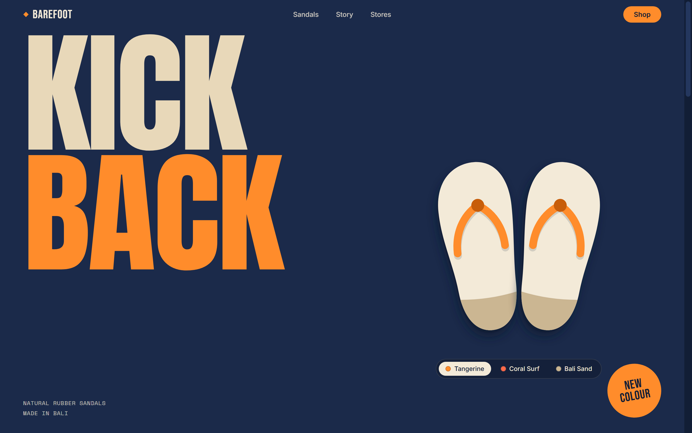
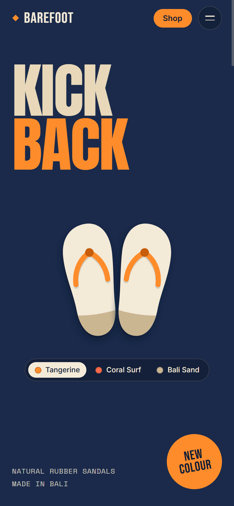
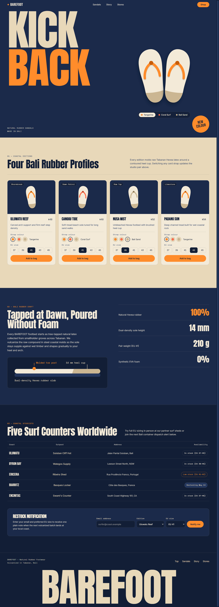

# BAREFOOT — KICK BACK

Standalone product landing page for BAREFOOT Bali natural rubber sandals built in Navy, Sand, and Tangerine.

## Screenshots

### Desktop Hero (1440×900)


### Mobile Hero (390×844)


### Full Page


## Design System

| Role | Color | Hex |
| :--- | :--- | :--- |
| Quiet 1 (Navy Canvas) | Navy | `#1B2A4A` |
| Quiet 1 (Deep Step) | Deep Navy | `#121E36` |
| Quiet 2 (Footbed & Display Contrast) | Sand | `#E8D8B9` |
| Quiet 2 (Upper Footbed) | Cream Sand | `#F3EAD8` |
| Quiet 2 (Heel Patch) | Warm Heel Sand | `#CBB692` |
| Loud Accent | Tangerine | `#FF8C2B` |

- **Typography:** Anton (hero `KICK BACK` lockup, section display headings, and footer wordmark), Bebas Neue (brand lockup, `NEW COLOUR` stamp, edition names, and store titles), Inter (navigation, descriptions, and controls), Space Mono (origins metadata, sizing buttons, and stockist ledger indices).
- **Layout:** Asymmetric full-viewport (`100dvh`) Navy hero pairing stacked `KICK BACK` typography against an inline top-down pair of anatomical natural rubber sandals with live strap colourway switching (`Tangerine`, `Coral Surf`, `Bali Sand`) and a tilted `NEW COLOUR` jump stamp; followed below the fold by four Sand-canvas coastal editions with EU sizing and a live bag drawer (`#sandals`), Bali Hevea rubber `<dl>` craft specifications (`#story`), and a five-coast stockist ledger with restock alerts (`#stores`).

## Run Locally

Serve the directory over HTTP:

```bash
npx serve .
```
