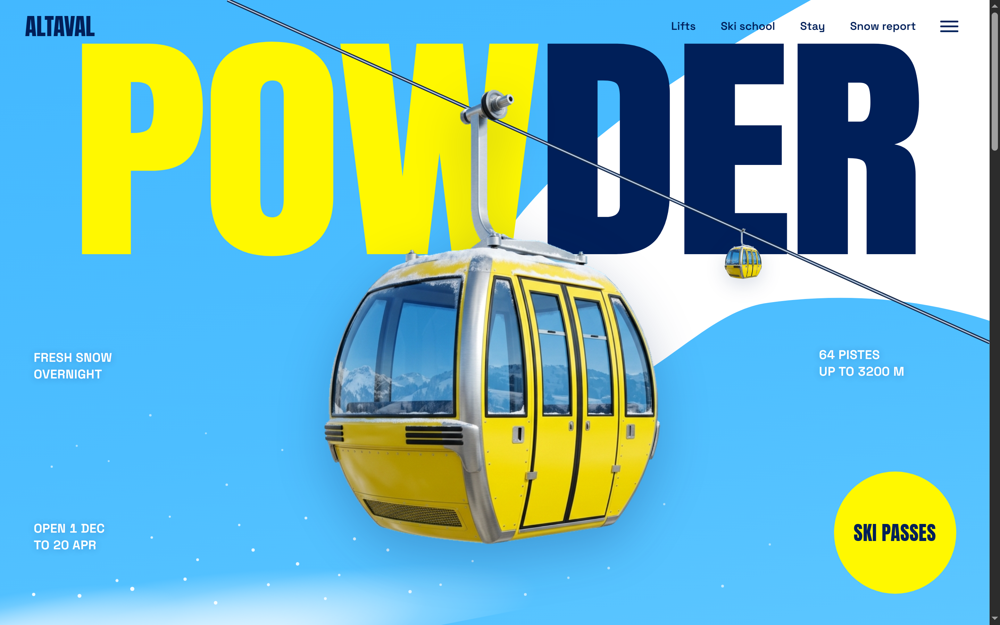
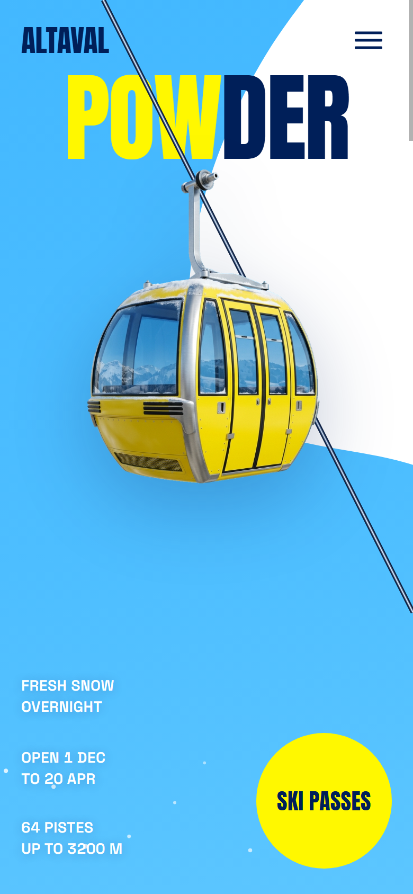
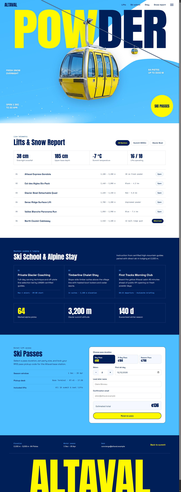

# ALTAVAL — High-Altitude Alpine Ski Resort

Standalone web recreation built from the ALTAVAL (`POWDER`) ski resort reference design.

## Screenshots

### Desktop Hero (1440×900)


### Mobile Hero (390×844)


### Full Page


## Design System

| Role | Color | Hex |
| :--- | :--- | :--- |
| Quiet 1 (Sky Canvas) | Baby Blue | `#4DBEFF` |
| Quiet 2 (Slope & Ink) | Indigo Navy | `#001F59` |
| Loud Accent | Bumblebee Yellow | `#FFF800` |
| Snow Surface | Alpine White | `#FFFFFF` |

- **Typography:** Anton (monumental `POWDER` headline, `ALTAVAL` wordmarks, circular CTA), Space Grotesk (navigation, callouts, interface copy), JetBrains Mono (elevations, metrics, pass metadata).
- **Layout:** Full-viewport `100dvh` baby-blue hero with a sweeping snow-slope curve, split-color `POWDER` headline, multi-strand steel haul cable, foreground and distant glacier gondolas, alpine metadata callouts, and a circular `SKI PASSES` CTA, followed by an interactive lift and snow report ledger, a three-column ski school and lodging grid with semantic `<dl>` metrics, an interactive pass reservation calculator, and a navy footer anchored by the `ALTAVAL` display wordmark.

## Run Locally

Open `index.html` in a browser or serve the folder over HTTP:

```bash
npx serve .
```
